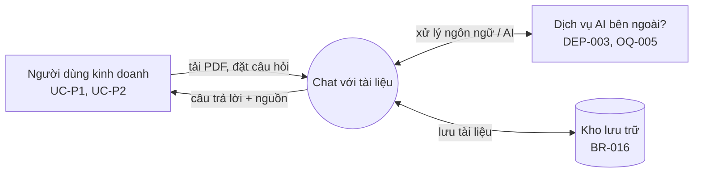
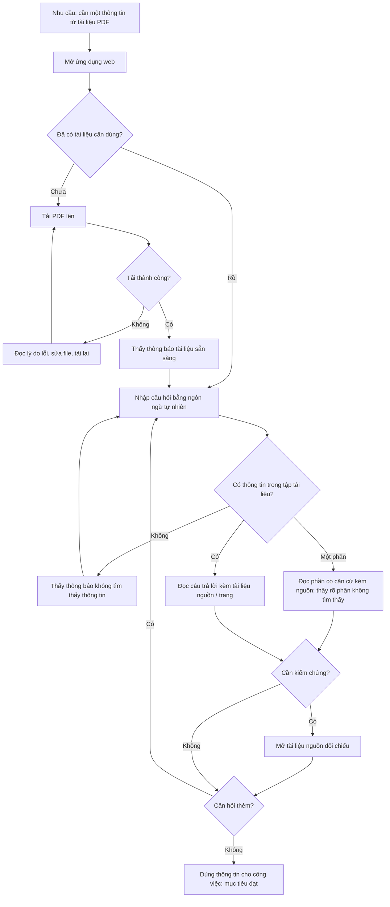

# Tài liệu Yêu cầu Sản phẩm (PRD) — "Chat với tài liệu" (MVP)

> **Chuẩn áp dụng:** IEEE 29148-2018
> **Phiên bản:** 0.6 (Draft) — 2026-10-26. Đồng bộ với `use-case-diagram.drawio` (13 UC) và BRD v0.6: loại US-011…US-019 (trừ US-015), NFR-PRF-001, NFR-REL, NFR-SEC-003, IF-01, IF-04, IF-05, các cổng G6, G7, G10, mục analytics §5.2; không đăng nhập, không quản trị, không nhật ký, không số liệu sử dụng, không hỏi tiếp nối. ID không đánh số lại sau khi loại; khoảng trống là có chủ ý.
> **Đầu vào:** `docs/02-requirements/BRD.md` (v0.6, trạng thái Draft)
> **Ngôn ngữ:** Tiếng Việt
> **Quy ước:** `[TBD: OQ-xxx]` = chưa có thông tin, đã ghi thành câu hỏi mở. `[Đề xuất]` = giá trị do PM đề xuất làm điểm xuất phát, **chưa được business owner xác nhận**. `[Unverified]` = chưa có nguồn.

---

## 0. Kiểm định nền tảng sản phẩm (Product Foundation Validation)

Prompt gốc có phần "Product Foundation" chưa điền. Tôi suy ra từ BRD như sau:

| Trường | Giá trị suy ra từ BRD | Nguồn | Trạng thái |
|---|---|---|---|
| Tên sản phẩm | "Chat với tài liệu" (MVP) | BRD §0 | Đã xác nhận trong BRD |
| Người dùng mục tiêu | Đội phát triển kinh doanh (UC-P1), trưởng nhóm/quản lý (UC-P2); không có vai quản trị | BRD §6.1 | UC-P2 là `[Unverified]` |
| Vấn đề | Thông tin nằm rải rác trong nhiều PDF; mỗi lần tra cứu phải mở và tổng hợp thủ công | BRD §3 (SRC-001) | Chưa định lượng (OQ-001) |
| Giải pháp cốt lõi | Ứng dụng web: tải PDF lên, hỏi AI bằng ngôn ngữ tự nhiên, nhận câu trả lời dựa trên các tài liệu đã tải và kèm nguồn | BRD §5, BR-001…BR-009 | Đã xác nhận ở mức phạm vi |

**Kiểm định các trụ cột UX (UX Pillars).** BRD không nêu trụ cột UX; tôi đề xuất 5 trụ cột rút ra từ nhu cầu và rủi ro trong BRD:

| # | Trụ cột đề xuất | Căn cứ trong BRD | Đánh giá | Vấn đề cần xử lý |
|---|---|---|---|---|
| P1 | **Luôn kèm nguồn để kiểm chứng:** mọi câu trả lời có nội dung tài liệu đều kèm tài liệu nguồn (và trang nếu xác định được) | SN-003, BR-007, BR-008, RSK-001 | Hợp lệ | Mức chi tiết nguồn (tên + trang hay kèm trích đoạn) → OQ-P05 |
| P2 | **Trung thực khi không biết:** thà nói "không tìm thấy" còn hơn trả lời không căn cứ | BR-010, BRU-001 | Hợp lệ | Ngưỡng chính xác chưa có → OQ-004 |
| P3 | **Ít thao tác:** từ lúc mở ứng dụng đến lúc có câu trả lời đầu tiên cho một tài liệu đã có tối đa 3 thao tác (mở khung hỏi, nhập, gửi); đến lúc có câu trả lời đầu tiên cho tài liệu mới tối đa 5 thao tác `[Đề xuất]` | BO-001, MET-001 | Hợp lệ; con số là đề xuất | Cần business owner xác nhận; kiểm bằng thử nghiệm sử dụng (G12) |
| P4 | **Đơn giản, không đăng nhập:** mở ứng dụng là dùng ngay; MVP dùng chung một kho tài liệu (chỉ triển khai nơi người truy cập đã được kiểm soát) | BRD, CON-005 | Hợp lệ; đánh đổi: không riêng tư theo người dùng (RSK-P03) | Cần CNTT/bảo mật chấp nhận → OQ-005 |
| P5 | **Web, ưu tiên máy tính:** dùng trình duyệt trên máy tính; mobile không cam kết trong MVP | CON-001 (web) | `[Đề xuất]` — BRD chỉ nêu "web" | Cần xác nhận → OQ-P02 |

**Top 3 rủi ro đối với PRD:**
1. Các mục tiêu đo lường chưa có baseline/target (OQ-001, OQ-002) nên OKR dưới đây chỉ là đề xuất.
2. Chính sách dữ liệu/bảo mật chưa chốt (OQ-005); không có đăng nhập nên nếu CNTT yêu cầu kiểm soát truy cập thì phải bổ sung yêu cầu và use case mới.
3. Chưa có bộ câu hỏi kiểm thử và ngưỡng chính xác (OQ-004) nên cổng phát hành về chất lượng AI chưa đo được.

---

## 1. Tóm tắt điều hành và chiến lược

### 1.1 Tầm nhìn sản phẩm

Mọi nhân sự kinh doanh lấy được thông tin họ cần từ kho tài liệu PDF của tổ chức trong vài phút, thay vì mở và tổng hợp thủ công nhiều file, và luôn biết thông tin đó đến từ tài liệu nào. MVP kiểm chứng giả thuyết này trên một nhóm người dùng giới hạn trước khi đầu tư mở rộng. (Căn cứ: BRD §2 Tầm nhìn; mức gắn với chiến lược tổ chức `[TBD: OQ-007]`.)

**Giả thuyết cần kiểm chứng của MVP:** *Nếu người dùng có thể hỏi bằng ngôn ngữ tự nhiên trên các PDF của mình và nhận câu trả lời kèm nguồn, thì thời gian tìm thông tin giảm đạt mức mục tiêu KR1.1 so với cách làm thủ công, và người dùng quay lại dùng hằng tuần đạt mức mục tiêu KR3.1.*

### 1.2 Mục tiêu và kết quả then chốt (OKR)

Giá trị baseline/target chính thức do business owner chốt (OQ-001, OQ-002). Cột "Đề xuất" chỉ là điểm xuất phát để thảo luận.

| Objective | Key Result | Metric (BRD) | Baseline | Target chính thức | Đề xuất khởi điểm `[Đề xuất]` | Cách đo |
|---|---|---|---|---|---|---|
| **O1.** Rút ngắn thời gian tìm một thông tin từ nhiều PDF (BO-001) | KR1.1 Thời gian trung bình hoàn thành một tác vụ tra cứu chuẩn | MET-001 | [TBD: OQ-001] | [TBD: OQ-002] | Giảm ≥ 50% so với baseline | Đo thử trên bộ tác vụ chuẩn, so sánh cách làm thủ công với công cụ |
| **O2.** Câu trả lời đáng tin và kiểm chứng được (BO-002) | KR2.1 Tỷ lệ câu trả lời đúng trên bộ câu hỏi kiểm thử | MET-002 | [TBD: OQ-001] | [TBD: OQ-004] | ≥ 85% | Chấm điểm bộ kiểm thử do business owner xác nhận |
| | KR2.2 Tỷ lệ câu trả lời có nội dung tài liệu mà kèm nguồn đúng | — (AC-007) | n/a | 100% (theo AC-007) | 100% | Kiểm thử + lấy mẫu |
| | KR2.3 Tỷ lệ câu hỏi ngoài tài liệu được từ chối đúng | — (AC-010) | n/a | 100% trong bộ thử (theo AC-010) | 100% | Bộ câu hỏi ngoài phạm vi |

> Các đề xuất 50%, 85% **không có nguồn** trong BRD. Chúng chỉ được dùng nếu business owner chấp nhận hoặc điều chỉnh.

### 1.3 Phạm vi sản phẩm (tóm tắt từ BRD §5)

- **MVP gồm (theo sơ đồ use case):** tải PDF (kiểm tra, xử lý, báo lỗi), xem danh sách và xóa tài liệu, hỏi đáp có trích nguồn trên toàn bộ kho tài liệu dùng chung (mỗi câu hỏi độc lập), mở tài liệu nguồn để đối chiếu. Không đăng nhập; kiểm soát truy cập bằng môi trường triển khai (CON-005).
- **Ngoài phạm vi:** định dạng khác PDF; ứng dụng di động gốc; tích hợp CRM/ERP/kho tài liệu; chỉnh sửa tài liệu gốc; đăng nhập, phân quyền, quản trị; chia sẻ tài liệu; nhật ký truy cập; bảng số liệu sử dụng; hỏi tiếp nối theo ngữ cảnh; cam kết thời gian phản hồi và độ sẵn sàng.

### 1.4 Mục đích tài liệu và ngữ cảnh hệ thống

**Mục đích.** PRD này chuyển các yêu cầu nghiệp vụ trong BRD (BR-xxx) thành yêu cầu sản phẩm mà Engineering, Design và QA cùng dùng: user story, tiêu chí chấp nhận, yêu cầu phi chức năng, cổng phát hành. PRD mô tả **sản phẩm làm gì**, không quy định cách xây dựng (thuộc SRS/SAD).

**Ngữ cảnh hệ thống.** Sản phẩm tương tác với người dùng và với một số hệ thống bên ngoài. Việc có hay không và loại hệ thống nào do các câu hỏi mở quyết định (xem §4.3).



*Sơ đồ khớp `use-case-diagram.drawio`: actor người duy nhất là Người dùng kinh doanh (UC-P1, UC-P2); IF-02, IF-03 là hệ thống ngoài. CNTT/bảo mật và sponsor là bên liên quan, không phải actor.*

Ranh giới: sản phẩm **không** thay đổi tài liệu gốc, không tích hợp CRM/ERP/kho tài liệu doanh nghiệp (ngoài phạm vi, §1.3).

---

## 2. Persona và hành trình người dùng

### 2.1 Persona mục tiêu

Các persona dưới đây rút ra từ BRD §6.1 và chưa qua phỏng vấn (OQ-008). Tôi không đặt tên giả để tránh tạo cảm giác có dữ liệu thật.

| | **Persona chính — Nhân viên phát triển kinh doanh (UC-P1)** | **Persona phụ — Trưởng nhóm / quản lý kinh doanh (UC-P2)** |
|---|---|---|
| Mục tiêu | Tìm nhanh một thông tin cụ thể để chuẩn bị đề xuất/trả lời đối tác | Có cái nhìn tổng hợp xuyên nhiều tài liệu để ra quyết định |
| Nỗi đau | Phải mở nhiều PDF và tự tổng hợp | Không tin thông tin tổng hợp nếu không rõ nguồn |
| Hành vi chính | Tải tài liệu, đặt nhiều câu hỏi ngắn | Đặt câu hỏi tổng hợp, kiểm tra nguồn |
| Mức quen thuộc AI | [TBD: OQ-008] | [TBD: OQ-008] |
| Quy mô / tần suất | [TBD: OQ-001] | [TBD: OQ-001] |
| Nguồn | SRC-001 | `[Unverified]` |

**Vai bổ sung xuất hiện trong user story (để mọi vai trong §3 đều có định nghĩa):**

| ID | Vai | Mô tả | Quan tâm chính | Nguồn |
|---|---|---|---|---|
| UC-P4 | Đại diện CNTT / bảo mật / pháp lý (bên liên quan, không phải actor trong sơ đồ) | Người phê duyệt chính sách dữ liệu (STK-003, STK-004) | Vị trí lưu trữ, mã hóa, rò rỉ dữ liệu | `[Unverified]` — OQ-005 |

**Persona tiêu cực (nhóm có thể cản trở áp dụng, STK-005):** người lo ngại AI trả lời sai, thích tự đọc tài liệu. Họ chỉ chấp nhận công cụ nếu kiểm chứng nguồn dễ dàng (trụ cột P1).

### 2.2 Hành trình người dùng cấp cao



| Giai đoạn | Hành động người dùng | Cảm xúc/rủi ro | Cơ hội sản phẩm | Yêu cầu BRD |
|---|---|---|---|---|
| Khám phá | Nghe giới thiệu từ quản lý, mở ứng dụng | Hoài nghi | Màn hình đầu tiên nêu rõ công cụ làm gì và dữ liệu được lưu ra sao | BR-016 |
| Chuẩn bị | Tải PDF | Lo tài liệu bị lộ; lo upload thất bại | Thông báo kết quả rõ ràng, nêu lý do lỗi | BR-001, BR-002, BR-018 |
| Hỏi đáp | Đặt câu hỏi | Lo câu trả lời sai | Nguồn hiển thị ngay bên câu trả lời; từ chối khi thiếu căn cứ | BR-006, BR-007, BR-009, BR-010 |
| Kiểm chứng | Đối chiếu nguồn | Mất công nếu phải tìm lại | Chỉ ra trang để mở nhanh | BR-008 |
| Hoàn tất | Dùng thông tin, xóa tài liệu không cần | Muốn kiểm soát dữ liệu | Xóa được tài liệu ngay từ danh sách tài liệu (không cần vào màn hình khác) | BR-004 |

---

## 3. Yêu cầu chức năng và User Story

**Quy ước:** P0 = bắt buộc để phát hành (tương ứng *Must* trong BRD); P1 = nên có (*Should*); P2 = có thì tốt (*Could*). Mọi story đều truy vết về một `BR-xxx`. Story P0 có tiêu chí chấp nhận dạng Given-When-Then; story P1/P2 có AC rút gọn. Tiêu chí chấp nhận được đặt ID dạng `US-xxx-ACn` để không nhầm với `AC-xxx` của BRD. Giá trị `[TBD]` được giữ nguyên, không bịa.

### 3.1 Ma trận Epic / Feature

| Epic | Feature | User story | Ưu tiên | BRD |
|---|---|---|---|---|
| **E1. Quản lý tài liệu** | F1.1 Tải PDF | US-001 | P0 | BR-001, BR-005 |
| | F1.2 Thông báo kết quả tải | US-002, US-003 | P0 | BR-002, BR-018 |
| | F1.3 Danh sách tài liệu | US-004 | P1 | BR-003 |
| | F1.4 Xóa tài liệu | US-005 | P1 | BR-004 |
| **E2. Hỏi đáp trên tài liệu** | F2.1 Hỏi và nhận trả lời | US-006 | P0 | BR-006 |
| | F2.2 Trích dẫn nguồn | US-007, US-008 | P0 / P1 | BR-007, BR-008 |
| | F2.3 Tổng hợp nhiều tài liệu | US-009 | P0 | BR-009 |
| | F2.4 Từ chối khi thiếu căn cứ | US-010 | P0 | BR-010 |
| **E3. Bảo mật, dữ liệu** | F3.3 Vị trí lưu trữ | US-015 | P0 | BR-016 |
| **Chất lượng (cổng phát hành)** | Ngưỡng chính xác câu trả lời | — (xem §5.1) | P0 | BR-011 |

### 3.2 User story và tiêu chí chấp nhận

Chi tiết 11 user story (US-001…US-010, US-015) và tiêu chí chấp nhận Given-When-Then nằm ở `USER_STORIES.md` (cùng thư mục). Mỗi story gắn BR và use case của sơ đồ. Tính chính xác câu trả lời (BR-011, Must) không phải story mà là cổng phát hành G3 (§5.1).

### 3.3 Yêu cầu phi chức năng (NFR)

Cú pháp: *sản phẩm* **shall** … Ưu tiên theo thang Must / Should / Could (BRD). Giá trị `[Đề xuất]` là điểm khởi đầu do PM đưa ra, chưa được xác nhận; giá trị `[TBD]` chờ quyết định.

| ID | Yêu cầu | Nhóm | Ưu tiên | Nguồn | Xác minh |
|---|---|---|---|---|---|
| NFR-PRF-002 | Khi một tài liệu được tải lên thành công, sản phẩm **shall** hoàn tất xử lý để tài liệu sẵn sàng tra cứu trong tối đa [TBD: OQ-P07] phút kể từ lúc tải xong. | Hiệu năng | Should | BR-002 | Test |
| NFR-CAP-001 | Sản phẩm **shall** chấp nhận file PDF kích thước tối đa [TBD: OQ-009] MB và tối đa [TBD: OQ-009] tài liệu cho mỗi người dùng. | Dung lượng | Must | BR-005 | Test |
| NFR-SCL-001 | Sản phẩm **shall** phục vụ đồng thời tối thiểu [TBD: OQ-001] người dùng mà vẫn trả lời được không lỗi do quá tải. | Mở rộng | Should | BO-001 | Test |
| NFR-SCL-002 | Khi tải vượt công suất, sản phẩm **shall** thông báo cho người dùng rằng hệ thống đang bận và giữ nguyên các tài liệu đã tải `[Đề xuất]`. | Mở rộng | Should | RSK-P02 | Test |
| NFR-SEC-001 | Sản phẩm **shall** chỉ truyền dữ liệu giữa người dùng và hệ thống qua kênh được mã hóa; chuẩn cụ thể [TBD: OQ-P08] `[Đề xuất]`. | Bảo mật | Must | SN-006, CON-004 | Inspection |
| NFR-SEC-002 | Sản phẩm **shall** bảo vệ tài liệu đang lưu trữ bằng mã hóa theo chuẩn [TBD: OQ-P08] `[Đề xuất]`. | Bảo mật | Must | SN-006, CON-004 | Inspection |


---

## 4. Yêu cầu UX và UI

> BRD không quy định giao diện. Mô tả dưới đây là **đề xuất** của PM theo các trụ cột P1–P5; thiết kế chi tiết do Design thực hiện.

### 4.1 Luồng và bố cục cốt lõi

```text
┌───────────────────────────────────────────────────────────────┐
│  Chat với tài liệu                                           │
├──────────────────────┬────────────────────────────────────────┤
│ TÀI LIỆU             │  Cuộc trao đổi                         │
│ [+ Tải PDF lên]      │                                        │
│                      │  Bạn:  Điều khoản thanh toán là gì?    │
│ ● hop-dong-A.pdf  ✓  │  AI:   Thanh toán trong 30 ngày ...    │
│ ● bao-gia-B.pdf   ⟳  │        Nguồn: hop-dong-A.pdf, tr. 4    │
│ ● quy-dinh-C.pdf  ✕  │               [Mở tài liệu]            │
│   (lỗi: file bị khóa)│                                        │
│                      │  ┌──────────────────────────────┐ [Gửi]│
│  (xóa 🗑 khi chọn)   │  │ Nhập câu hỏi...              │      │
│                      │  └──────────────────────────────┘      │
└──────────────────────┴────────────────────────────────────────┘
 ✓ sẵn sàng   ⟳ đang xử lý   ✕ lỗi
```
*(Ví dụ minh họa; nội dung "30 ngày" là giả định hiển thị, không phải dữ liệu thật.)*

**Nguyên tắc tương tác then chốt:**
1. **Hai vùng cố định:** danh sách tài liệu bên trái, khung trao đổi bên phải; tải PDF luôn nằm một thao tác từ màn hình chính (trụ cột P3).
2. **Nguồn gắn liền câu trả lời:** tài liệu nguồn (và trang nếu có) nằm ngay dưới mỗi câu trả lời, không ẩn trong menu (trụ cột P1).
3. **Trạng thái tài liệu luôn nhìn thấy:** sẵn sàng / đang xử lý / lỗi; chỉ tài liệu "sẵn sàng" mới được dùng để trả lời (US-002).
4. **Phân biệt rõ ba loại phản hồi:** có câu trả lời kèm nguồn; trả lời một phần; không tìm thấy thông tin (trụ cột P2). Hai loại sau phải có kiểu hiển thị khác để người dùng không nhầm.
5. **Đang xử lý câu hỏi:** hiển thị chỉ báo đang chờ; cho phép gửi lại hoặc hủy nếu quá thời gian.
6. **Thông tin nhạy cảm:** màn hình đầu và vùng tải lên có dòng nêu rõ dữ liệu được lưu ở đâu và rằng mọi người dùng ứng dụng đều xem được (khi OQ-005 đóng).
7. **Khả năng tiếp cận:** điều khiển dùng được bằng bàn phím; mức tuân thủ tiêu chuẩn truy cập cần xác nhận `[TBD: OQ-P02]`.

### 4.2 Trường hợp biên và trạng thái lỗi

| # | Tình huống | Hành vi yêu cầu | Liên quan |
|---|---|---|---|
| EC-01 | Chưa có tài liệu nào (trạng thái trống) | Hiển thị hướng dẫn tải PDF; vô hiệu khung hỏi | US-006-AC2 |
| EC-02 | File không phải PDF | Từ chối ngay, nêu chỉ hỗ trợ PDF | US-001-AC3, BRU-003 |
| EC-03 | File vượt giới hạn kích thước | Từ chối, nêu giới hạn [TBD: OQ-009] | US-001-AC2 |
| EC-04 | PDF hỏng hoặc có mật khẩu | Báo lỗi nêu lý do; không đưa vào danh sách "sẵn sàng" | US-003-AC1, US-003-AC2 |
| EC-05 | PDF dạng ảnh quét, không trích xuất được văn bản | Báo "không đọc được nội dung văn bản" và không coi là sẵn sàng | US-003-AC3, ASM-001, RSK-005, OQ-014 |
| EC-06 | Mất mạng khi đang tải lên | Báo thất bại, cho thử lại; không để lại tài liệu dở dang | US-003-AC4 |
| EC-07 | Mất mạng khi đang chờ câu trả lời | Giữ lại câu hỏi đã nhập; báo lỗi kết nối; cho gửi lại | BR-006 |
| EC-08 | Câu hỏi rỗng hoặc chỉ khoảng trắng | Không gửi; không tạo yêu cầu mới | BR-006 |
| EC-09 | Câu hỏi quá dài | Báo giới hạn độ dài [TBD: OQ-P06] | BR-006 |
| EC-10 | Không tìm thấy thông tin | Thông báo rõ, không bịa; có thể gợi ý đặt lại câu hỏi | US-010 |
| EC-11 | Thông tin mâu thuẫn giữa các tài liệu | Nêu có khác biệt và liệt kê từng nguồn | US-009-AC2 |
| EC-12 | Tải lên tài liệu trùng tên / trùng nội dung | Cách xử lý (ghi đè, giữ cả hai) chưa quyết định | OQ-014 |
| EC-15 | Hệ thống không phản hồi quá thời gian | Báo hết thời gian, cho thử lại | BR-006 |
| EC-16 | Tài liệu bị xóa khi đang có cuộc trao đổi dùng nó | Các câu hỏi sau không dùng tài liệu đó; câu trả lời cũ giữ nguyên nhưng nguồn đánh dấu "đã xóa" `[Đề xuất]` | US-005 |

### 4.3 Giao diện hệ thống và môi trường vận hành

**Môi trường người dùng.** Ứng dụng web chạy trên trình duyệt máy tính. Danh sách trình duyệt và phiên bản được hỗ trợ: [TBD: OQ-P09]. Môi trường triển khai (nội bộ hay đám mây): [TBD: OQ-005] (phụ thuộc chính sách dữ liệu). Mobile: chưa cam kết (OQ-P02).

**Giao diện phần cứng.** Không áp dụng — sản phẩm là ứng dụng web, không có kết nối phần cứng chuyên dụng trong MVP.

**Giao diện phần mềm / hệ thống bên ngoài** (mức nghiệp vụ; chi tiết giao thức thuộc SRS/SAD):

| ID | Hệ thống | Mục đích | Dữ liệu trao đổi | Trạng thái | Nguồn |
|---|---|---|---|---|---|
| IF-02 | Dịch vụ xử lý AI / hạ tầng bên thứ ba (nếu có) | Hiểu câu hỏi và tạo câu trả lời từ nội dung tài liệu | Nội dung tài liệu / câu hỏi (mức nhạy cảm cần phê duyệt) | Chưa quyết định có dùng hay không (OQ-005, DEP-003) | DEP-003 `[Unverified]` |
| IF-03 | Kho lưu trữ tài liệu | Lưu tài liệu theo vị trí đã duyệt | Tệp PDF, siêu dữ liệu | Phụ thuộc OQ-005 | BR-016 |

**Giao diện truyền thông.** Mọi trao đổi giữa trình duyệt và sản phẩm, và giữa sản phẩm với IF-02, IF-03, phải đi qua kênh được mã hóa (NFR-SEC-001). Giao thức và chuẩn cụ thể: [TBD: OQ-P08], để SRS/SAD quy định.

---

## 5. Tiêu chí phát hành

### 5.1 Cổng phát hành (Launch Gates)

Giá trị chính thức do business owner chốt. Cột "Đề xuất" chỉ để khởi động thảo luận.

| # | Cổng | Mức | Tiêu chí | Giá trị yêu cầu | Đề xuất `[Đề xuất]` | Nguồn / bằng chứng |
|---|---|---|---|---|---|---|
| G1 | Chức năng | Must | 100% story P0 đạt toàn bộ AC | 100% | 100% | Báo cáo kiểm thử |
| G2 | Chức năng | Must | Không còn lỗi mức nghiêm trọng/chặn mở đối với P0 | 0 | 0 | Hệ thống theo dõi lỗi |
| G3 | Chất lượng AI | Must | Tỷ lệ câu trả lời đúng trên bộ kiểm thử đã xác nhận (BR-011, MET-002) | [TBD: OQ-004] | ≥ 85% | Bộ kiểm thử do business owner xác nhận (DEP-002) |
| G4 | Chất lượng AI | Must | 100% câu trả lời có nội dung tài liệu đều có nguồn đúng (AC-007) | 100% | 100% | Kiểm thử + lấy mẫu |
| G5 | Chất lượng AI | Must | Câu hỏi ngoài tài liệu nhận thông báo "không tìm thấy" (AC-010) | 100% trong bộ thử | 100% | Bộ câu hỏi ngoài phạm vi |
| G8 | Bảo mật / tuân thủ | Must | Chính sách vị trí lưu trữ được phê duyệt và đã cấu hình (AC-016) | Đạt | Đạt | Chữ ký CNTT/Pháp lý (OQ-005) |
| G9 | Bảo mật | Must | Không có lỗ hổng mức cao/nghiêm trọng chưa xử lý; NFR-SEC-001, NFR-SEC-002 đạt | 0 | 0 | Kết quả quét/rà soát bảo mật |
| G11 | Sẵn sàng vận hành | Should | Có quy trình xóa tài liệu khi có sự cố (RSK-002, BR-004) | Có | Có | Tài liệu quy trình |
| G12 | Chấp nhận nghiệp vụ | Must | Business owner xác nhận kết quả thử với người dùng thật, gồm thử nghiệm số thao tác (trụ cột P3) | Có | Có | Biên bản UAT |
| G13 | Phi chức năng | Must | Mọi NFR mức Must (NFR-CAP-001, NFR-SEC-001, NFR-SEC-002) đạt | Đạt | Đạt | Báo cáo kiểm thử NFR |

**Điều kiện chặn phát hành:** G3 và G8 chưa thể đánh giá cho tới khi OQ-004 và OQ-005 được trả lời. Không phát hành khi bất kỳ cổng mức **Must** (G1–G5, G8, G9, G12, G13) chưa đạt. Cổng mức **Should** (G11) chưa đạt chỉ được phát hành kèm ngoại lệ bằng văn bản của business owner.


---

## 6. Truy vết BRD ↔ PRD

| BRD | Ưu tiên BRD | User story | Ưu tiên PRD | Ghi chú |
|---|---|---|---|---|
| BR-001, BR-005 | Must | US-001 | P0 | |
| BR-002 | Must | US-002 | P0 | |
| BR-018 | Must | US-003 | P0 | |
| BR-003 | Should | US-004 | P1 | |
| BR-004 | Should | US-005 | P1 | |
| BR-006 | Must | US-006 | P0 | |
| BR-007 | Must | US-007 | P0 | |
| BR-008 | Should | US-008 | P1 | |
| BR-009 | Must | US-009 | P0 | |
| BR-010 | Must | US-010 | P0 | |
| BR-011 | Must | Cổng G3 | P0 | Không phải story |
| BR-016 | Must | US-015 | P0 | |

**Độ phủ:** 13/13 yêu cầu BR của BRD (BR-001…BR-011, BR-016, BR-018) đều có story hoặc cổng phát hành tương ứng. Không có story mồ côi.

**Yêu cầu phi chức năng và giao diện (§3.3, §4.3) truy vết về BRD:**

| NFR / IF | Nguồn BRD |
|---|---|
| NFR-PRF-002 | BR-002 |
| NFR-CAP-001 | BR-005 |
| NFR-SCL-001 | BO-001 |
| NFR-SCL-002 | RSK-P02 (PRD) |
| NFR-SEC-001, NFR-SEC-002 | SN-006, CON-004 |
| IF-02, IF-03 | DEP-003, BR-016 |

**Phần PRD vượt ra ngoài BRD (cần xác nhận):** trụ cột UX (§0), OKR đề xuất (§1.2), persona UC-P4, EC-16, các cổng G9, G11, G13, NFR-SCL-002, NFR-SEC-001, NFR-SEC-002 (mức Must do PM đề xuất, vì BRD chưa có yêu cầu mã hóa cụ thể).

---

## 7. Câu hỏi mở của PRD

Kế thừa từ BRD (nội dung xem `BRD.md` §12):

- **Chặn phát hành:** OQ-001, OQ-002, OQ-003, OQ-004, OQ-005, OQ-007, OQ-009, OQ-011 (US-006-AC3).
- **Không chặn, cần theo dõi:** OQ-014 (phạm vi vòng đời tài liệu, RSK-005), OQ-008, OQ-012.

Bổ sung câu hỏi riêng của PRD:

| ID | Câu hỏi | Ảnh hưởng | Chủ sở hữu | Cần trước | Trạng thái |
|---|---|---|---|---|---|
| OQ-P02 | Có cần dùng được trên điện thoại/máy tính bảng và mức tuân thủ khả năng tiếp cận nào không? | Trụ cột P5, §4.1 | Business owner | [TBD] | Open |
| OQ-P05 | Nguồn chỉ cần tên tài liệu và trang, hay cần hiển thị cả đoạn trích? | US-007/008, trụ cột P1 | Business owner | [TBD] | Open |
| OQ-P06 | Giới hạn độ dài câu hỏi và số tài liệu tối đa mỗi người dùng? | EC-09, OQ-009 | Product owner | [TBD] | Open |
| OQ-P07 | Thời gian tối đa chấp nhận được để một tài liệu sẵn sàng sau khi tải? | NFR-PRF-002, US-002 | Business owner | [TBD] | Open |
| OQ-P08 | Yêu cầu chuẩn mã hóa và tiêu chuẩn bảo mật cụ thể của tổ chức? | NFR-SEC-001, NFR-SEC-002, G9 | CNTT / Bảo mật | [TBD] | Open |
| OQ-P09 | Danh sách trình duyệt và phiên bản cần hỗ trợ? | §4.3 | Product owner / CNTT | [TBD] | Open |

---

## 8. Giả định, ràng buộc và rủi ro sản phẩm (tóm tắt)

- **Giả định kế thừa:** ASM-001 (PDF có văn bản trích xuất được), ASM-002 (ngôn ngữ tài liệu, OQ-011), ASM-003 (người dùng được phép tải tài liệu lên công cụ). ASM-004 (mọi người truy cập đều xem, hỏi và xóa được mọi tài liệu).
- **Ràng buộc kế thừa (nội dung):**
  - CON-001: sản phẩm là ứng dụng web.
  - CON-002: đầu vào tài liệu là file PDF.
  - CON-003: ngân sách và thời hạn MVP [TBD: OQ-003].
  - CON-004: yêu cầu pháp lý/tuân thủ về dữ liệu [TBD: OQ-005]; chưa liệt kê quy định cụ thể.
  - CON-005: không có đăng nhập; chỉ triển khai nơi người truy cập đã được kiểm soát.
  - Ràng buộc công nghệ: chưa có (nếu có sẽ ghi tại SRS/SAD).
- **Phụ thuộc kế thừa:**

| ID | Phụ thuộc | Ảnh hưởng tới PRD | Chủ sở hữu | Hạn |
|---|---|---|---|---|
| DEP-001 | Quyết định chính sách dữ liệu và bảo mật | US-015, NFR-SEC, G8 | [TBD: OQ-007] | [TBD: OQ-003] |
| DEP-002 | Bộ tài liệu mẫu và bộ câu hỏi kiểm thử | G3, G4, G5 | [TBD: OQ-007] | [TBD: OQ-003] |
| DEP-003 | Dịch vụ xử lý AI / hạ tầng bên thứ ba (nếu có) | IF-02, NFR-SEC | [TBD: OQ-007] | [TBD: OQ-003] |
| DEP-004 | Chương trình / hệ thống liên quan đến kho tài liệu PDF hiện có | EC-12, phạm vi vòng đời tài liệu | [TBD: OQ-007] | [TBD: OQ-003] |

- **Rủi ro kế thừa:** RSK-001 (trả lời sai), RSK-002 (rò rỉ dữ liệu), RSK-003 (mức sử dụng thấp), RSK-004 (chi phí biến đổi), RSK-005 (PDF không đọc được), RSK-006 (không có đăng nhập).
- **Rủi ro sản phẩm mới:**
  - *RSK-P01:* người dùng tin tưởng quá mức vào câu trả lời và bỏ qua việc kiểm chứng → giảm thiểu: nguồn luôn hiển thị (trụ cột P1), hướng dẫn ngắn lúc bắt đầu.
  - *RSK-P03:* không có đăng nhập — ai truy cập được ứng dụng đều xem, hỏi và xóa được mọi tài liệu → giảm thiểu: chỉ triển khai trong mạng nội bộ/VPN (CON-005), chỉ dùng tài liệu không nhạy cảm tới khi OQ-005 đóng; bổ sung kiểm soát truy cập trước khi mở rộng.
  - *RSK-P02:* trải nghiệm chậm khiến người dùng quay lại cách thủ công → giảm thiểu: chỉ báo chờ, cho hủy/gửi lại.

---

## 9. Tuyên bố mức sẵn sàng

**Not ready** (Chưa sẵn sàng chuyển sang SRS/thiết kế chi tiết).

**Mục chặn:**
- **OQ-001, OQ-002:** thiếu baseline/target, nên OKR (§1.2) chưa xác nhận.
- **OQ-004:** thiếu ngưỡng chính xác, nên cổng G3 và BR-011 (Must) chưa đo được.
- **OQ-005:** thiếu chính sách dữ liệu (kể cả chấp nhận việc không có đăng nhập, CON-005), nên US-015 (P0) chưa kiểm thử được.
- **OQ-009, OQ-011:** thiếu giới hạn kích thước và ngôn ngữ, nên US-001-AC2, US-006-AC3 và NFR-CAP-001 chưa có giá trị.
- **OQ-P08:** chưa có chuẩn mã hóa/bảo mật, nên NFR-SEC-001/002 và cổng G9 chưa đo được.
- **Không chặn:** OQ-014 (theo dõi song song).
- **OQ-007:** chưa có sponsor, owner, approver.

**Có thể tiến hành song song:** thiết kế giao diện theo §4 (các trường hợp biên EC-01…EC-11 không phụ thuộc câu hỏi chặn), và chuẩn bị bộ tài liệu mẫu cùng bộ câu hỏi kiểm thử (DEP-002).
