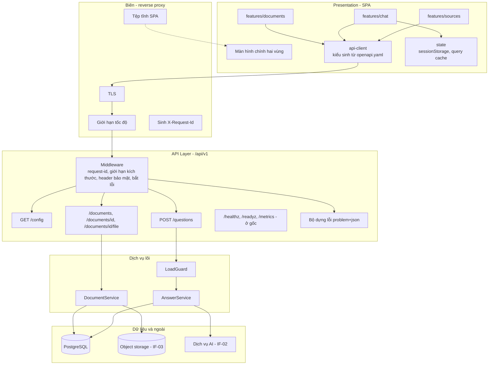
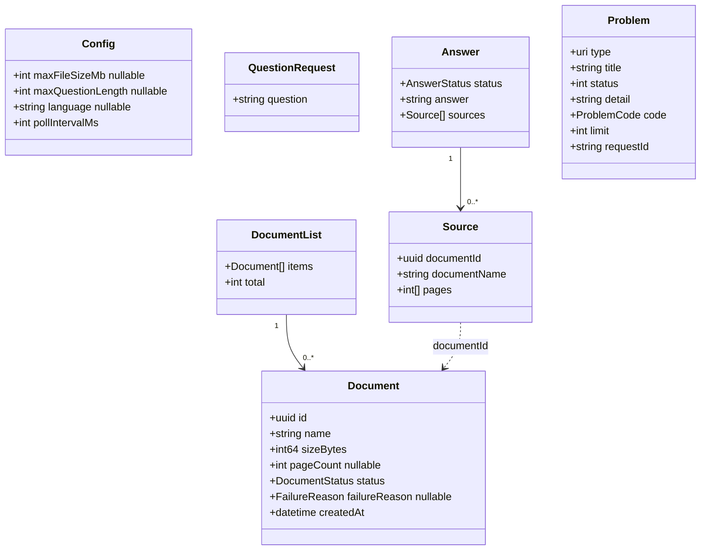
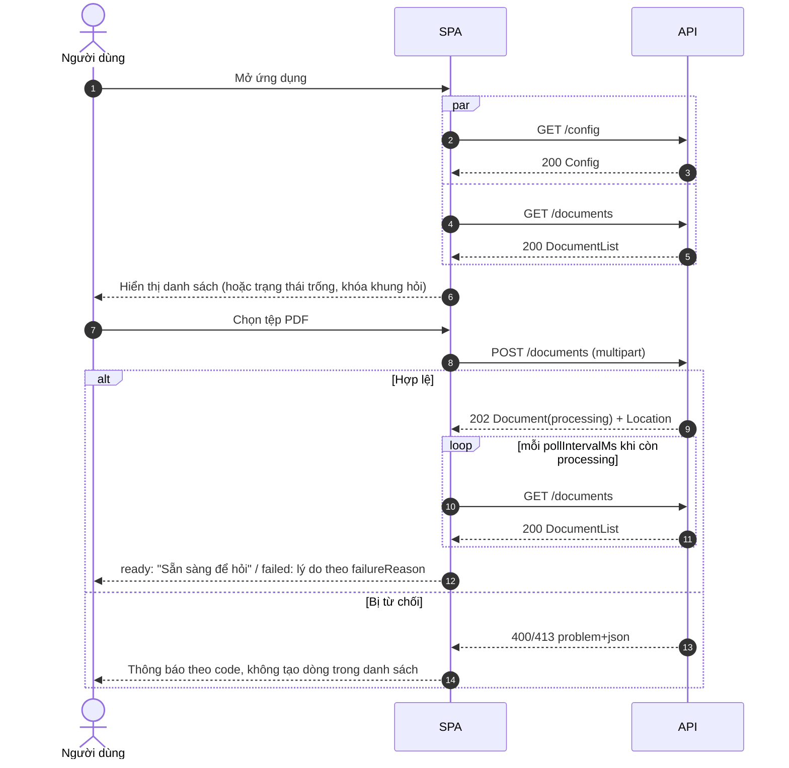
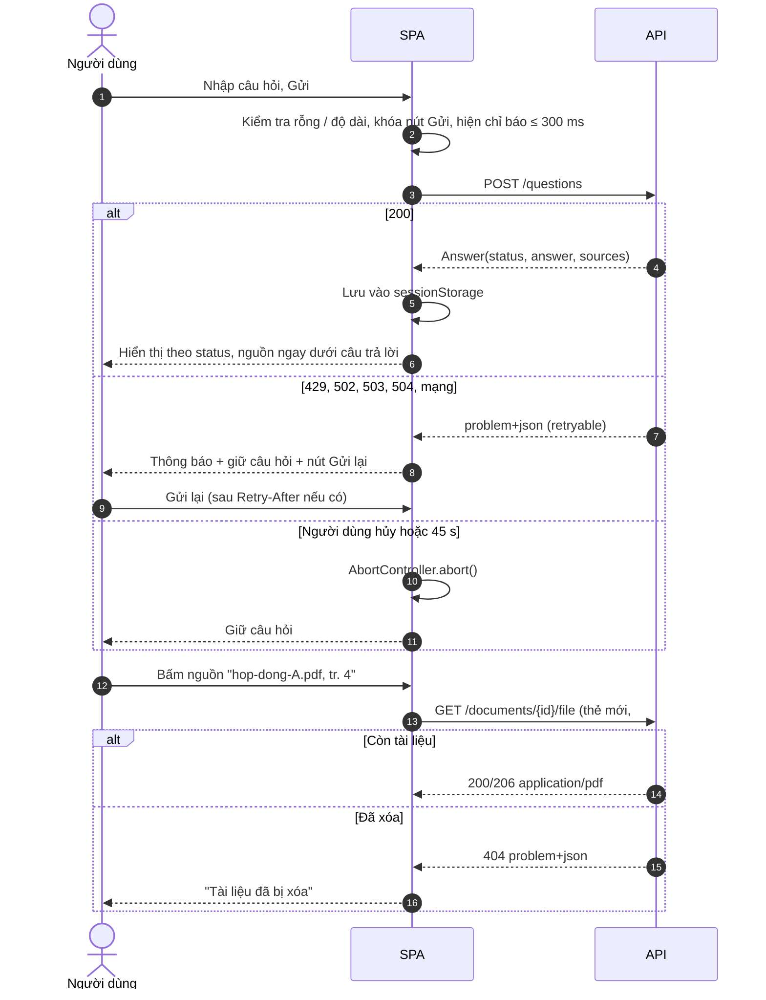

# Software API Design — "Chat với tài liệu" (MVP)

> **Chuẩn áp dụng:** IEEE 1016-2009. Đặc tả máy đọc được: OpenAPI 3.0.3 (`openapi.yaml`, cùng thư mục).
> **Prompt nguồn:** `apiDesign_prompt.md`. Prompt chỉ định nghĩa mục 3.1 (Composition View) dù ghi "tám khung nhìn". Tám khung nhìn ở đây là cùng tập với `Blueprint_Design.md` (Composition, Logical, Dependency, Information, Interface, Interaction, State Dynamics, Resource), mỗi khung nhìn gồm cả phần UI/UX và phần API như prompt yêu cầu.
> **Đầu vào:** `SAD.md` (v0.1) §2.4, §3.2, §4; `Blueprint_Design.md` (v0.1) §2–§3; `BRD.md` (v0.6); `PRD.md` (v0.6); `USER_STORIES.md`; `docs/diagrams/use-case-diagram.drawio` (13 use case).
> **Quan hệ với tài liệu khác:** SAD quyết định kiến trúc; Blueprint mô tả thiết kế chi tiết; tài liệu này là **hợp đồng API** giữa giao diện web và máy chủ. Hình dạng yêu cầu/phản hồi: `openapi.yaml` là nguồn chuẩn. Lý do thiết kế: tài liệu này.
> **Ngôn ngữ:** Tiếng Việt; tên trường, mã lỗi, URL giữ tiếng Anh.
> **Quy ước:** `[TBD: OQ-xxx]` = chưa có thông tin. `[Đề xuất]` = lựa chọn của tác giả, chưa được xác nhận. `[Unverified]` = chưa có nguồn hoặc chưa kiểm chứng.

---

## 1. Context & Subject

### 1.1 System Identification

Ứng dụng web cho phép người dùng tải PDF lên một kho dùng chung, hỏi bằng ngôn ngữ tự nhiên và nhận câu trả lời dựa trên các tài liệu đã tải, kèm nguồn (tên tài liệu, số trang) hoặc thông báo "không tìm thấy". Mỗi câu hỏi độc lập; không đăng nhập; không quản trị (BRD §5, sơ đồ use case). API này phục vụ đúng 13 use case của sơ đồ.

| Attribute | Value |
|---|---|
| **System Name** | "Chat với tài liệu" (MVP) |
| **SDD Version** | 0.1 (Draft) |
| **Document Date** | 2026-10-27 |
| **Document ID** | API-CWD-001 |
| **Document Owner** | API Lead / Lead Architect `[TBD: OQ-007]` |

| Version | Date | Author | Changes |
|---|---|---|---|
| 0.1 | 2026-10-27 | Software Architect (do Claude soạn thảo) | Bản đầu tiên từ SAD/Blueprint v0.1; kèm `openapi.yaml` đã kiểm tra hợp lệ OpenAPI 3.0 |

### 1.2 System Scope and External Boundaries

| Boundary Type | Description |
|---|---|
| **System Purpose** | Cho phép rút ngắn thời gian tìm thông tin trong nhiều PDF và kiểm chứng được nguồn (BO-001, BO-002) |
| **User Personas** | UC-P1 nhân viên phát triển kinh doanh; UC-P2 trưởng nhóm (xem §2.1) |
| **API Consumers** | **Duy nhất một consumer sản xuất: SPA web (first-party)**. Ngoài ra: hạ tầng (proxy/orchestrator thăm dò sức khỏe; Prometheus lấy số đo) và công cụ kiểm thử hợp đồng nội bộ. Không có đối tác, bên thứ ba hay ứng dụng di động |
| **User Journey Context** | Tải PDF → chờ sẵn sàng → hỏi → đọc câu trả lời kèm nguồn → mở nguồn đối chiếu → (xóa tài liệu không dùng). Xem PRD §2.2 |
| **External Systems** | IF-03 Kho lưu trữ, IF-02 Dịch vụ AI — **không** lộ ra qua API; chỉ máy chủ gọi |
| **External Interfaces** | REST/JSON qua HTTPS; `multipart/form-data` (tải lên); `application/pdf` (tải tệp). Không GraphQL, gRPC, webhook, hàng đợi công khai |
| **UI Channels** | Một ứng dụng web một màn hình chính hai vùng (danh sách tài liệu / khung trao đổi) |
| **API Channels** | **Internal API** cùng gốc với giao diện (`/api/v1`). Không có Public API, Partner API hay webhook |
| **Touchpoints** | Màn hình chính: nút tải PDF, danh sách tài liệu (trạng thái, xóa), ô nhập câu hỏi, danh sách nguồn dưới mỗi câu trả lời, hộp xác nhận xóa. Không có đăng nhập, dashboard, báo cáo |
| **API Touchpoints** | `/config`, `/documents`, `/documents/{id}`, `/documents/{id}/file`, `/questions`; hạ tầng: `/healthz`, `/readyz`, `/metrics`. Không có xác thực hay callback |
| **Trust Boundaries** | Trình duyệt (Z1, không tin cậy) → reverse proxy (Z2) → API (Z3) → dữ liệu (Z4); IF-02 là miền bên thứ ba. Toàn bộ trong mạng nội bộ/VPN (CON-005). Mọi đầu vào từ Z1, kể cả tệp PDF, là không tin cậy |
| **Deployment Environment** | Container nội bộ `[Đề xuất]`; chi tiết SAD §5 `[TBD: OQ-005, OQ-S02]` |
| **Device Support** | Máy tính (≥ 1024 px). Máy tính bảng/di động không cam kết `[TBD: OQ-P02]` |
| **Browser Support** | `[TBD: OQ-P09]`. Yêu cầu tối thiểu API đòi hỏi: `fetch`, `FormData`, `AbortController`, `sessionStorage` (mọi trình duyệt hiện đại) |

### 1.3 Assumptions and Constraints

| Type | Description |
|---|---|
| **Technical Constraints** | CON-001 ứng dụng web; CON-002 chỉ PDF có văn bản; CON-005 không đăng nhập. Đặc tả API bằng OpenAPI 3.0+ (quyết định của tài liệu này). Không có ràng buộc công nghệ khác (PRD §8) |
| **Business Constraints** | Ngân sách/thời hạn `[TBD: OQ-003]`; pháp lý dữ liệu `[TBD: OQ-005]`; **không cam kết SLA, thời gian phản hồi hay độ sẵn sàng** (BRD §5) |
| **UX/UI Assumptions** | Người dùng có kỹ năng máy tính cơ bản; phiên làm việc ngắn; mức quen AI `[TBD: OQ-008]` |
| **API Assumptions** | Chỉ SPA first-party gọi API; SPA và API được triển khai cùng nhau nhưng trình duyệt có thể còn giữ bản SPA cũ khi API vừa nâng cấp (xem §5) |
| **Device Assumptions** | Chủ yếu máy tính `[Đề xuất]` |
| **Network Assumptions** | Mạng nội bộ/VPN; độ trễ tới API thấp `[Unverified]`. Nhiều người dùng có thể đi qua cùng một địa chỉ (NAT/VPN) — ảnh hưởng giới hạn tốc độ, xem §3.8.2 |
| **Data Assumptions** | ≤ 20 người dùng đồng thời, ≤ 200 tài liệu, ≤ 100 trang/tài liệu `[Đề xuất]`; giới hạn thật `[TBD: OQ-001, OQ-009]`. Máy chủ không lưu câu hỏi/câu trả lời |

---

## 2. Stakeholders & Concerns

### 2.1 User Personas

Dựa trên BRD §6.1, chưa qua phỏng vấn (OQ-008). Không đặt tên giả để tránh tạo cảm giác có dữ liệu thật.

| Persona | Role | Demographics | Goals | Pain Points | Tech Proficiency | Usage Frequency |
|---|---|---|---|---|---|---|
| **UC-P1** | Nhân viên phát triển kinh doanh | `[TBD: OQ-001]` | Tìm nhanh một thông tin cụ thể; chuẩn bị đề xuất, trả lời đối tác | Phải mở nhiều PDF, tự tổng hợp | `[TBD: OQ-008]` | `[TBD: OQ-001]` |
| **UC-P2** | Trưởng nhóm / quản lý kinh doanh | `[TBD: OQ-001]` `[Unverified]` | Tổng hợp xuyên nhiều tài liệu; kiểm chứng nguồn | Không tin thông tin tổng hợp nếu không rõ nguồn | `[TBD: OQ-008]` | `[TBD: OQ-001]` |

*Prompt gợi ý persona quản trị viên IT và nhân viên CSKH; MVP không có vai quản trị (sơ đồ use case), nên không đưa vào.*

### 2.2 API Consumer Personas

| API Consumer | Type | Technical Level | Goals | Pain Points | Expected Volume | SLAs |
|---|---|---|---|---|---|---|
| **SPA web** | First-party | Cao (do chính đội viết) | Dựng giao diện đúng ba loại phản hồi; phân biệt lỗi thử lại được và không; giữ câu hỏi khi lỗi | Kiểu dữ liệu không ổn định; thông báo lỗi không rõ; trình duyệt giữ SPA cũ khi API đổi | ≤ 20 người dùng; tối đa ~0,5 yêu cầu/s mỗi người khi polling `[Đề xuất]` | Không cam kết. Mục tiêu thiết kế (không phải SLA): p95 ≤ 200 ms cho endpoint không gọi AI `[Đề xuất]` |
| **Hạ tầng (proxy / orchestrator)** | First-party | Cao | Biết tiến trình sống, sẵn sàng | Kiểm tra sức khỏe giả (xanh khi CSDL hỏng) | 1 yêu cầu/vài giây | Không cam kết |
| **Prometheus** | First-party | Cao | Lấy số đo vận hành | Số đo thiếu nhãn, lộ nội dung | 1 yêu cầu/15–60 s `[Đề xuất]` | Không cam kết |
| **Kiểm thử hợp đồng / đánh giá (QA)** | First-party | Cao | Kiểm tra từng phản hồi khớp `openapi.yaml`; chạy bộ câu hỏi chuẩn lặp lại được | Kết quả không lặp lại | Theo đợt kiểm thử | — |

### 2.3 Stakeholder Identification

| Stakeholder | Role/Title | Primary Interest | UX/UI Specific Concern | API Specific Concern |
|---|---|---|---|---|
| **End-Users** (STK-001, UC-P2, STK-005) | Người dùng kinh doanh | Câu trả lời đúng, có nguồn; tải tài liệu không lỗi | Ba loại phản hồi phân biệt rõ; lỗi dễ hiểu | API trả kết quả dự đoán được; nguồn lấy từ dữ liệu, không từ văn bản LLM |
| **UX Designers** | Thiết kế | Nhất quán, trạng thái rõ | Trạng thái tài liệu, trạng thái chờ | Hình dạng dữ liệu đủ để dựng mọi trạng thái (`status`, `failureReason`) |
| **UI Developers** | Đội frontend | Triển khai khả thi | Thành phần dùng lại | Định dạng phản hồi nhất quán; kiểu sinh từ OpenAPI |
| **API Developers** | Đội backend | Chất lượng API, dễ kiểm thử | — | `openapi.yaml` đầy đủ, quy tắc phiên bản, kiểm thử hợp đồng |
| **API Consumers** | Chính là UI Developers | Tích hợp dễ | — | Ổn định; mã lỗi cố định; lỗi có hành động tiếp theo |
| **Product Owner** | Business | Chứng minh giá trị MVP | Số thao tác ít (P3) | Không có số liệu sử dụng ở API (đã loại khỏi MVP) |
| **Accessibility Officer** | Tuân thủ (nếu có) | Tiếp cận | Bàn phím, trình đọc màn hình | Thông báo lỗi dạng văn bản, không chỉ màu/biểu tượng; `detail` đọc được |
| **Security Officer** (STK-003) | CNTT/bảo mật | Bảo vệ dữ liệu khi không có đăng nhập | Giữ nguyên thông báo dữ liệu (OQ-005) | Không xác thực → kiểm soát thay thế: mạng kín, giới hạn tốc độ, xác thực tệp, không rò thông tin trong lỗi |
| **DevOps/SRE** | Nền tảng | Triển khai, quan sát, khôi phục | — | Health/ready/metrics; `X-Request-Id`; không lộ nội dung trong nhật ký |
| **QA Engineers** | Kiểm thử | Kiểm thử lặp lại | Kiểm thử thành phần | Kiểm thử hợp đồng từ `openapi.yaml` |

### 2.4 Stakeholder Concerns (IEEE 1016-2009)

| ID | Stakeholder | Concern | Priority | UX/UI Acceptance Criteria | API Acceptance Criteria |
|---|---|---|---|---|---|
| A-01 | End-User | Kết quả đúng và kiểm chứng được | High | Mỗi câu trả lời có nội dung tài liệu hiển thị kèm nguồn ngay bên dưới (AC-007); "không tìm thấy" khác biệt về hiển thị | `answered/partial` ⇒ `sources` ≥ 1; `not_found` ⇒ `sources = []`; 100% nguồn lấy từ siêu dữ liệu (AC-007, AC-008, AC-010) |
| A-02 | End-User | Tải lên thành công hoặc biết lý do | High | 100% tải lỗi hiển thị lý do và hướng xử lý (AC-018) | Mọi lỗi tải có `code` hoặc `failureReason` thuộc danh mục cố định (§3.5.5) |
| A-03 | End-User | Ít thao tác | High | ≤ 3 thao tác tới câu trả lời đầu tiên (tài liệu đã có) `[Đề xuất]` | Một lần gọi `POST /questions` cho một câu hỏi; không cần gọi chuẩn bị |
| A-04 | UX Designer | Dựng được mọi trạng thái | High | Có trạng thái: trống, đang xử lý, sẵn sàng, lỗi, chờ trả lời, ba loại phản hồi | `Document.status` ∈ 3 giá trị; `Answer.status` ∈ 3 giá trị; `GET /config` công bố giới hạn |
| A-05 | UI Developer | Hợp đồng ổn định, ít bất ngờ | High | — | Cùng dạng lỗi `application/problem+json` cho mọi endpoint; kiểu sinh từ `openapi.yaml`; thay đổi chỉ cộng thêm trong v1 (§5) |
| A-06 | Security Officer | Bảo vệ khi không đăng nhập | High | Dòng thông báo "mọi người dùng ứng dụng đều xem được tài liệu" (OQ-005) | Xác thực tệp `%PDF-`; giới hạn tốc độ; lỗi không lộ nội dung/stack; TLS; khóa lưu trữ là UUID |
| A-07 | Security Officer | Xóa có hiệu lực ngay | High | Hộp xác nhận xóa; tài liệu biến khỏi danh sách | Sau `DELETE` → `204`, 0 đoạn tài liệu đó trong `POST /questions` (AC-004) |
| A-08 | DevOps/SRE | Chẩn đoán không lộ dữ liệu | Medium | Hiển thị `requestId` trong thông báo lỗi chung để báo hỗ trợ | Mọi phản hồi có `X-Request-Id`; nhật ký không chứa câu hỏi/câu trả lời/văn bản tài liệu |
| A-09 | End-User / DevOps | Quá tải không làm mất tài liệu | Medium | Thông báo "bận" rõ, giữ câu hỏi | `SYSTEM_BUSY` 503 + `Retry-After`; tài liệu đã tải không đổi (NFR-SCL-002) |
| A-10 | QA | Kiểm thử hợp đồng | High | — | 100% phản hồi trong bộ kiểm thử hợp lệ theo `openapi.yaml` |
| A-11 | API Developer | Khả năng đổi nhà cung cấp AI không đổi API | Medium | — | Không trường nào trong API mang tên/định dạng riêng của nhà cung cấp AI |

### 2.5 API Design Quality Attribute Scenarios

Số liệu `[Đề xuất]` là mục tiêu thiết kế, không phải cam kết.

| Quality Attribute | API Scenario |
|---|---|
| **Performance** | Ở ≤ 20 người dùng đồng thời, p95 ≤ 200 ms cho `GET /config`, `GET /documents`, `GET /documents/{id}`, `DELETE`, và phản hồi `202` của `POST /documents` (không tính thời gian nhận tệp); `POST /questions` p95 ≤ 20 s, tối đa 40 s rồi `AI_TIMEOUT` `[Đề xuất]` |
| **Scalability** | API không giữ trạng thái; thêm bản `api` tăng thông lượng tới khi CSDL hoặc IF-02 là nút cổ chai (chưa đo). Quá giới hạn đồng thời → `SYSTEM_BUSY`, không treo |
| **Availability** | Không cam kết SLA. Suy giảm có kiểm soát: IF-02 ngưng → `POST /questions` trả `502 AI_UNAVAILABLE` < 1 s (breaker mở); `GET /documents`, `DELETE`, `GET file` vẫn dùng được |
| **Security** | Không xác thực (CON-005). TLS 1.2+; giới hạn tốc độ theo địa chỉ nguồn; kiểm tra tệp theo chữ ký; lỗi không lộ stack/đường dẫn/tên nhà cung cấp AI |
| **Reliability** | `DELETE` idempotent; `POST /documents` nguyên tử (lỗi giữa chừng không để tài liệu nửa vời); `POST /questions` không có tác dụng phụ trạng thái ⇒ gửi lại an toàn về dữ liệu |
| **Versioning** | URI `/api/v1`; trong v1 chỉ thay đổi cộng thêm; thay đổi phá vỡ ⇒ `/api/v2` kèm `Sunset` (§5) |
| **Documentation** | `openapi.yaml` đầy đủ, hợp lệ OpenAPI 3.0 (đã kiểm), có ví dụ cho ba loại phản hồi và các lỗi chính; thay đổi API phải đổi tệp này trong cùng PR `[Đề xuất]` |
| **Developer Experience** | Kiểu TypeScript sinh tự động từ `openapi.yaml` `[Đề xuất]`; một dạng lỗi duy nhất; `code` để rẽ nhánh, `detail` để hiển thị |
| **Observing** | `X-Request-Id` mọi phản hồi và trường `requestId` trong lỗi; nhật ký JSON; `/metrics`; trace OpenTelemetry (SAD §4.3) |
| **Backward Compatibility** | SPA cũ hoạt động với API mới trong thời gian nâng cấp cuốn chiếu: không bỏ/đổi nghĩa trường; client coi giá trị `code`/`failureReason` lạ là lỗi chung |

### 2.6 API Design Constraints Matrix

| API Constraint | Requirement | Tool/Standard | Verification Method |
|---|---|---|---|
| **API Specification** | OpenAPI 3.0.3, một tệp `openapi.yaml` | OpenAPI Specification | Trình kiểm tra OpenAPI (đã chạy: hợp lệ); kiểm thử hợp đồng khi có triển khai |
| **Authentication** | **Không có** (quyết định, ADR-09): `security: []`. Kiểm soát truy cập bằng mạng kín | — | Rà soát bảo mật (OQ-005); kiểm tra proxy chỉ lắng nghe mạng nội bộ |
| **Rate Limiting** | Theo địa chỉ nguồn tại proxy; `429` + `Retry-After`. `POST /questions` 30/phút, `POST /documents` 10/phút, endpoint còn lại 120/phút `[Đề xuất]` | RFC 9110 (`Retry-After`) | Kiểm thử tải |
| **Pagination** | Không phân trang trong v1 (≤ 200 tài liệu). Nếu vượt: thêm `limit`/`cursor` tùy chọn, tương thích ngược | Cursor-based `[Đề xuất]` | Rà soát API |
| **Versioning** | URI `/api/v1/` | Semantic Versioning cho `info.version` | Rà soát API |
| **Error Response** | `application/problem+json` với thành phần mở rộng `code`, `requestId`, `limit` | RFC 9457 (thay thế RFC 7807) | Kiểm thử hợp đồng |
| **Idempotency** | `GET`, `DELETE` idempotent. `POST /documents` **không** idempotent; không hỗ trợ `Idempotency-Key` ở v1 (lý do §3.5.1) | RFC 9110 §9.2 | Kiểm thử API |
| **CORS** | **Không bật** — SPA và API cùng gốc. Không có `Access-Control-*` | RFC 6454 (same-origin) | Kiểm tra bảo mật |
| **Content Negotiation** | Yêu cầu: `application/json`, `multipart/form-data`. Phản hồi: `application/json`, `application/problem+json`, `application/pdf`. `Content-Type` sai → `400 INVALID_REQUEST` | HTTP semantics | Kiểm thử API |
| **Deprecation** | Khi có v2: `Sunset` (và `Deprecation`) trên endpoint cũ; thời gian song song `[TBD]` | RFC 8594 | Rà soát API |
| **Caching** | `no-store` cho JSON; tệp PDF `private, max-age=0, must-revalidate` + `ETag` | RFC 9111 | Kiểm thử API |
| **Compression** | gzip cho JSON ở proxy `[Đề xuất]`; không nén PDF | HTTP | Kiểm thử API |

---

## 3. Design Views (IEEE 1016-2009 Core)

Mỗi khung nhìn nêu cả phần UI/UX và phần API. Truy vết đầy đủ ở §4.

---

### 3.1 Composition View

**Purpose:** Hệ thống được lắp từ các lớp UI và API nào.
**Viewpoint:** Phân rã thành lớp trình bày, biên, API, dịch vụ, dữ liệu.
**Stakeholder Concerns Addressed:** A-05, A-10, A-11 (Maintainability, Modularity, API Organization).



| Thành phần | Lớp | Trách nhiệm | Phụ thuộc |
|---|---|---|---|
| `api-client` | UI | Gọi REST, ánh xạ `Problem` → lỗi kiểu mạnh, hủy yêu cầu, quản lý timeout phía client | `openapi.yaml` (kiểu) |
| `features/*` | UI | Hiển thị theo `Document.status`, `Answer.status`; xử lý thử lại | `api-client`, `state` |
| Reverse proxy | Biên | TLS, tệp tĩnh, giới hạn tốc độ, sinh `X-Request-Id` nếu thiếu, giới hạn kích thước thân yêu cầu | — |
| Middleware API | API | Gắn `requestId` vào ngữ cảnh, header bảo mật, bắt ngoại lệ → `Problem` | `platform` |
| Routers | API | Xác thực đầu vào theo schema, gọi dịch vụ, định dạng phản hồi | `core` |
| Bộ dựng lỗi | API | Ánh xạ một-một ngoại lệ miền → `code`/HTTP/`detail` (§3.5.5) | — |

---

### 3.2 Logical View

**Purpose:** Tài nguyên và mô hình dữ liệu mà API trình bày; quan hệ với mô hình miền.
**Viewpoint:** Thiết kế tài nguyên REST.
**Stakeholder Concerns Addressed:** A-01, A-04, A-05, A-11.

#### 3.2.1 Tài nguyên

| Tài nguyên | URI | Ghi chú |
|---|---|---|
| Cấu hình | `/api/v1/config` | Singleton, chỉ đọc |
| Tập tài liệu | `/api/v1/documents` | Danh sách (`GET`), tạo (`POST`) |
| Tài liệu | `/api/v1/documents/{id}` | Đọc (`GET`), xóa (`DELETE`) |
| Tệp của tài liệu | `/api/v1/documents/{id}/file` | Biểu diễn nhị phân; tài nguyên con |
| Hỏi đáp | `/api/v1/questions` | **Không phải tài nguyên lưu trữ**: `POST` thực hiện một phép tính và trả kết quả; không tạo tài nguyên, không có `GET /questions/{id}` |

Quy ước: danh từ số nhiều; chữ thường; không động từ trong URI (trừ `questions`, là danh từ cho tác vụ hỏi); `id` là UUID.

**Vì sao `POST /questions` không trả `201` + `Location`:** không có thứ gì được tạo và lưu (ADR-06, không hỏi tiếp nối). `200` là mã đúng.

#### 3.2.2 Mô hình dữ liệu của API



| Kiểu liệt kê | Giá trị | Mô hình miền (Blueprint §3.2) |
|---|---|---|
| `DocumentStatus` | `processing`, `ready`, `failed` | Giống `DocumentStatus` |
| `FailureReason` | `FILE_CORRUPT`, `FILE_ENCRYPTED`, `NO_EXTRACTABLE_TEXT`, `PROCESSING_ERROR` | Giống |
| `AnswerStatus` | `answered`, `partial`, `not_found` | Giống |
| `ProblemCode` | `INVALID_REQUEST`, `UNSUPPORTED_TYPE`, `FILE_TOO_LARGE`, `EMPTY_QUESTION`, `QUESTION_TOO_LONG`, `NOT_FOUND`, `RATE_LIMITED`, `SYSTEM_BUSY`, `STORAGE_UNAVAILABLE`, `AI_UNAVAILABLE`, `AI_TIMEOUT`, `INTERNAL_ERROR` | — |

**Điều API cố ý không lộ:** `storage_key`, `content_sha256`, `deleted_at`, `ready_at`, `chunk_id`, điểm liên quan, văn bản đoạn, tên mô hình AI, `jobs` và `last_error`. Lý do: giảm bề mặt, tránh khóa giao diện vào chi tiết triển khai (A-11), và tránh lộ nội dung (A-06).

---

### 3.3 Dependency View

**Purpose:** Phần UI nào gọi endpoint nào; endpoint nào phụ thuộc dịch vụ nào.
**Viewpoint:** Ma trận phụ thuộc.
**Stakeholder Concerns Addressed:** A-05, A-10.

#### 3.3.1 UI → API

| Thành phần UI | Use case | Endpoint | Khi nào gọi |
|---|---|---|---|
| Khởi động ứng dụng | — | `GET /config`, `GET /documents` | Khi tải trang |
| Nút "Tải PDF lên" | UC07, UC08 | `POST /documents` | Khi chọn tệp |
| Danh sách tài liệu / trạng thái | UC09, UC10, UC11 | `GET /documents` (định kỳ khi còn `processing`) | Mỗi `pollIntervalMs` |
| Biểu tượng xóa + hộp xác nhận | UC12 | `DELETE /documents/{id}` | Sau khi xác nhận |
| Ô hỏi + nút Gửi | UC14, UC15, UC16, UC18, UC19, UC21 | `POST /questions` | Khi gửi |
| Liên kết nguồn ("Mở tài liệu") | UC17 | `GET /documents/{id}/file` (mở thẻ mới, `#page=N`) | Khi bấm |
| Kiểm tra nguồn đã xóa (EC-16) | — | (không gọi riêng) — tra danh sách đã có; hoặc `404` khi mở | Khi hiển thị/ bấm nguồn |

Không có endpoint nào chỉ phục vụ thiết bị này: mọi endpoint nghiệp vụ gắn với một use case.

#### 3.3.2 API → dịch vụ

| Endpoint | Dịch vụ lõi | Cổng ngoài |
|---|---|---|
| `GET /config` | Config | — |
| `GET/POST/DELETE /documents*` | `DocumentService` | CSDL; `ObjectStorePort` (IF-03) |
| `GET /documents/{id}/file` | `DocumentService.open_file` | `ObjectStorePort` |
| `POST /questions` | `LoadGuard` → `AnswerService` → `RetrievalService` | CSDL; `LlmPort` (IF-02) |
| `/healthz`, `/readyz` | — / kiểm tra CSDL, hàng đợi, object storage | — |

**Hệ quả của suy giảm:** IF-03 ngưng ⇒ `POST /documents` và `GET file` lỗi `503 STORAGE_UNAVAILABLE`, còn `GET /documents`, `DELETE` và `POST /questions` (trên tài liệu `ready`) vẫn chạy. IF-02 ngưng ⇒ chỉ `POST /questions` lỗi `502`; tải lên vẫn nhận `202` nhưng tài liệu chưa `ready` (việc nền được hoãn).

---

### 3.4 Information View

**Purpose:** Dữ liệu trong hợp đồng: kiểu, ràng buộc, nguồn gốc, kích thước.
**Viewpoint:** Lược đồ trường và ánh xạ từ lưu trữ.
**Stakeholder Concerns Addressed:** A-01, A-02, A-04.

#### 3.4.1 Từ điển trường

| Đối tượng.trường | Kiểu | Bắt buộc | Ràng buộc | Nguồn dữ liệu |
|---|---|---|---|---|
| `Config.maxFileSizeMb` | int \| null | Có | ≥ 1 | Cấu hình `[TBD: OQ-009]` |
| `Config.maxQuestionLength` | int \| null | Có | ≥ 1 | Cấu hình `[TBD: OQ-P06]` |
| `Config.language` | string \| null | Có | — | Cấu hình `[TBD: OQ-011]` |
| `Config.pollIntervalMs` | int | Có | ≥ 500 | Cấu hình (mặc định 2000) |
| `Document.id` | uuid | Có | — | `documents.id` |
| `Document.name` | string | Có | ≤ 255 ký tự, đã làm sạch | `documents.name` |
| `Document.sizeBytes` | int64 | Có | ≥ 1 | `documents.size_bytes` |
| `Document.pageCount` | int \| null | Có | ≥ 1; null cho tới khi trích xong | `documents.page_count` |
| `Document.status` | enum | Có | 3 giá trị | `documents.status` |
| `Document.failureReason` | enum \| null | Có | Khác null ⇔ `status = failed` | `documents.failure_reason` |
| `Document.createdAt` | date-time (UTC) | Có | ISO 8601 | `documents.created_at` |
| `QuestionRequest.question` | string | Có | Sau `trim`: 1…`maxQuestionLength`; không có trường nào khác (`additionalProperties: false`) | Người dùng |
| `Answer.status` | enum | Có | 3 giá trị | Lớp grounding (SAD §2.2.4) |
| `Answer.answer` | string | Có | `not_found` ⇒ thông báo chuẩn | LLM đã qua kiểm tra; hoặc hằng của hệ thống |
| `Answer.sources[]` | Source[] | Có | Xem bất biến §3.5.2 | `chunks` + `documents` (G-L3) |
| `Source.pages[]` | int[] | Có | ≥ 1, tăng dần, không trùng; có thể rỗng | `chunks.page_start..page_end` đã gộp |

Quy tắc ngôn ngữ: giá trị liệt kê và `code` là ASCII không đổi (cho máy); `detail` và `answer` là văn bản cho người, tiếng Việt.

#### 3.4.2 Kích thước và giới hạn

| Mục | Giới hạn | Ghi chú |
|---|---|---|
| Thân `POST /documents` | `maxFileSizeMb` + phần đầu multipart; proxy giới hạn cứng cao hơn một chút | Vượt → `413` (proxy trả cũng phải ở dạng `problem+json` — cấu hình proxy) |
| Thân `POST /questions` | `maxQuestionLength` ký tự (+ chi phí JSON); proxy giới hạn cứng 64 KB `[Đề xuất]` | |
| `GET /documents` | ≤ ~200 phần tử × ~250 B ≈ 50 KB | Không phân trang ở v1 |
| `POST /questions` phản hồi | `answer` vài KB; `sources` ≤ 8 mục | |

#### 3.4.3 Bộ nhớ đệm và nhất quán

| Endpoint | Chính sách | Lý do |
|---|---|---|
| JSON (`/config`, `/documents*`, `/questions`) | `Cache-Control: no-store` | Trạng thái đổi liên tục; câu trả lời nhạy cảm |
| `GET /documents/{id}/file` | `private, max-age=0, must-revalidate` + `ETag` (băm nội dung) | Cho phép trình xem PDF yêu cầu `Range` hiệu quả; sau khi xóa phải `404` ngay nên không cache dài |
| Nhất quán | Đọc-sau-ghi trên cùng một CSDL chính: sau `POST /documents` (`202`), `GET /documents` thấy tài liệu `processing`; sau `DELETE` (`204`), danh sách và truy xuất không còn tài liệu | Không có replica đọc ở MVP |

---

### 3.5 Interface View

**Purpose:** Hợp đồng chi tiết của từng endpoint. Nguồn chuẩn cho hình dạng: `openapi.yaml`.
**Viewpoint:** Đặc tả giao diện.
**Stakeholder Concerns Addressed:** A-01, A-02, A-05, A-06, A-10.

#### 3.5.1 Quy ước chung

| Hạng mục | Quyết định | Lý do |
|---|---|---|
| Gốc | `/api/v1`; hạ tầng ở gốc (`/healthz`, `/readyz`, `/metrics`) | Hạ tầng không thuộc hợp đồng nghiệp vụ nên không đổi phiên bản theo |
| Định dạng | JSON UTF-8; `multipart/form-data` cho tải lên | |
| Thời gian | ISO 8601 UTC (`2026-10-27T03:00:00Z`) | |
| Xác thực | Không có | CON-005, ADR-09 |
| CORS | Không bật | Cùng gốc |
| `X-Request-Id` | Mọi phản hồi. Proxy luôn sinh giá trị mới và ghi đè giá trị client gửi (tránh giả mạo/nhiễu truy vết) | Truy vết |
| Mã trạng thái | `200`, `202`, `204`, `206`, `400`, `404`, `413`, `416`, `429`, `500`, `502`, `503`, `504` | Dùng đúng ngữ nghĩa HTTP |
| Idempotency-Key | **Không hỗ trợ ở v1** | Trùng tài liệu do gửi lại đang chờ chính sách chống trùng (EC-12, OQ-014); người dùng xóa được bản trùng. Nếu OQ-014 chọn "chặn trùng theo băm nội dung" thì có cách tự nhiên hơn khóa idempotency. Xem lại ở v1.x |
| Retry | Máy chủ không thử lại hộ client. Client chỉ gửi lại khi `retryable` (§3.5.5) | Tránh nhân đôi chi phí AI |
| Tiêu đề bảo mật | `X-Content-Type-Options: nosniff`, CSP, `Referrer-Policy: no-referrer`, `frame-ancestors 'none'` (đặt ở proxy cho cả SPA) | SAD §4.1 |

#### 3.5.2 Đặc tả endpoint

**1. `GET /api/v1/config`** — `getConfig`
- Phản hồi `200`: `Config`. Ví dụ `{ "maxFileSizeMb": null, "maxQuestionLength": null, "language": null, "pollIntervalMs": 2000 }`.
- UI: gọi một lần khi khởi động; `null` ⇒ không chặn phía client.

**2. `POST /api/v1/documents`** — `uploadDocument` (UC07, UC08; kết quả nền UC09, UC10)
- Yêu cầu: `multipart/form-data`, đúng một phần `file`.
- Kiểm tra đồng bộ theo thứ tự: (1) có phần `file` (`INVALID_REQUEST`); (2) đếm byte khi nhận, dừng khi vượt `maxFileSizeMb` (`FILE_TOO_LARGE`, 413); (3) đuôi `.pdf` **và** 5 byte đầu `%PDF-` (`UNSUPPORTED_TYPE`, 400). Không dùng `Content-Type` do client khai.
- `202`: thân `Document` (`status: "processing"`, `pageCount: null`), header `Location: /api/v1/documents/{id}`.
- Tác dụng phụ: lưu tệp; một giao dịch tạo bản ghi và việc nền. Lỗi giữa chừng không để bản ghi (không có tài liệu nửa vời — US-003-AC4).
- Lỗi: `400`, `413`, `429`, `503 SYSTEM_BUSY | STORAGE_UNAVAILABLE`, `500`.
- Ví dụ:
```bash
curl -sS -X POST https://<host>/api/v1/documents -F "file=@hop-dong-A.pdf;type=application/pdf"
```
```json
{ "id": "7b0c1f2e-3a4b-4c5d-8e9f-0a1b2c3d4e5f", "name": "hop-dong-A.pdf", "sizeBytes": 482113,
  "pageCount": null, "status": "processing", "failureReason": null, "createdAt": "2026-10-27T03:00:00Z" }
```

**3. `GET /api/v1/documents`** — `listDocuments` (UC11)
- `200`: `{ "items": [Document…], "total": n }`; chỉ tài liệu chưa xóa; `createdAt` giảm dần.
- Ví dụ một phần tử lỗi: `{ "id": "9d4e…", "name": "quy-dinh-C.pdf", "sizeBytes": 91002, "pageCount": null, "status": "failed", "failureReason": "FILE_ENCRYPTED", "createdAt": "…" }`.

**4. `GET /api/v1/documents/{id}`** — `getDocument` (UC09, UC10)
- `200`: `Document` | `404 NOT_FOUND` (không tồn tại hoặc đã xóa).

**5. `DELETE /api/v1/documents/{id}`** — `deleteDocument` (UC12)
- `204` không thân. Xóa mềm; xóa vật lý sau ≈ 1 giờ. Xóa lại khi còn xóa mềm vẫn `204`; sau khi xóa vật lý → `404` (UI coi như đã xóa). Idempotent theo nghĩa *trạng thái cuối giống nhau*.
- UI **phải** hỏi xác nhận trước khi gọi (thao tác không hoàn tác được).

**6. `GET /api/v1/documents/{id}/file`** — `getDocumentFile` (UC17)
- `200 application/pdf` (`Content-Disposition: inline`, `ETag`, `Accept-Ranges: bytes`) hoặc `206` với `Range`; `304` khi `If-None-Match` khớp `ETag` (bổ sung khi triển khai, cộng thêm); `404` nếu không tồn tại/đã xóa; `416` nếu `Range` sai.
- Số trang: UI thêm `#page=N` vào URL khi mở; fragment không gửi lên máy chủ và do trình xem PDF của trình duyệt xử lý. Hành vi `#page=` có thể khác giữa trình duyệt `[Unverified: kiểm thử theo OQ-P09]`.

**7. `POST /api/v1/questions`** — `askQuestion` (UC14, UC15, UC16, UC18, UC19, UC21)
- Yêu cầu: `{ "question": string }`.
- Phản hồi `200`: `Answer`. **Bất biến** (kiểm bằng kiểm thử hợp đồng):

| `status` | `answer` | `sources` |
|---|---|---|
| `answered` | Nội dung từ tài liệu | ≥ 1; mỗi tài liệu một mục, `pages` đã gộp |
| `partial` | Phần có căn cứ **và** câu nêu rõ phần không tìm thấy | ≥ 1 |
| `not_found` | Thông báo chuẩn "Không tìm thấy thông tin trong các tài liệu đã tải." (hằng của hệ thống, không do LLM sinh) | `[]` |

- Nhiều tài liệu (UC18, US-009): `sources` liệt kê từng tài liệu; thông tin mâu thuẫn ⇒ `answer` nêu khác biệt và dẫn từng nguồn (US-009-AC2).
- Chỉ xét tài liệu `ready` và chưa xóa ⇒ tài liệu `processing` không xuất hiện trong `sources` (US-002-AC2).
- Lỗi: `400 EMPTY_QUESTION | QUESTION_TOO_LONG | INVALID_REQUEST`, `429`, `503 SYSTEM_BUSY`, `502 AI_UNAVAILABLE`, `504 AI_TIMEOUT`, `500`.
- Ví dụ:
```bash
curl -sS -X POST https://<host>/api/v1/questions -H 'Content-Type: application/json' \
     -d '{"question":"Điều khoản thanh toán là gì?"}'
```
```json
{ "status": "answered",
  "answer": "Thanh toán trong vòng … ngày kể từ …",
  "sources": [ { "documentId": "7b0c1f2e-3a4b-4c5d-8e9f-0a1b2c3d4e5f", "documentName": "hop-dong-A.pdf", "pages": [4, 5] } ] }
```

**8. Hạ tầng** — `GET /healthz` (`200` nếu sống), `GET /readyz` (`200`/`503` theo CSDL, hàng đợi, object storage), `GET /metrics` (Prometheus; chỉ mạng hạ tầng). Không thuộc hợp đồng v1; không có `/api/v1/` ở trước.

#### 3.5.3 Dạng lỗi (RFC 9457)

`Content-Type: application/problem+json`.

```json
{ "type": "urn:cwd:problem:file-too-large",
  "title": "Tệp quá lớn",
  "status": 413,
  "detail": "Tệp lớn hơn giới hạn 50 MB.",
  "code": "FILE_TOO_LARGE",
  "limit": 50,
  "requestId": "3f1c9a53" }
```

- `type`: URN ổn định, không dẫn tới trang web. `title`: ngắn, ổn định. `detail`: câu hiển thị được cho người dùng (tiếng Việt, không kỹ thuật). `code`: **khóa để client rẽ nhánh** (không phân tích `detail`). `limit`: giá trị giới hạn để điền thông báo. `requestId`: bằng `X-Request-Id`.
- Lỗi ở tầng proxy (413 do giới hạn cứng, 429 do giới hạn tốc độ, 502/504 khi API không phản hồi) cũng phải ở dạng này — cấu hình proxy trả thân JSON cố định `[Đề xuất]`; nếu không, `api-client` phải sinh `Problem` mặc định từ mã HTTP.
- Không bao giờ có trong lỗi: stack trace, đường dẫn, SQL, tên nhà cung cấp AI, khóa lưu trữ, nội dung tài liệu hoặc câu hỏi.

#### 3.5.4 Header đáng chú ý

| Header | Chiều | Dùng ở | Ý nghĩa |
|---|---|---|---|
| `X-Request-Id` | Phản hồi (và yêu cầu do proxy gắn) | Mọi endpoint | Truy vết |
| `Location` | Phản hồi | `POST /documents` `202` | URL tài liệu |
| `Retry-After` (giây) | Phản hồi | `429`, `503`, `502` | Thời gian nên đợi |
| `Range` / `Accept-Ranges` / `ETag` | Yêu cầu / phản hồi | `GET file` | Tải từng phần cho trình xem PDF |
| `Cache-Control` | Phản hồi | Mọi endpoint | Xem §3.4.3 |

#### 3.5.5 Danh mục lỗi

| `code` | HTTP | `retryable` (client) | `detail` hiển thị (gợi ý) | Hành vi UI |
|---|---|---|---|---|
| `INVALID_REQUEST` | 400 | Không | "Yêu cầu không hợp lệ. Vui lòng thử lại." | Hiển thị `requestId` để báo lỗi |
| `UNSUPPORTED_TYPE` | 400 | Không | "Chỉ hỗ trợ tệp PDF." | Cho chọn tệp khác |
| `FILE_TOO_LARGE` | 413 | Không | "Tệp lớn hơn giới hạn {limit} MB." | Cho chọn tệp khác |
| `EMPTY_QUESTION` | 400 | Không | (UI chặn gửi trước, không đến API) | Khóa nút Gửi |
| `QUESTION_TOO_LONG` | 400 | Không | "Câu hỏi dài hơn {limit} ký tự." | Giữ nguyên nội dung, cho rút gọn |
| `NOT_FOUND` | 404 | Không | "Tài liệu không còn tồn tại." (EC-16) | Đánh dấu nguồn "đã xóa" / loại khỏi danh sách |
| `RATE_LIMITED` | 429 | Có, sau `Retry-After` | "Bạn thao tác quá nhanh. Vui lòng thử lại sau ít giây." | Giữ câu hỏi/tệp, tự bật lại nút sau `Retry-After` |
| `SYSTEM_BUSY` | 503 | Có | "Hệ thống đang bận. Tài liệu của bạn không bị mất. Vui lòng thử lại." | Giữ câu hỏi, nút "Gửi lại" |
| `STORAGE_UNAVAILABLE` | 503 | Có | "Chưa lưu được tệp. Vui lòng thử lại." | Nút "Thử lại" (chưa có tài liệu nào được tạo) |
| `AI_UNAVAILABLE` | 502 | Có | "Dịch vụ AI tạm thời không dùng được. Câu hỏi của bạn vẫn được giữ." | Giữ câu hỏi, "Gửi lại" |
| `AI_TIMEOUT` | 504 | Có | "Hết thời gian chờ. Câu hỏi của bạn vẫn được giữ." | Giữ câu hỏi, "Gửi lại" |
| `INTERNAL_ERROR` | 500 | Có (một lần) | "Đã xảy ra lỗi. Vui lòng thử lại; nếu còn lặp lại, báo mã {requestId}." | Hiển thị `requestId` |

Thêm: lỗi mạng (không có phản hồi HTTP) do `api-client` tạo ra phía trình duyệt, coi là `retryable` (EC-06, EC-07). `failureReason` của tài liệu (không phải lỗi HTTP) và thông báo tương ứng: xem Blueprint §3.5.4.

Quy tắc tiến hóa: client **phải** coi `code`/`failureReason` không nhận ra là lỗi chung (dùng `detail` nếu có), để máy chủ thêm mã mới không làm vỡ SPA cũ.

---

### 3.6 Interaction View

**Purpose:** Trình tự gọi giữa giao diện và API cho các hành trình chính. Trình tự bên trong máy chủ: Blueprint §3.6, SAD §3.2.
**Viewpoint:** Trình tự UI ↔ API.
**Stakeholder Concerns Addressed:** A-01, A-02, A-03, A-09.

#### 3.6.1 Khởi động và tải tài liệu



#### 3.6.2 Hỏi đáp, thử lại và mở nguồn



#### 3.6.3 Xóa tài liệu

```mermaid
sequenceDiagram
    autonumber
    actor U as Người dùng
    participant B as SPA
    participant A as API

    U->>B: Bấm xóa
    B-->>U: Hộp xác nhận (focus vào nút an toàn)
    U->>B: Xác nhận
    B->>A: DELETE /documents/{id}
    A-->>B: 204
    B->>B: Gỡ khỏi danh sách; các nguồn cũ trong cuộc trao đổi đánh dấu "đã xóa"
    Note over B,A: 404 khi xóa cũng được coi là đã xóa
```

---

### 3.7 State Dynamics View

**Purpose:** Trạng thái tài nguyên quyết định thao tác nào hợp lệ; trạng thái yêu cầu phía UI.
**Viewpoint:** Máy trạng thái và ma trận thao tác × trạng thái.
**Stakeholder Concerns Addressed:** A-02, A-04, A-07, A-09.

#### 3.7.1 Ma trận thao tác × trạng thái tài liệu

Máy trạng thái của tài liệu: Blueprint §3.7.1.

| Thao tác | `processing` | `ready` | `failed` | Đã xóa mềm | Đã xóa vật lý |
|---|---|---|---|---|---|
| `GET /documents` (có trong danh sách) | Có | Có | Có | Không | Không |
| `GET /documents/{id}` | 200 | 200 | 200 | 404 | 404 |
| `GET /documents/{id}/file` | 200 | 200 | 200 | 404 | 404 |
| `DELETE /documents/{id}` | 204 | 204 | 204 | 204 | 404 |
| Được dùng làm nguồn trong `POST /questions` | Không | **Có** | Không | Không | Không |

#### 3.7.2 Trạng thái yêu cầu phía UI

Máy trạng thái hỏi đáp, tải lên: Blueprint §3.7.3, §3.7.4. Quy tắc API → UI:

| Sự kiện từ API | UI chuyển sang |
|---|---|
| `Answer.status = answered` / `partial` / `not_found` | Ba kiểu hiển thị khác nhau |
| `Problem.code` thuộc nhóm retryable | `error` + giữ dữ liệu + "Gửi lại" |
| `Problem.code` không retryable | `error` + hướng sửa (chọn tệp khác / rút gọn câu hỏi) |
| Không có phản hồi (mạng) | `error`, retryable |
| `Document.status` đổi `processing → ready/failed` qua polling | Cập nhật dòng tài liệu; thông báo trong dòng, không hộp thoại chặn |

#### 3.7.3 Quy tắc polling

Chỉ poll khi trong danh sách còn ≥ 1 tài liệu `processing`; dừng khi hết. Khoảng cách `pollIntervalMs` (mặc định 2000). Khi nhận `429`/`503`, tăng khoảng cách gấp đôi (tối đa 30 s) và tôn trọng `Retry-After`. Tạm dừng khi thẻ không hiển thị (`document.hidden`) `[Đề xuất]`.

---

### 3.8 Resource View

**Purpose:** Tài nguyên mà API tiêu thụ: tốc độ, đồng thời, timeout, kích thước.
**Viewpoint:** Giới hạn và ngân sách.
**Stakeholder Concerns Addressed:** A-03, A-09, A-10.

#### 3.8.1 Timeout và ngân sách thời gian

| Endpoint | Ngân sách phía máy chủ `[Đề xuất]` | Timeout client |
|---|---|---|
| `GET /config`, `GET /documents`, `GET /documents/{id}`, `DELETE` | p95 ≤ 200 ms; tối đa 5 s | 10 s |
| `POST /documents` | Phụ thuộc kích thước tệp và băng thông; phần xử lý sau khi nhận xong ≤ 2 s | 120 s (tệp lớn) |
| `GET /documents/{id}/file` | Phát luồng | Không giới hạn tổng; ngắt khi không có dữ liệu 30 s |
| `POST /questions` | ≤ 40 s (embed 10 s + sinh 30 s, SAD §4.2) | 45 s |

#### 3.8.2 Giới hạn tốc độ và đồng thời `[Đề xuất]`

| Nhóm | Giới hạn theo địa chỉ nguồn | Đồng thời |
|---|---|---|
| `POST /questions` | 30/phút | 8 mỗi bản `api` (LoadGuard); chờ ≤ 2 s rồi `SYSTEM_BUSY` |
| `POST /documents` | 10/phút | Theo `SYSTEM_BUSY` chung |
| Còn lại (GET, DELETE) | 120/phút | — |

**Rủi ro:** trong mạng VPN có NAT, nhiều người dùng chia sẻ một địa chỉ nguồn và sẽ dùng chung hạn mức, nên 20 người cùng đặt câu hỏi có thể chạm 30/phút. Giảm thiểu: khóa giới hạn theo `X-Forwarded-For` đã tin cậy nếu mạng cho phép; hạn mức là cấu hình, nâng được mà không đổi API; hiệu chỉnh khi biết cấu trúc mạng `[TBD: OQ-S02]`. Nếu giới hạn gây hại hơn giúp, phương án thay là chỉ giữ Load Guard toàn cục.

#### 3.8.3 Tải ước tính từ polling

20 người dùng, mỗi người một thẻ, polling 0,5 yêu cầu/s ⇒ tối đa ~10 yêu cầu/s `GET /documents` (~50 KB mỗi phản hồi tại 200 tài liệu ⇒ ~0,5 MB/s) trong lúc có tài liệu `processing`; thấp. Mỗi người ~30 yêu cầu/phút ≪ 120/phút. Nhiều thẻ trên một trình duyệt nhân lên; chấp nhận. Nếu tải thật lớn hơn, đổi sang SSE (ADR-11 điều kiện xem lại).

#### 3.8.4 Nén và kích thước

gzip JSON ở proxy; PDF không nén. Không `ETag` cho JSON ở v1 (`no-store`).

---

## 4. Truy vết

### 4.1 Mối quan tâm → phần tử API

| Concern | Phần tử API | Khung nhìn | Kiểm chứng |
|---|---|---|---|
| A-01 | Bất biến `Answer`; `sources` từ siêu dữ liệu; `not_found` hằng | 3.2, 3.5.2 | Kiểm thử hợp đồng; AC-007, AC-008, AC-010 |
| A-02 | `failureReason`; `UNSUPPORTED_TYPE`, `FILE_TOO_LARGE`; danh mục lỗi | 3.4, 3.5.2, 3.5.5 | AC-018 |
| A-03 | Một lần gọi cho một câu hỏi; không bước chuẩn bị | 3.3.1, 3.6 | G12 (số thao tác) |
| A-04 | Hai enum trạng thái; `GET /config` | 3.2.2, 3.4.1 | Rà soát với Designer |
| A-05 | `openapi.yaml`; dạng lỗi duy nhất; quy tắc tiến hóa | 3.5.3, §5 | Trình kiểm tra OpenAPI; kiểm thử hợp đồng |
| A-06 | Xác thực tệp; giới hạn tốc độ; lỗi không lộ; TLS | 2.6, 3.5.1, 3.5.3 | NFR-SEC-001/002; G9 |
| A-07 | `DELETE` + loại khỏi truy xuất ngay | 3.7.1 | AC-004; US-005-AC2 |
| A-08 | `X-Request-Id`, `requestId` | 3.5.1, 3.5.3 | 100% phản hồi có header |
| A-09 | `SYSTEM_BUSY`, `Retry-After`, giữ dữ liệu | 3.5.5, 3.8.2 | NFR-SCL-002 |
| A-10 | `openapi.yaml` làm nguồn kiểm thử | 2.6 | 100% phản hồi hợp lệ |
| A-11 | Không lộ chi tiết nhà cung cấp AI/lưu trữ | 3.2.2 | Rà soát lược đồ |

### 4.2 Use case → endpoint → user story → AC

| UC | Endpoint | User story | AC (BRD) |
|---|---|---|---|
| UC07 Tải PDF | `POST /documents` | US-001 | AC-001, AC-005 |
| UC08 Kiểm tra file | `POST /documents` (kiểm tra đồng bộ); `GET /config` | US-001 | AC-005 |
| UC09 Xử lý, báo sẵn sàng | `GET /documents`, `GET /documents/{id}` (`status`) | US-002, US-015 | AC-002, AC-016 |
| UC10 Báo lỗi tải | `problem+json` (đồng bộ) và `failureReason` (nền) | US-003 | AC-018 |
| UC11 Xem danh sách | `GET /documents` | US-004 | AC-003 |
| UC12 Xóa | `DELETE /documents/{id}` | US-005 | AC-004 |
| UC14 Đặt câu hỏi | `POST /questions` | US-006 | AC-006 |
| UC15 Hiển thị nguồn | `Answer.sources` | US-007 | AC-007 |
| UC16 Số trang | `Source.pages` | US-008 | AC-008 |
| UC17 Mở nguồn | `GET /documents/{id}/file` (+ `#page=N`) | US-008 | AC-008 |
| UC18 Tổng hợp nhiều tài liệu | `POST /questions` (`sources` nhiều mục) | US-009 | AC-009 |
| UC19 Báo không tìm thấy | `Answer.status = not_found` | US-010 | AC-010 |
| UC21 Truy xuất & sinh | `POST /questions` (nội bộ) | US-006 | AC-006, AC-011 |

Cả 13 use case có endpoint đảm nhiệm. `openapi.yaml` có 10 thao tác trên 8 đường dẫn: 7 nghiệp vụ (`getConfig`, `listDocuments`, `uploadDocument`, `getDocument`, `deleteDocument`, `getDocumentFile`, `askQuestion`) và 3 hạ tầng.

### 4.3 Chiến lược kiểm thử hợp đồng `[Đề xuất]`

1. Kiểm tra tĩnh: `openapi.yaml` hợp lệ OpenAPI 3.0 trong CI (đã chạy một lần cho bản này).
2. Kiểm thử hợp đồng dựa trên đặc tả (ví dụ công cụ kiểu Schemathesis) chạy với `LlmPort` giả: mọi phản hồi khớp schema; không có `5xx` với đầu vào hợp lệ theo schema.
3. Kiểm thử bất biến `Answer` (§3.5.2) và "không lộ" trong lỗi (§3.5.3) bằng kiểm thử viết tay.
4. Kiểm thử tương thích: bộ yêu cầu của SPA phiên bản trước chạy với API mới (§5).
5. Kiểm thử proxy: lỗi `413/429/502/504` ở tầng proxy có dạng `problem+json` hoặc được `api-client` chuẩn hóa.

---

## 5. Phiên bản hóa và tiến hóa

| Quy tắc | Nội dung |
|---|---|
| Phiên bản | URI `/api/v1`; `info.version` theo SemVer (`1.x` cộng thêm, `2.0` phá vỡ) |
| Được phép trong v1 | Thêm endpoint; thêm trường **tùy chọn** vào phản hồi; thêm trường tùy chọn vào yêu cầu; thêm giá trị `ProblemCode`/`FailureReason` (client phải chịu được) |
| Cấm trong v1 | Xóa/đổi tên/đổi nghĩa/đổi kiểu trường; siết ràng buộc yêu cầu đã chấp nhận; đổi mã HTTP của một kết quả; thêm trường **bắt buộc** vào yêu cầu |
| Vì sao quan trọng dù chỉ có một consumer | Nâng cấp cuốn chiếu (SAD §4.2) nghĩa là có lúc SPA cũ chạy với API mới và ngược lại; trình duyệt có thể giữ SPA cũ |
| Khi cần phá vỡ | Tạo `/api/v2`; giữ v1 cùng `Sunset` (RFC 8594) trong khoảng `[TBD]`; chỉ một consumer nên cửa sổ song song có thể ngắn |
| Thay đổi phải kèm | Cập nhật `openapi.yaml` và bảng truy vết §4 trong cùng thay đổi |

---

## 6. Câu hỏi mở ảnh hưởng API

| ID | Câu hỏi | Ảnh hưởng |
|---|---|---|
| OQ-009 | Giới hạn kích thước/số tài liệu | `Config.maxFileSizeMb`; `FILE_TOO_LARGE`; có cần phân trang không |
| OQ-P06 | Giới hạn độ dài câu hỏi | `Config.maxQuestionLength` |
| OQ-011 | Ngôn ngữ tài liệu/câu hỏi | `Config.language`; US-006-AC3 |
| OQ-014 | Xử lý tài liệu trùng | Có cần `409`/chống trùng hoặc `Idempotency-Key` ở `POST /documents` |
| OQ-005 | Chính sách dữ liệu/kiểm soát truy cập | Nếu bắt buộc kiểm soát truy cập thì API cần xác thực và use case mới — thay đổi **phá vỡ** (RSK-006) |
| OQ-P05 | Nguồn chỉ tên + trang hay kèm đoạn trích | Có thêm `Source.excerpt` (thay đổi cộng thêm, tương thích) |
| OQ-P09 | Trình duyệt hỗ trợ | Hành vi `#page=` của trình xem PDF |
| OQ-S02 | Cấu trúc mạng/NAT | Khóa giới hạn tốc độ (§3.8.2) |
| (mới) OQ-A01 | Proxy có thể trả thân `problem+json` cho lỗi ở tầng proxy không? | §3.5.3 |
| (mới) OQ-A02 | `GET /documents/{id}/file` có thương lượng nội dung theo `Accept` không: điều hướng của trình duyệt (`text/html`) nhận trang "Tài liệu không còn tồn tại" (`html_design/scr-06-nguon-da-xoa.html`), còn `fetch` vẫn nhận `problem+json`? Thay đổi tương thích ngược | §3.5.2 #6, thiết kế màn hình SCR-06 |

**Mức sẵn sàng:** *Not ready* để khóa hợp đồng (Draft; chưa có triển khai kiểm chứng; chưa có Tech Lead review). `openapi.yaml` đã được kiểm tra hợp lệ OpenAPI 3.0 bằng công cụ; sơ đồ Mermaid chưa được dựng thử; mọi số liệu `[Đề xuất]` chưa đo.
