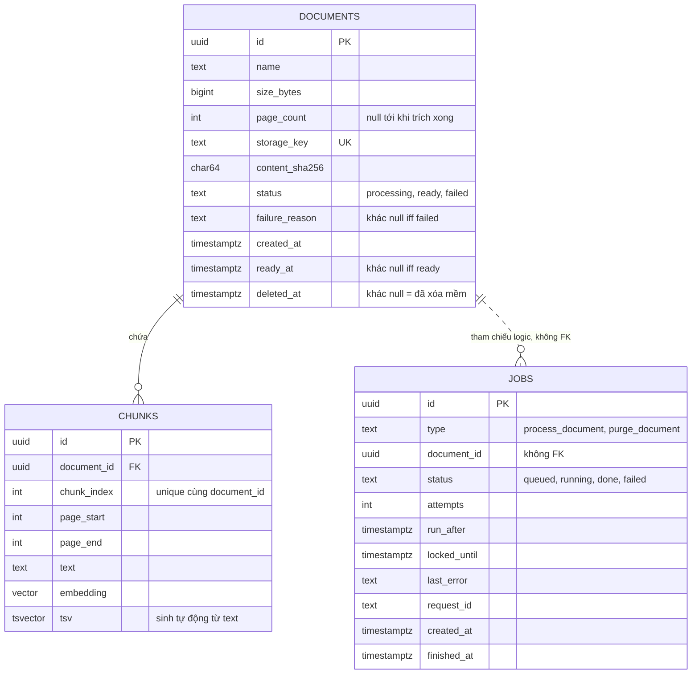

# Software Database Design — "Chat với tài liệu" (MVP)

> **Chuẩn áp dụng:** IEEE 1016-2009 (chủ yếu Information Viewpoint, kèm các viewpoint hỗ trợ). DDL thực thi: `schema.sql` (cùng thư mục).
> **Về prompt nguồn:** repo **không có** prompt "databaseDesign" (chỉ có `SAD_Prompt_IEEE_standard.md`, `bluePrint_design_prompt.md`, `apiDesign_prompt.md`). Tài liệu này dùng cùng khung với `apiDesign_prompt.md` (Context & Subject → Stakeholders & Concerns → Design Views → Traceability) và gắn vào các khung nhìn của IEEE 1016. Nếu bạn có prompt riêng, cần đối chiếu lại bố cục.
> **Đầu vào:** `SAD.md` §2.3, §3.1; `Blueprint_Design.md` §3.4; `API_Design.md` §3.4; `BRD.md` v0.6; `PRD.md` v0.6; `USER_STORIES.md`; sơ đồ use case (13 UC).
> **Nguồn chuẩn:** `schema.sql` cho cấu trúc; tài liệu này cho lý do thiết kế. Phần DDL trong `Blueprint_Design.md` đã được thay bằng con trỏ tới `schema.sql` để tránh lệch.
> **Ngôn ngữ:** Tiếng Việt; tên bảng/cột giữ tiếng Anh.
> **Quy ước:** `[TBD: OQ-xxx]` = chưa có thông tin. `[Đề xuất]` = lựa chọn của tác giả, chưa xác nhận. `[Unverified]` = chưa có nguồn hoặc chưa kiểm chứng.

---

## 1. Context & Subject

### 1.1 System Identification

| Attribute | Value |
|---|---|
| **System Name** | "Chat với tài liệu" (MVP) |
| **Document ID** | DB-CWD-001 |
| **Version** | 0.1 (Draft) |
| **Date** | 2026-10-27 |
| **Owner** | Lead Architect / DBA `[TBD: OQ-007]` |
| **DBMS** | PostgreSQL 16 + pgvector `[Đề xuất]` (ADR-02). Không dùng cơ sở dữ liệu thứ hai |

| Version | Date | Author | Changes |
|---|---|---|---|
| 0.1 | 2026-10-27 | Software Architect (do Claude soạn thảo) | Bản đầu tiên. `schema.sql` kiểm cú pháp bằng trình phân tích PostgreSQL (30 câu lệnh); chưa chạy trên máy chủ thật |

### 1.2 Phạm vi dữ liệu

| Hạng mục | Mô tả |
|---|---|
| **Mục đích** | Lưu siêu dữ liệu tài liệu, đoạn văn bản kèm vector và chỉ mục từ khóa, và hàng đợi việc nền, để phục vụ 13 use case (UC07–UC12, UC14–UC19, UC21) |
| **Trong CSDL** | `documents`, `chunks`, `jobs` (3 bảng) |
| **Ngoài CSDL** | PDF gốc (object storage, IF-03); cuộc trao đổi (trình duyệt, `sessionStorage`); nhật ký và số đo (hệ thống quan sát) |
| **Cố ý không có** | Người dùng, phiên, vai trò ứng dụng, hội thoại, nhật ký truy cập, nhật ký kiểm toán, số liệu sử dụng, chia sẻ — vì sơ đồ use case và BRD §5 loại khỏi MVP (CON-005, BRU-004). Thêm bảng cho các thứ này đòi hỏi bổ sung use case trước (RSK-006) |
| **Người truy cập CSDL** | Chỉ tiến trình `api` và `worker` (hai vai trò CSDL tách biệt, §4). Không có truy cập trực tiếp của người dùng |
| **Trust boundary** | Vùng Z4 (SAD §5.1). Không có đường ra Internet |

### 1.3 Assumptions and Constraints

| Type | Description |
|---|---|
| **Technical** | PostgreSQL ≥ 13; pgvector có chỉ mục HNSW; một nút chính, không bản sao đọc ở MVP. Số chiều vector `[TBD: OQ-S01]` |
| **Business** | Ngân sách `[TBD: OQ-003]`; pháp lý/vị trí dữ liệu `[TBD: OQ-005]`; không cam kết SLA hay RPO/RTO (BRD §5) |
| **Data volume** | Giả định định cỡ `[Đề xuất]`: ≤ 200 tài liệu × ≤ 100 trang ⇒ ≈ 40.000 đoạn; giới hạn thật `[TBD: OQ-001, OQ-009]` |
| **Retention** | Tài liệu giữ tới khi bị xóa; xóa vật lý sau ≈ 1 giờ; thời hạn tối đa theo chính sách `[TBD: OQ-005]`. Việc nền đã xong giữ 7 ngày `[Đề xuất]` |
| **Sensitivity** | `documents.name` và đặc biệt `chunks.text` có thể chứa thông tin nhạy cảm của tổ chức; mức độ `[TBD: OQ-005]`. Mặc định xem là **Nội bộ – có thể nhạy cảm** |
| **Language** | Cấu hình full-text `simple` cho tới khi chốt `[TBD: OQ-011]` |

---

## 2. Stakeholders & Concerns

### 2.1 Stakeholders

| Stakeholder | Quan tâm về dữ liệu |
|---|---|
| Người dùng (UC-P1, UC-P2) | Tài liệu đã tải không mất; xóa là hết; trả lời đúng nguồn/trang |
| CNTT / bảo mật (STK-003), chủ sở hữu tài liệu (STK-004) | Nơi lưu trữ, mã hóa, xóa thật sự, phạm vi truy cập vào dữ liệu |
| Developer | Lược đồ đơn giản, migration an toàn, kiểm thử được |
| AI/Data | Chỉ mục truy xuất đủ nhanh và đúng; đổi mô hình embedding được |
| DevOps/SRE / DBA | Sao lưu, khôi phục, dung lượng, bảo trì, chẩn đoán |
| QA | Dữ liệu mẫu, kiểm tra ràng buộc, kiểm tra xóa |

### 2.2 Stakeholder Concerns

| ID | Stakeholder | Concern | Priority | Acceptance Criteria |
|---|---|---|---|---|
| D-01 | Người dùng, STK-004 | Xóa có hiệu lực ngay trong tra cứu và xóa thật sau đó | High | AC-004: sau `DELETE`, 0 đoạn/tên của tài liệu đó trong kết quả; sau ≈ 1 giờ, 0 dòng trong `documents`, `chunks` và 0 đối tượng trong object storage |
| D-02 | Người dùng | Không có tài liệu "nửa vời" (đủ đoạn mới `ready`) | High | Ràng buộc `documents_ready_iff_time`; ghi đoạn và đặt `ready` trong một giao dịch |
| D-03 | AI/Data, Người dùng | Nguồn (tên, trang) luôn đúng | High | Nguồn lấy từ `chunks.page_start/page_end` và `documents.name` (G-L3); `page_start ≤ page_end` do ràng buộc |
| D-04 | AI/Data | Truy xuất lai đủ nhanh | High | Mỗi truy vấn ứng viên p95 ≤ 100 ms ở ≈ 40.000 đoạn `[Đề xuất, chưa đo]` |
| D-05 | Developer | Xử lý nền idempotent, không trùng đoạn | High | `UNIQUE (document_id, chunk_index)`; `jobs_active_uq`; kill worker giữa chừng → 0 đoạn trùng |
| D-06 | STK-003 | Quyền tối thiểu theo thành phần | High | Hai vai trò `cwd_api`, `cwd_worker` với quyền cột (§4) |
| D-07 | STK-003 | Mã hóa lưu trữ và truyền | High | Volume mã hóa; TLS tới CSDL (NFR-SEC-001/002; chuẩn `[TBD: OQ-P08]`) |
| D-08 | DevOps | Khôi phục khi mất dữ liệu | Medium | Sao lưu hằng ngày + khôi phục thử thành công (§5.2) |
| D-09 | Developer | Đổi mô hình embedding không mất dữ liệu gốc | Medium | `chunks` dựng lại được từ PDF gốc (§5.3) |
| D-10 | DevOps | Dung lượng và bảo trì dự đoán được | Medium | Ước lượng §3.5; theo dõi §6 |
| D-11 | QA | Dữ liệu sai bị chặn ở tầng CSDL | Medium | Ràng buộc CHECK/UNIQUE/FK; kiểm thử vi phạm từng ràng buộc |

### 2.3 Data Quality Attribute Scenarios

| ID | Attribute | Scenario (Source → Stimulus → Artifact → Response → Measure) |
|---|---|---|
| DQ-01 | **Integrity** | Worker chết giữa chừng khi ghi đoạn → `chunks`/`documents` → giao dịch rollback; việc quay lại hàng đợi; chạy lại → tài liệu `ready` với đoạn đủ, không trùng. Đo: 0 dòng trùng `(document_id, chunk_index)`; `ready` ⇒ đủ đoạn |
| DQ-02 | **Deletion consistency** | Người dùng `DELETE` đúng lúc worker sắp đặt `ready` → `documents` → khóa dòng tuần tự hóa hai việc; không bao giờ có tài liệu vừa xóa vừa `ready` mà vẫn được truy xuất. Đo: 100% truy vấn truy xuất loại tài liệu có `deleted_at` |
| DQ-03 | **Performance** | Một câu hỏi → hai truy vấn ứng viên (vector, FTS) → mỗi truy vấn p95 ≤ 100 ms ở ≈ 40.000 đoạn `[Đề xuất]` |
| DQ-04 | **Durability** | Mất ổ đĩa CSDL → khôi phục từ bản sao lưu gần nhất → mất tối đa dữ liệu kể từ bản sao lưu (không cam kết RPO); tài liệu gốc còn trong object storage → `chunks` dựng lại được |
| DQ-05 | **Security** | Lỗ hổng trong `api` bị khai thác → vai trò `cwd_api` → không thể ghi `chunks`, không thể xóa `documents`, chỉ cập nhật được `deleted_at` |
| DQ-06 | **Maintainability** | Đổi số chiều vector → migration theo quy trình (§5.3) → tài liệu `ready` vẫn truy xuất được trong lúc chuyển đổi |
| DQ-07 | **Backup/restore** | Khôi phục thử hằng quý `[Đề xuất]` → CSDL dựng lại, `GET /documents` khớp với object storage sau bước đối soát |

---

## 3. Design Views

### 3.1 Composition View (cấu trúc lược đồ)

**Concerns:** D-05, D-06, D-11.

| Đối tượng | Loại | Vai trò | Use case |
|---|---|---|---|
| `documents` | Bảng | Siêu dữ liệu tài liệu, trạng thái, xóa mềm | UC07, UC09, UC10, UC11, UC12, UC17 |
| `chunks` | Bảng | Đoạn văn bản + biên trang + vector + tsvector | UC09, UC15, UC16, UC18, UC19, UC21 |
| `jobs` | Bảng | Hàng đợi việc nền | UC09, UC12 |
| `documents_visible_idx` | Chỉ mục (một phần) | Liệt kê tài liệu chưa xóa | UC11 |
| `chunks_embedding_hnsw` | Chỉ mục HNSW | Tìm vector gần nhất | UC21 |
| `chunks_tsv_gin` | Chỉ mục GIN | Tìm từ khóa | UC21 |
| `jobs_queued_idx`, `jobs_running_idx`, `jobs_finished_idx`, `jobs_active_uq` | Chỉ mục (một phần) | Nhận việc, quét quá hạn, dọn dẹp, chống enqueue trùng | UC09, UC12 |
| `cwd_api`, `cwd_worker` | Vai trò nhóm | Quyền tối thiểu | — |
| Tiện ích `vector` | Extension | Kiểu `vector`, toán tử `<=>`, HNSW | UC21 |

Một lược đồ (`public`), không phân vùng (partition), không view, không thủ tục lưu trữ, không trigger. Logic nằm ở ứng dụng; CSDL chỉ bảo vệ bất biến bằng ràng buộc.

### 3.2 Logical View (mô hình dữ liệu)

**Concerns:** D-02, D-03, D-05.

**Quyết định mô hình hóa**

| Quyết định | Lý do | Thay thế đã loại |
|---|---|---|
| Xóa là **cờ** `deleted_at`, không phải giá trị của `status` | Trạng thái xử lý (`processing/ready/failed`) và việc đã xóa là hai chiều độc lập; tài liệu có thể bị xóa ở bất kỳ trạng thái nào mà không mất thông tin "đã `failed` hay `ready`" | Thêm `deleted` vào `status` (gộp hai chiều, khó viết ràng buộc `ready_iff_time`) |
| `jobs.document_id` **không** có FK | `purge_document` xóa dòng `documents` trong khi chính việc đó đang chạy; FK sẽ chặn hoặc cascade xóa mất việc | FK với `ON DELETE CASCADE` (mất bản ghi việc giữa chừng) |
| `chunks.document_id` có `ON DELETE CASCADE` | Xóa tài liệu phải kéo theo mọi đoạn, kể cả khi quy trình bị ngắt | Xóa tay từng bảng (dễ sót) |
| Không tách bảng `pages` | MVP chỉ cần biên trang của đoạn (`page_start/page_end`), không cần văn bản theo trang | Bảng `pages` (thêm kích thước, không use case nào cần) |
| Lưu `content_sha256` nhưng chưa `UNIQUE` | Chính sách tài liệu trùng chưa quyết định (OQ-014) | `UNIQUE (content_sha256)` (chặn sớm, có thể sai chính sách) |
| `text` thay vì enum PostgreSQL cho trạng thái | Thêm giá trị mới chỉ cần đổi CHECK; enum khó sửa trong giao dịch | `CREATE TYPE ... AS ENUM` |
| Khóa chính `uuid` sinh phía CSDL | Không đoán được (khóa API công khai trong URL); không cần phối hợp giữa các bản `api` | `bigserial` (lộ số lượng, đoán được) |

**Bất biến do CSDL bảo đảm**

| Bất biến | Cơ chế |
|---|---|
| Tài liệu `failed` có lý do, và chỉ tài liệu `failed` mới có lý do | `documents_failed_iff_reason` |
| Tài liệu `ready` có `ready_at`, và chỉ tài liệu `ready` mới có | `documents_ready_iff_time` |
| Khóa lưu trữ đúng dạng `documents/{uuid}.pdf` (chống path traversal) | `documents_key_format` |
| Tên tài liệu 1–255 ký tự; kích thước > 0; trang > 0 | `documents_name_len`, `documents_size_pos`, `documents_pages_pos` |
| Biên trang đoạn hợp lệ; không trùng chỉ số đoạn trong tài liệu | `chunks_pages_ok`, `chunks_doc_index_uq` |
| Mọi đoạn thuộc một tài liệu tồn tại | FK `chunks.document_id` |
| Việc `running` luôn có hạn khóa | `jobs_running_locked` |
| Tối đa một việc hoạt động cho mỗi (tài liệu, loại) | `jobs_active_uq` |

**Bất biến do ứng dụng bảo đảm (CSDL không kiểm được):** `ready` ⇒ tài liệu có ≥ 1 đoạn; số chiều vector đúng mô hình đang dùng; nguồn hiển thị chỉ lấy từ đoạn của tài liệu searchable (§3.4.2).

### 3.3 Dependency View

**Concerns:** D-05, D-09.

| Quan hệ | Chiều | Ghi chú |
|---|---|---|
| `chunks` → `documents` | FK, cascade | Xóa tài liệu kéo theo đoạn |
| `jobs` ⇢ `documents` | Logic | Không FK (§3.2) |
| PDF gốc ↔ `documents.storage_key` | Logic, ngoài CSDL | Không có ràng buộc tham chiếu giữa CSDL và object storage ⇒ cần đối soát (§5.4) |
| `chunks.embedding` → mô hình embedding | Dữ liệu dẫn xuất | Đổi mô hình = dựng lại toàn bộ cột (§5.3) |
| Chỉ mục HNSW/GIN → `chunks` | Chỉ mục | Xây lại được; HNSW tốn thời gian xây |
| Ứng dụng → pgvector | Phiên bản | Chọn phiên bản có HNSW; kiểm tra khi nâng cấp |

### 3.4 Information View

**Concerns:** D-01, D-03, D-04.

#### 3.4.1 Từ điển dữ liệu

**`documents`**

| Cột | Kiểu | Null | Mặc định | Ràng buộc | Mô tả | Ánh xạ API |
|---|---|---|---|---|---|---|
| `id` | uuid | Không | `gen_random_uuid()` | PK | Mã tài liệu | `Document.id` |
| `name` | text | Không | — | 1–255 ký tự | Tên hiển thị, đã làm sạch | `Document.name`, `Source.documentName` |
| `size_bytes` | bigint | Không | — | > 0 | Kích thước tệp | `Document.sizeBytes` |
| `page_count` | int | Có | — | > 0 | Số trang; điền khi trích xong | `Document.pageCount` |
| `storage_key` | text | Không | — | UNIQUE; đúng dạng `documents/{uuid}.pdf` | Khóa đối tượng trong IF-03 | (không lộ) |
| `content_sha256` | char(64) | Không | — | 64 ký tự hex thường | Băm nội dung | `ETag` của `GET file` |
| `status` | text | Không | — | `processing`/`ready`/`failed` | Trạng thái xử lý | `Document.status` |
| `failure_reason` | text | Có | — | 4 giá trị; khác null ⇔ `failed` | Lý do thất bại | `Document.failureReason` |
| `created_at` | timestamptz | Không | `now()` | — | Thời điểm nhận | `Document.createdAt` |
| `ready_at` | timestamptz | Có | — | khác null ⇔ `ready` | Thời điểm sẵn sàng | (không lộ) |
| `deleted_at` | timestamptz | Có | — | — | Thời điểm xóa mềm | (không lộ) |

**`chunks`**

| Cột | Kiểu | Null | Mặc định | Ràng buộc | Mô tả | Ánh xạ API |
|---|---|---|---|---|---|---|
| `id` | uuid | Không | `gen_random_uuid()` | PK | Mã đoạn (nội bộ) | (không lộ) |
| `document_id` | uuid | Không | — | FK → `documents`, cascade | Tài liệu chứa | `Source.documentId` |
| `chunk_index` | int | Không | — | ≥ 0; UNIQUE cùng `document_id` | Thứ tự đoạn | (không lộ) |
| `page_start`, `page_end` | int | Không | — | `1 ≤ page_start ≤ page_end` | Biên trang | `Source.pages` (gộp) |
| `text` | text | Không | — | không rỗng | Nội dung đoạn (nhạy cảm) | (không lộ) |
| `embedding` | vector(1536) | Không | — | `[TBD: OQ-S01]` | Vector | (không lộ) |
| `tsv` | tsvector | — | sinh tự động | `GENERATED ALWAYS … STORED` | Chỉ mục từ khóa | (không lộ) |

**`jobs`**

| Cột | Kiểu | Null | Mặc định | Ràng buộc | Mô tả |
|---|---|---|---|---|---|
| `id` | uuid | Không | `gen_random_uuid()` | PK | Mã việc |
| `type` | text | Không | — | `process_document`/`purge_document` | Loại việc |
| `document_id` | uuid | Không | — | Không FK | Tài liệu liên quan |
| `status` | text | Không | `'queued'` | `queued`/`running`/`done`/`failed` | Trạng thái |
| `attempts` | int | Không | 0 | ≥ 0 | Số lần đã nhận (tăng lúc `claim`) |
| `run_after` | timestamptz | Không | `now()` | — | Không chạy trước thời điểm này |
| `locked_until` | timestamptz | Có | — | khác null khi `running` | Hạn khóa của worker |
| `last_error` | text | Có | — | — | Lỗi kỹ thuật (không hiển thị cho người dùng) |
| `request_id` | text | Có | — | — | Nối truy vết với API |
| `created_at`, `finished_at` | timestamptz | Không / Có | `now()` / — | — | Mốc thời gian |

#### 3.4.2 Mẫu truy cập, chỉ mục và kế hoạch kỳ vọng

Mọi truy vấn dùng tham số liên kết. **Điều kiện "searchable"** = `documents.status = 'ready' AND documents.deleted_at IS NULL`, phải có trong **mọi** truy vấn đọc `chunks` (kể cả tra nguồn theo mã đoạn), vì xóa mềm có hiệu lực ngay còn xóa vật lý đến sau ≈ 1 giờ (D-01).

| # | Mẫu truy cập | Use case | Truy vấn | Chỉ mục | Tần suất |
|---|---|---|---|---|---|
| Q1 | Liệt kê tài liệu | UC11 | `SELECT … FROM documents WHERE deleted_at IS NULL ORDER BY created_at DESC` | `documents_visible_idx` | Cao (polling 2 s/người khi có `processing`) |
| Q2 | Đọc một tài liệu | UC09, UC10, UC17 | `… WHERE id = :id AND deleted_at IS NULL` | PK | Trung bình |
| Q3 | Ứng viên vector | UC21 | `… FROM chunks c JOIN documents d … WHERE searchable ORDER BY c.embedding <=> :q LIMIT :k` | `chunks_embedding_hnsw` (hoặc quét chính xác) | Mỗi câu hỏi |
| Q4 | Ứng viên từ khóa | UC21 | `… WHERE searchable AND c.tsv @@ to_tsquery('simple', :q) ORDER BY ts_rank_cd(…) DESC LIMIT :k` | `chunks_tsv_gin` | Mỗi câu hỏi |
| Q5 | Tra nguồn theo mã đoạn | UC15, UC16 | `… WHERE c.id = ANY(:ids) AND searchable` | PK `chunks` | Mỗi câu hỏi |
| Q6 | Tạo tài liệu + việc | UC07 | `INSERT documents …; INSERT jobs …` (một giao dịch) | — | Thấp |
| Q7 | Nhận việc | UC09, UC12 | `UPDATE jobs … WHERE id = (SELECT … FOR UPDATE SKIP LOCKED) RETURNING *` | `jobs_queued_idx` | Chu kỳ của worker |
| Q8 | Quét việc quá hạn khóa | UC09 | `UPDATE jobs SET status='queued' … WHERE status='running' AND locked_until < now()` | `jobs_running_idx` | 5 phút |
| Q9 | Ghi đoạn | UC09 | `INSERT INTO chunks … ON CONFLICT (document_id, chunk_index) DO NOTHING` | `chunks_doc_index_uq` | Theo tài liệu |
| Q10 | Xóa mềm + xếp purge | UC12 | `UPDATE documents SET deleted_at = now() WHERE id=:id AND deleted_at IS NULL; INSERT jobs … ON CONFLICT DO NOTHING` | PK, `jobs_active_uq` | Thấp |
| Q11 | Xóa vật lý | UC12 | `DELETE FROM documents WHERE id = :id` (cascade `chunks`) | PK, `chunks_doc_index_uq` | Theo tài liệu |
| Q12 | Dọn việc xong | — | `DELETE FROM jobs WHERE status IN ('done','failed') AND finished_at < now() - interval '7 days'` | `jobs_finished_idx` | Hằng ngày |

Câu SQL đầy đủ của Q3, Q4, Q7, Q8, Q9: `Blueprint_Design.md` §3.4.3 (Q5 phải thêm điều kiện searchable như bảng trên). **Chưa chạy `EXPLAIN` trên dữ liệu thật**; kế hoạch kỳ vọng: Q1 quét chỉ mục một phần; Q3 quét HNSW (hoặc quét chính xác khi cấu hình); Q4 quét GIN; Q7 quét `jobs_queued_idx` với khóa `SKIP LOCKED`.

#### 3.4.3 Phân loại dữ liệu

| Bảng.cột | Phân loại | Ghi chú |
|---|---|---|
| `documents.name` | Nội bộ, có thể nhạy cảm | Tên tệp có thể lộ tên khách hàng/hợp đồng |
| `chunks.text` | Nội bộ, **có thể nhạy cảm** | Nội dung tài liệu; gửi tới IF-02 khi xử lý và khi hỏi (OQ-005) |
| `chunks.embedding` | Nội bộ, nhạy cảm gián tiếp | Vector có thể bị đảo ngược một phần `[Unverified]`; đối xử như văn bản |
| `jobs.last_error` | Nội bộ, kỹ thuật | Không được chứa văn bản tài liệu; kiểm tra khi ghi |
| Còn lại | Nội bộ | — |

Không có dữ liệu cá nhân của người dùng (không đăng nhập). Tên tệp có thể chứa tên người `[Unverified]`.

#### 3.4.4 Vòng đời dữ liệu

| Dữ liệu | Tạo | Sửa | Xóa | Lưu giữ |
|---|---|---|---|---|
| `documents` | `POST /documents` | Worker (`status`, `page_count`, `ready_at`, `failure_reason`); API (`deleted_at`) | Worker `purge_document` | Tới khi xóa; tối đa `[TBD: OQ-005]` |
| `chunks` | Worker (một giao dịch với `ready`) | Không (xử lý lại = xóa rồi ghi lại trong cùng giao dịch) | Cascade khi xóa `documents` | Như trên |
| `jobs` | API (tải lên, xóa); worker (tự xếp lại khi thử lại) | Worker | Dọn 7 ngày sau khi xong | 7 ngày |
| PDF gốc | `POST /documents` | Không | `purge_document` (xóa **trước** dòng CSDL) | Như `documents` |

**Thứ tự xóa vật lý (quan trọng):** (1) xóa đối tượng trong object storage (idempotent); (2) `DELETE FROM documents` (cascade `chunks`); (3) đánh dấu việc `done`. Nếu bước 2 lỗi, dòng `documents` vẫn ở trạng thái xóa mềm và việc được thử lại, đối tượng xóa lại là vô hại. Nếu làm ngược lại (CSDL trước), sự cố giữa chừng để lại **tệp mồ côi** không còn tham chiếu.

#### 3.4.5 Rủi ro dữ liệu

| Rủi ro | Mô tả | Giảm thiểu |
|---|---|---|
| Lọc sau chỉ mục HNSW | Chỉ mục xấp xỉ có thể trả ít hơn `k` dòng khi điều kiện searchable loại nhiều dòng | Ở ≈ 40.000 đoạn quét chính xác chấp nhận được ⇒ cấu hình chọn chế độ; nếu dùng HNSW, tăng `hnsw.ef_search` (khởi điểm 100 `[Đề xuất]`) và dùng quét lặp của pgvector nếu phiên bản hỗ trợ `[Unverified]`. Kiểm thử DQ-02/QAS-11 với cả hai chế độ |
| Tuyên bố `ready` nhưng 0 đoạn | CSDL không kiểm được | Ứng dụng từ chối đặt `ready` khi 0 đoạn (chuyển `failed/NO_EXTRACTABLE_TEXT`); kiểm thử |
| Lệch CSDL ↔ object storage | Không có tham chiếu giữa hai kho | Đối soát định kỳ (§5.4) |
| Số chiều vector sai | Ghi vector khác số chiều ⇒ lỗi khi ghi | Kiểu `vector(N)` từ chối; kiểm thử khởi động đối chiếu số chiều mô hình |
| Cắt nội dung độc hại trong `text` | `tsvector` giới hạn kích thước 1 MB mỗi giá trị | Đoạn ≈ 600 token ≪ giới hạn; Chunker giới hạn cứng độ dài đoạn |

### 3.5 Physical / Resource View

**Concerns:** D-04, D-10.

#### 3.5.1 Ước lượng dung lượng (cho giả định §1.3)

| Đại lượng | Ước lượng | Cách tính / ghi chú |
|---|---|---|
| Số đoạn | ≈ 40.000 | 200 × 100 × ~2 |
| Vector | ≈ 246 MB | 40.000 × 1536 × 4 B |
| Văn bản đoạn | ≈ 100 MB | 40.000 × ~2,5 KB (600 token ≈ 2–3 KB văn bản) `[Unverified]` |
| `tsv` | ≈ 40–60 MB | `[Unverified]` |
| Chỉ mục HNSW | Cùng bậc với dữ liệu vector (vài trăm MB) | `[Unverified]` — đo thật |
| Chỉ mục GIN | Vài chục MB | `[Unverified]` — đo thật |
| `documents`, `jobs` | < 5 MB | — |
| **Tổng ước lượng** | Dưới ~1,5 GB | Đĩa 20 GB (SAD §5.2) dư nhiều lần |

#### 3.5.2 Tham số khởi điểm `[Đề xuất]` (máy chủ 2 vCPU / 4 GB)

| Tham số | Giá trị | Lý do |
|---|---|---|
| `shared_buffers` | 1 GB | ~25% RAM; toàn bộ tập làm việc vừa bộ nhớ đệm |
| `work_mem` | 16 MB | Sắp xếp nhỏ; số kết nối thấp |
| `maintenance_work_mem` | 256 MB | Xây chỉ mục HNSW/GIN |
| `max_connections` | ≥ (hồ bơi mỗi bản `api` × số bản + hồ bơi worker) + dự phòng | Mỗi bản `api` dùng hồ bơi 10 (Blueprint §3.8.2) |
| `hnsw.ef_search` | 100 | Cân bằng độ chính xác và tốc độ; hiệu chỉnh bằng DEP-002 |
| `idle_in_transaction_session_timeout` | 60 s | Tránh giữ khóa khi ứng dụng treo |
| `statement_timeout` | 30 s cho vai trò đăng nhập của `api` (worker đặt dài hơn cho lô ghi) | Chặn truy vấn chạy mãi; nhỏ hơn ngân sách 40 s của một câu hỏi. Đặt bằng `ALTER ROLE <vai trò đăng nhập> SET …`: cài đặt theo vai trò **không** kế thừa qua vai trò nhóm `cwd_api`/`cwd_worker` |

#### 3.5.3 Cấu hình an toàn

- Volume dữ liệu mã hóa; kết nối từ `api`/`worker` dùng TLS (chuẩn `[TBD: OQ-P08]`).
- Lắng nghe chỉ trên mạng vùng Z3–Z4; không công bố cổng ra ngoài.
- Mật khẩu vai trò đăng nhập từ bộ quản lý bí mật, xoay vòng được.

---

## 4. Truy cập và bảo mật dữ liệu

### 4.1 Vai trò và quyền

`schema.sql` tạo hai vai trò nhóm không đăng nhập; mỗi môi trường tạo vai trò đăng nhập và gán vào nhóm. Một vai trò thứ ba — chủ sở hữu lược đồ chạy migration — nằm ngoài ứng dụng và **không** được `api`/`worker` dùng.

| Đối tượng | `cwd_api` | `cwd_worker` |
|---|---|---|
| `documents` | SELECT, INSERT; UPDATE chỉ cột `deleted_at` | SELECT, DELETE; UPDATE cột `status`, `failure_reason`, `page_count`, `ready_at` |
| `chunks` | SELECT | SELECT, INSERT, DELETE |
| `jobs` | INSERT | SELECT, INSERT, UPDATE, DELETE |

| Rủi ro được chặn | Cơ chế |
|---|---|
| Lỗ hổng trong `api` bị lợi dụng để sửa/xóa nội dung đoạn hoặc xóa vật lý tài liệu | `cwd_api` không có INSERT/UPDATE/DELETE trên `chunks`, không DELETE trên `documents` |
| Lỗ hổng trong `worker` (xử lý PDF không tin cậy) để đọc dữ liệu ngoài phạm vi | `worker` chỉ có quyền trên 3 bảng; không phải chủ sở hữu; không tạo/sửa đối tượng |
| Nhận việc rồi không xử lý | `locked_until` + quét quá hạn |

Ghi chú: `SELECT … FOR UPDATE` trên `documents` của worker cần quyền UPDATE trên ít nhất một cột; đã được cấp bằng quyền cột. Việc kiểm thử quyền phải chạy mọi câu truy vấn Q1–Q12 bằng đúng vai trò thật, để bắt thiếu quyền sớm.

### 4.2 Chống tiêm SQL và dữ liệu không tin cậy

Mọi giá trị truyền vào bằng tham số liên kết. Chuỗi tsquery do ứng dụng dựng (`'a | b | c'`) từ từ khóa đã làm sạch (chỉ chữ/số, giới hạn số từ), không ghép trực tiếp từ câu hỏi. `jobs.last_error` không chứa văn bản tài liệu; khi lỗi PDF, chỉ ghi loại lỗi và vị trí kỹ thuật.

### 4.3 Không có kiểm toán

Không có bảng nhật ký truy cập/kiểm toán (BRD §5). Bù lại: CSDL `pg_stat_*` để chẩn đoán hiệu năng, và nhật ký ứng dụng có `requestId` (SAD §4.3) không chứa nội dung. Nếu CNTT/bảo mật yêu cầu kiểm toán ở OQ-005, phải thêm use case trước, rồi thiết kế bảng.

---

## 5. Giao dịch, đồng thời và vận hành dữ liệu

### 5.1 Giao dịch và khóa

Mức cô lập mặc định `READ COMMITTED`. Không dùng `SERIALIZABLE`: không có bất biến nào cần nó nhờ khóa dòng và ràng buộc.

| Giao dịch | Nội dung | Khóa / đồng thời |
|---|---|---|
| T1 Tải lên | `INSERT documents (processing)` + `INSERT jobs (process_document)` | Không xung đột; lỗi → rollback, API xóa đối tượng vừa ghi |
| T2 Nhận việc | Một câu `UPDATE … WHERE id = (SELECT … FOR UPDATE SKIP LOCKED) RETURNING` | `SKIP LOCKED` ⇒ nhiều worker không tranh một việc |
| T3 Hoàn tất xử lý | `SELECT … FROM documents WHERE id=:id FOR UPDATE`; nếu `deleted_at IS NOT NULL` → rollback và kết thúc việc; ngược lại `INSERT chunks … ON CONFLICT DO NOTHING` (lô), rồi `UPDATE documents SET status='ready', page_count, ready_at` | Khóa dòng `documents` tuần tự hóa với T4 |
| T4 Xóa mềm | `UPDATE documents SET deleted_at = now() WHERE id=:id AND deleted_at IS NULL`; `INSERT jobs (purge_document, run_after = now() + 1 giờ) ON CONFLICT DO NOTHING` | Chờ khóa dòng nếu T3 đang chạy |
| T5 Hỏi đáp | Chỉ đọc, mỗi truy vấn tự cam kết | Không khóa |
| T6 Xóa vật lý | (sau khi xóa đối tượng) `DELETE FROM documents WHERE id=:id`; việc `done` | Cascade `chunks` |

**Cuộc đua T3 ↔ T4:** nếu T4 chạy trước ⇒ T3 thấy `deleted_at` và dừng; nếu T3 chạy trước ⇒ tài liệu `ready` rồi mới bị xóa mềm, mọi truy vấn tiếp theo đã loại. Không có trạng thái "đã xóa nhưng vẫn truy xuất được" sau khi T4 cam kết (DQ-02).

**Cuộc đua hỏi đáp ↔ xóa:** giữa Q3/Q4 và Q5, tài liệu có thể bị xóa. Q5 lọc searchable nên chỉ mục trích dẫn của tài liệu vừa bị xóa bị loại; nếu không còn trích dẫn hợp lệ ⇒ `not_found` (SAD G-L2). Câu trả lời không bao giờ nêu tên tài liệu đã xóa mềm tại thời điểm Q5.

**Idempotency:** `chunks_doc_index_uq` + `ON CONFLICT DO NOTHING` (ghi lặp); `jobs_active_uq` + `ON CONFLICT DO NOTHING` (enqueue lặp); `deleted_at IS NULL` trong điều kiện xóa (xóa lặp).

### 5.2 Sao lưu và khôi phục

| Hạng mục | Quyết định `[Đề xuất]` | Ghi chú |
|---|---|---|
| Sao lưu CSDL | `pg_dump` (dạng custom) hằng ngày, giữ 7 bản | Đủ cho tải nhỏ; RPO tối đa ~24 giờ, **không cam kết** |
| Sao lưu PDF gốc | Bật versioning trên bucket | Nguồn dựng lại `chunks` |
| Khôi phục | Dựng CSDL từ bản dump → đối soát (§5.4) → với tài liệu `ready` mà thiếu đoạn thì xếp lại `process_document` | Thử khôi phục hằng quý (DQ-07) |
| Xóa trong bản sao lưu | Dữ liệu tài liệu đã xóa còn trong bản sao lưu tới hết vòng đời (7 ngày) | Phải ghi trong quy trình sự cố G11 và nêu cho CNTT (OQ-005) |
| PITR (WAL) | Không dùng ở MVP | Xem lại nếu RPO ~24 giờ không chấp nhận được |

### 5.3 Migration và thay đổi lược đồ

| Quy tắc | Nội dung |
|---|---|
| Công cụ | Alembic `[Đề xuất]`; revision `0001_init` = `schema.sql` |
| Tương thích | Mở rộng trước, thu hẹp sau: thêm cột/bảng tùy chọn trước, đổi mã, rồi mới bỏ cũ ở bản sau. Cần vì có lúc hai phiên bản `api`/`worker` cùng chạy (nâng cấp cuốn chiếu) |
| Chạy | Bước riêng trước khi triển khai ứng dụng, bằng vai trò chủ sở hữu; không tự chạy khi `api` khởi động |
| Chỉ mục lớn | `CREATE INDEX CONCURRENTLY` cho bảng đã có dữ liệu (ngoài giao dịch) |
| **Đổi mô hình embedding / số chiều** | (1) Thêm cột `embedding_v2 vector(N')` (cho phép NULL) và chỉ mục mới; (2) worker dựng lại đoạn cho từng tài liệu từ PDF gốc, ghi `embedding_v2`; (3) khi 100% tài liệu `ready` có `embedding_v2`, đổi truy xuất sang cột mới; (4) bỏ cột và chỉ mục cũ. Trong lúc chuyển, truy xuất dùng cột cũ nên không gián đoạn (DQ-06). Tốn chi phí gọi IF-02 cho toàn bộ kho |
| Đổi ngôn ngữ FTS | Tạo lại cột `tsv` với cấu hình mới (cột sinh tự động nên cần `ALTER … DROP/ADD`), rồi xây lại GIN |
| Quay lui | Mỗi migration có hướng đi ngược hoặc kế hoạch khôi phục từ sao lưu; migration phá vỡ chỉ chạy sau khi có sao lưu mới |

### 5.4 Đối soát CSDL ↔ object storage

Chạy định kỳ trong worker (chu kỳ quét tồn đọng, SAD §2.2.3) và sau khôi phục:

| Tình huống | Phát hiện | Xử lý |
|---|---|---|
| Đối tượng không có dòng `documents` (mồ côi) | Liệt kê khóa `documents/*` và so với `documents.storage_key` | Xóa nếu cũ hơn một ngưỡng (ví dụ 24 giờ) để không xóa nhầm tệp vừa ghi chưa cam kết giao dịch |
| Dòng `documents` không có đối tượng | `GET file`/xử lý báo không tìm thấy | Đánh dấu `failed/PROCESSING_ERROR`; cảnh báo vận hành |
| `ready` nhưng 0 đoạn | `SELECT d.id FROM documents d LEFT JOIN chunks c … HAVING count(c.id)=0` | Xếp lại `process_document` |

### 5.5 Bảo trì

| Việc | Tần suất `[Đề xuất]` | Ghi chú |
|---|---|---|
| `VACUUM`/`ANALYZE` | Autovacuum; `jobs` đặt ngưỡng sớm hơn trong `schema.sql` | Bảng `jobs` có nhiều cập nhật/xóa |
| Dọn `jobs` đã xong | Hằng ngày (Q12) | Giữ 7 ngày |
| `REINDEX` HNSW | Khi chất lượng truy xuất giảm sau nhiều lần xóa/chèn, hoặc theo khuyến nghị của pgvector `[Unverified]` | Đo recall bằng bộ DEP-002 trước/sau |
| Theo dõi | Xem §6 | — |

---

## 6. Quan sát CSDL

| Chỉ báo | Nguồn | Cảnh báo `[Đề xuất]` |
|---|---|---|
| Độ trễ Q3/Q4 | Số đo ứng dụng + `pg_stat_statements` `[Unverified: bật tiện ích]` | p95 > 100 ms kéo dài |
| Số việc `queued`, tuổi việc cũ nhất | `jobs` | > 10 phút |
| Việc `failed` | `jobs` | Tăng đột biến |
| Dung lượng bảng/chỉ mục | `pg_total_relation_size` | Đĩa > 80% |
| Kết nối | `pg_stat_activity` | Gần `max_connections` |
| Khóa chờ lâu | `pg_locks` / `pg_stat_activity` | Giao dịch chờ > vài giây |
| Dòng chết (bloat) của `jobs` | `pg_stat_user_tables` | `n_dead_tup` cao dai dẳng |

Không đưa nội dung `text`, `name` vào số đo hay nhật ký.

---

## 7. Truy vết

### 7.1 Mối quan tâm → phần tử dữ liệu

| Concern | Phần tử | Kiểm chứng |
|---|---|---|
| D-01 | `documents.deleted_at`; điều kiện searchable trong Q3–Q5; `purge_document` (Q10–Q11); thứ tự xóa §3.4.4 | AC-004; QAS-11 |
| D-02 | `documents_ready_iff_time`; T3 | DQ-01 |
| D-03 | `chunks.page_start/page_end`, `chunks_pages_ok`; nguồn từ Q5 | AC-007, AC-008 |
| D-04 | `chunks_embedding_hnsw`, `chunks_tsv_gin`; tham số §3.5.2 | DQ-03 (cần đo) |
| D-05 | `chunks_doc_index_uq`, `jobs_active_uq`, `ON CONFLICT DO NOTHING`, `SKIP LOCKED` | DQ-01; kill worker |
| D-06 | Vai trò `cwd_api`, `cwd_worker`, quyền cột | DQ-05; kiểm thử quyền |
| D-07 | Mã hóa volume, TLS | NFR-SEC-001/002; G9 |
| D-08 | Sao lưu §5.2 | DQ-04, DQ-07 |
| D-09 | `chunks` dẫn xuất; quy trình §5.3 | DQ-06 |
| D-10 | Ước lượng §3.5.1; quan sát §6 | Đo thật |
| D-11 | Mọi CHECK/UNIQUE/FK ở §3.2 | Kiểm thử vi phạm từng ràng buộc |

### 7.2 Yêu cầu và use case → dữ liệu

| BR / US | UC | Bảng / cột | Ràng buộc / chỉ mục chính |
|---|---|---|---|
| BR-001, BR-005 / US-001 | UC07, UC08 | `documents.size_bytes`, `storage_key`, `name` | `documents_size_pos`, `documents_key_format` |
| BR-002 / US-002 | UC09 | `documents.status`, `ready_at`; `chunks` | `documents_ready_iff_time` |
| BR-018 / US-003 | UC10 | `documents.failure_reason` | `documents_failed_iff_reason`, `documents_reason_enum` |
| BR-003 / US-004 | UC11 | `documents` | `documents_visible_idx` |
| BR-004 / US-005 | UC12 | `documents.deleted_at`; `jobs` (purge); `chunks` cascade | Điều kiện searchable; `jobs_active_uq` |
| BR-006, BR-009 / US-006, US-009 | UC14, UC18, UC21 | `chunks.embedding`, `tsv`, `document_id` | HNSW, GIN |
| BR-007 / US-007 | UC15 | `documents.name`, `chunks.document_id` | FK |
| BR-008 / US-008 | UC16, UC17 | `chunks.page_start/page_end`; `documents.storage_key` | `chunks_pages_ok` |
| BR-010 / US-010 | UC19 | (không lưu; kết quả từ truy xuất + ngưỡng) | — |
| BR-016 / US-015 | UC09 | `documents.storage_key` (vị trí thực do IF-03/OQ-005) | — |

Cả 13 use case đều có dữ liệu hỗ trợ; UC14–UC19, UC21 không ghi dữ liệu nào (đường hỏi đáp chỉ đọc).

---

## 8. Câu hỏi mở ảnh hưởng dữ liệu

| ID | Câu hỏi | Ảnh hưởng |
|---|---|---|
| OQ-S01 | Mô hình embedding, số chiều | `vector(N)`, dung lượng, chi phí |
| OQ-005 | Nơi lưu trữ, lưu giữ tối đa, kiểm toán, nhạy cảm | Vị trí CSDL, mã hóa, thời gian giữ sao lưu, có cần bảng kiểm toán |
| OQ-009 | Giới hạn kích thước/số tài liệu | Định cỡ (§3.5.1) |
| OQ-011 | Ngôn ngữ | Cấu hình FTS, mô hình embedding |
| OQ-014 | Tài liệu trùng | `UNIQUE (content_sha256)` hay không |
| OQ-P08 | Chuẩn mã hóa | §3.5.3 |
| OQ-S02 | Nền tảng chạy | Cách triển khai PostgreSQL (container, dịch vụ quản lý) và sao lưu |
| (mới) OQ-D01 | CNTT có chấp nhận dữ liệu đã xóa còn trong sao lưu tới 7 ngày? | §5.2 |

## 9. Mức sẵn sàng

**Not ready** để khóa lược đồ.

- **Đã kiểm chứng:** `schema.sql` phân tích cú pháp thành công bằng trình phân tích PostgreSQL (30 câu lệnh); mọi cột trong chỉ mục và cấp quyền cột đều tồn tại.
- **Chưa kiểm chứng:** chưa chạy trên máy chủ PostgreSQL/pgvector thật (chưa biết hành vi HNSW khi lọc, kích thước chỉ mục, quyền thực tế), chưa có `EXPLAIN`, chưa thử khôi phục; mọi con số `[Đề xuất]`/`[Unverified]` cần đo.
- **Chặn:** OQ-S01 (số chiều vector), OQ-005 (lưu giữ, kiểm toán, vị trí).
- **Việc kế tiếp:** chạy `schema.sql` trên PostgreSQL + pgvector thật, nạp dữ liệu mẫu (DEP-002), đo Q3/Q4 và kiểm thử quyền theo vai trò.
