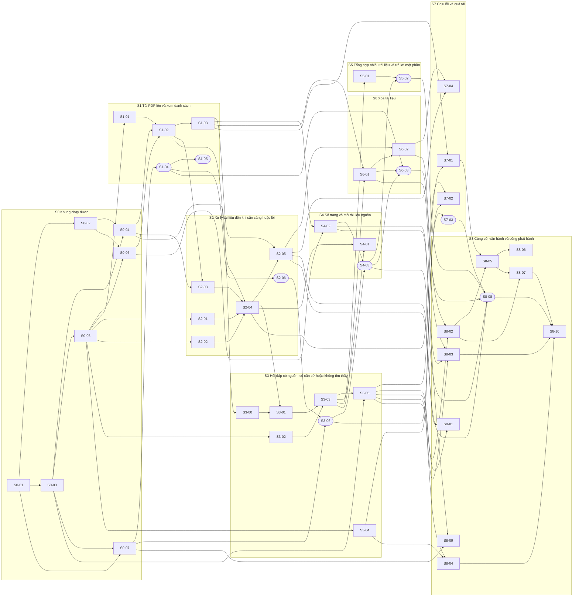

# PLAN — Kế hoạch triển khai "Chat với tài liệu" (MVP)

> **Phiên bản:** 0.1 (Draft) — 2026-10-27
> **Đầu vào:** `docs/04-design/SAD.md`, `docs/03-analysis/USER_STORIES.md`; chi tiết lấy từ `Blueprint_Design.md`, `API_Design.md` + `openapi.yaml`, `Database_Design.md` + `schema.sql`, `html_design/`, `docs/diagrams/use-case-diagram.drawio` (13 use case).
> **Kết quả:** 47 task trong `tasks/` (12 cỡ S, 35 cỡ M), xếp trong 9 lát cắt dọc và 5 mốc.
> **Quy ước:** `[TBD: OQ-xxx]` = chưa có thông tin. `[Đề xuất]` = lựa chọn của tác giả kế hoạch, chưa xác nhận. ⚠ = task bị chặn một phần bởi câu hỏi mở (xem §8).

---

## 1. Mục đích và cách dùng

Kế hoạch chia sản phẩm thành **lát cắt dọc**: mỗi lát cắt đi qua mọi tầng (giao diện, API, lõi nghiệp vụ, CSDL, worker) và để lại một hành vi người dùng **nhìn thấy và chạy được**, thay vì xây từng tầng riêng. Mỗi lát cắt gồm các task nhỏ (cỡ S hoặc M) để một agent hoàn thành trong vài vòng lặp, với tiêu chí hoàn thành kiểm tra được bằng lệnh.

Cách dùng với agent:

1. Chọn task có mọi phụ thuộc đã xong (§6 gợi ý thứ tự; hai đường Server và Web chạy song song được).
2. Đưa cho agent **một** tệp `tasks/<ID>-….md` kèm `PLAN.md` §2–§3.
3. Agent làm theo các bước, chạy tiêu chí hoàn thành, báo cáo kết quả thật.
4. Đánh dấu trạng thái trong tệp task; cập nhật tài liệu thiết kế nếu hợp đồng đổi (§2.3).

## 2. Quy trình làm việc cho mỗi task

### 2.1 Trước khi bắt đầu
- Đọc mục **Đọc trước** của task. Xác nhận các task phụ thuộc đã xong (chạy `make check` trên nhánh nền).
- Mọi giá trị `[TBD]` phải đến từ **cấu hình** (`Settings`/`GET /config`); **không** tự điền số cho OQ chưa quyết định.
- Chỉ làm đúng phạm vi task. Phát hiện việc cần thiết ngoài phạm vi: ghi vào mô tả PR, không tự làm.

### 2.2 Trong khi làm
- Viết test từ **Tiêu chí hoàn thành** trước hoặc cùng lúc với mã.
- Giữ ranh giới phụ thuộc (Blueprint §3.3.1); `make check` chạy kiểm tra import.
- Văn bản của người dùng, tài liệu và LLM **không bao giờ** vào log hay nhãn số đo (SAD §4.1, §4.3).
- Không thêm tính năng ngoài 13 use case: đăng nhập, quản trị, nhật ký truy cập, số liệu sử dụng, hỏi tiếp nối, chia sẻ (BRD §5).

### 2.3 Đồng bộ tài liệu thiết kế
Khi đổi hợp đồng, sửa **cùng thay đổi**: `openapi.yaml` (API), `schema.sql` + migration (CSDL), `API_Design.md`/`Database_Design.md`/`Blueprint_Design.md` (lý do/tóm tắt), `web/src/api-client/generated.ts` (chạy lại `npm run gen:api`). `make contract` (S8-03) bắt phần lệch.

### 2.4 Truy vết trong test
- Server: `@pytest.mark.req("US-001-AC2")` cho test chứng minh tiêu chí đó.
- Web: đặt mã trong tên test, ví dụ `it("[US-005-AC1] xóa xong dòng biến mất", …)`.
- `make trace` (S8-10) liệt kê AC chưa có test.

### 2.5 Định nghĩa hoàn thành (Definition of Done)
- [ ] Mọi mục trong **Tiêu chí hoàn thành** của task đã đạt và có bằng chứng (lệnh + kết quả).
- [ ] `make check` xanh; `make test-int` xanh nếu có kiểm thử tích hợp.
- [ ] Không còn `TODO` không gắn mã task; không còn mã gỡ lỗi; không có bí mật trong mã/log.
- [ ] Tài liệu thiết kế liên quan đã đồng bộ (§2.3).
- [ ] Báo cáo trung thực: đã chạy gì, kết quả, và điều **chưa** kiểm tra được.

### 2.6 Cỡ task
- **S**: 1–3 vòng lặp, ≤ ~150 dòng thay đổi, ≤ 4 tệp.
- **M**: 3–6 vòng lặp, ≤ ~400 dòng thay đổi, ≤ 8 tệp, ≤ 6 bước.
- Task vượt cỡ M trong khi làm: dừng, tách phần còn lại thành task mới (đặt ID kế tiếp trong lát cắt) rồi tiếp tục.

### 2.7 Khi bị chặn
Task có “Bị chặn bởi” vẫn làm được phần mã dùng giá trị mặc định/cấu hình ghi trong task; **không** được coi là hoàn thành về nghiệp vụ cho tới khi OQ đóng (§8). Ghi trạng thái “Xong về mã, chờ OQ-xxx”.

## 3. Quyết định kỹ thuật cố định cho triển khai

Các lựa chọn dưới đây là `[Đề xuất]` kế thừa từ SAD/Blueprint. Nếu Tech Lead bác bỏ, sửa S0-01 và phần tương ứng; các task sau dùng `make` nên ít bị ảnh hưởng.

| Hạng mục | Quyết định | Nguồn |
|---|---|---|
| Server | Python ≥ 3.11, FastAPI, endpoint **đồng bộ** (`def`) | SAD §2.2; chọn đồng bộ để worker và API dùng chung mã, đơn giản cho agent |
| CSDL | PostgreSQL + pgvector; SQLAlchemy 2 (đồng bộ) + Alembic; trình điều khiển psycopg 3 | SAD ADR-02; `schema.sql` |
| Hàng đợi | Bảng `jobs`, `FOR UPDATE SKIP LOCKED` | SAD ADR-03 |
| Kho tệp | Tương thích S3 (MinIO khi dev), boto3 | SAD §2.3 |
| AI | `LlmPort`; adapter HTTP tương thích OpenAI + `FakeLlm` cho kiểm thử | SAD ADR-05; S3-04 |
| PDF | PyMuPDF sau `PdfExtractorPort`, chạy trong tiến trình con | Blueprint §3.3.2; xem rủi ro giấy phép §9 |
| Web | React + TypeScript + Vite, TanStack Query, CSS thường với token từ `html_design`; MSW + vitest | Blueprint §3.1; `html_design` |
| Kiểu API phía web | Sinh từ `openapi.yaml` | API_Design §2.5 |
| Kiểm thử | pytest (unit / integration / api / contract), vitest, Playwright + axe | Blueprint §2.3 |
| Chạy | Docker Compose; Kubernetes chờ `[TBD: OQ-S02]` | SAD §5.1 |
| Phạm vi | Đúng 13 use case; không đăng nhập (CON-005) | use-case-diagram.drawio |

## 4. Cấu trúc repo (thư mục gốc dự án `chat_with_document/`)

```text
chat_with_document/
├── Makefile                  # setup, check, test-int, contract, e2e, eval, trace, up, down, migrate
├── .env.example
├── docs/                     # tài liệu (đã có), docs/05-implement/ là thư mục này
├── server/
│   ├── pyproject.toml, alembic.ini
│   ├── cwd_server/           # package: api/ core/{documents,ingestion,retrieval,answer,guard} ports/ adapters/ persistence/ worker/ platform/
│   └── tests/{unit,integration,api,contract,support,fixtures}/
├── web/                      # SPA: src/{features,state,api-client,components,app}
├── eval/                     # bộ đánh giá chất lượng AI
├── e2e/                      # Playwright
└── deploy/                   # compose.dev/prod, Dockerfile.*, proxy/, backup/restore, DATA_LOCATION.md
```

Cây này khớp Blueprint §3.1.2; chỉ khác là package Python đặt tên `cwd_server` nằm trong `server/`.

## 5. Lát cắt dọc và mốc

| Lát cắt | Mốc | Tên | Mục tiêu | Demo được | Task |
|---|---|---|---|---|---|
| **S0** | M0 | Khung chạy được (walking skeleton) | `docker compose up` chạy PostgreSQL + object storage; server trả `GET /api/v1/config`, `/healthz`; web hiện khung ứng dụng và đọc được `/config`. | Mở trang web, thấy khung hai vùng và dòng lưu ý dữ liệu; `curl /api/v1/config` trả JSON. | [S0-01](tasks/S0-01-khoi-tao-repo-cong-cu-va-quy-uoc-kiem-thu.md), [S0-02](tasks/S0-02-moi-truong-dev-bang-docker-compose.md), [S0-03](tasks/S0-03-nen-tang-server-cau-hinh-log-loi-problem.md), [S0-04](tasks/S0-04-csdl-migration-0001-phien-lam-viec-va-kiem.md), [S0-05](tasks/S0-05-kieu-mien-cong-ports-adapter-gia-va.md), [S0-06](tasks/S0-06-adapter-object-storage-s3-va-quy-tac-phu.md), [S0-07](tasks/S0-07-khung-web-app-shell-token-thiet-ke-va-api.md) |
| **S1** | M1 | Tải PDF lên và xem danh sách (UC07, UC08, UC11) | Người dùng chọn PDF, thấy bị từ chối nếu sai, hoặc thấy tài liệu xuất hiện ở trạng thái “đang xử lý”. | Tải một PDF → dòng mới xuất hiện “Đang xử lý”; tải `.docx` → báo lỗi, không có dòng. | [S1-01](tasks/S1-01-kiem-tra-tep-tai-len-uc08-kich-thuoc-duoi.md), [S1-02](tasks/S1-02-documentrepository-jobrepository-enqueue-va.md), [S1-03](tasks/S1-03-api-tai-lieu-post-documents-get-documents.md), [S1-04](tasks/S1-04-web-danh-sach-tai-lieu-huy-hieu-trang-thai.md), [S1-05](tasks/S1-05-web-tai-len-chon-tep-keo-tha-tien-do-huy-tu.md) |
| **S2** | M1 | Xử lý tài liệu đến khi sẵn sàng hoặc lỗi (UC09, UC10) | Worker biến tài liệu thành đoạn có vector; giao diện báo “Sẵn sàng” hoặc lý do lỗi. | Tải PDF hợp lệ → vài giây sau “Sẵn sàng”; tải PDF có mật khẩu → “Tệp có mật khẩu.” | [S2-01](tasks/S2-01-pdfextractor-pymupdf-chay-trong-tien-trinh.md), [S2-02](tasks/S2-02-chunker-chia-doan-600-token-chong-100-giu.md), [S2-03](tasks/S2-03-hang-doi-viec-nen-claim-complete-fail-sweep.md), [S2-04](tasks/S2-04-ingestionservice-process-tu-pdf-den-doan-co.md), [S2-05](tasks/S2-05-worker-entrypoint-vong-quet-tat-em-va-kiem.md), [S2-06](tasks/S2-06-web-ly-do-loi-thong-bao-san-sang-trang-thai.md) |
| **S3** | M2 | Hỏi đáp có nguồn: có căn cứ hoặc không tìm thấy (UC14, UC15, UC19, UC21) | Người dùng đặt câu hỏi và nhận câu trả lời kèm tên tài liệu nguồn, hoặc “không tìm thấy”. | Hỏi một câu có trong tài liệu → câu trả lời + nguồn; hỏi câu ngoài tài liệu → “Không tìm thấy thông tin…”. | [S3-00](tasks/S3-00-spike-hnsw-so-voi-quet-chinh-xac-khi-co.md), [S3-01](tasks/S3-01-chunkrepository-retrievalservice-vector-tu.md), [S3-02](tasks/S3-02-loi-nhac-schema-dau-ra-llm-va.md), [S3-03](tasks/S3-03-answerservice-g-l1-goi-llm-g-l2-dung-nguon.md), [S3-04](tasks/S3-04-adapter-llmport-qua-http-tuong-thich-openai.md), [S3-05](tasks/S3-05-api-post-questions.md), [S3-06](tasks/S3-06-web-khung-hoi-dap-trang-thai-cho-ba-loai.md) |
| **S4** | M2 | Số trang và mở tài liệu nguồn (UC16, UC17) | Nguồn có số trang đúng; bấm nguồn mở PDF ở thẻ mới đúng trang. | Bấm chip nguồn → thẻ mới mở PDF tại trang được nêu. | [S4-01](tasks/S4-01-kiem-thu-dau-cuoi-so-trang-dung-va-gop.md), [S4-02](tasks/S4-02-api-get-documents-id-file-phat-pdf-range.md), [S4-03](tasks/S4-03-web-nguon-dang-chip-va-mo-tai-lieu-nguon-o.md) |
| **S5** | M3 | Tổng hợp nhiều tài liệu và trả lời một phần (UC18, UC19) | Một câu hỏi lấy thông tin từ ≥ 2 tài liệu; phần không có căn cứ được nêu rõ. | Hỏi câu cần 2 tài liệu → một câu trả lời, hai nguồn; mâu thuẫn được nêu rõ. | [S5-01](tasks/S5-01-backend-tong-hop-nhieu-tai-lieu-mau-thuan.md), [S5-02](tasks/S5-02-web-hien-thi-tra-loi-mot-phan-va-nhieu-nguon.md) |
| **S6** | M3 | Xóa tài liệu (UC12) | Xóa có xác nhận, hiệu lực ngay trong tra cứu, xóa vật lý sau đó. | Xóa tài liệu → biến khỏi danh sách; hỏi lại không còn nội dung của nó; nguồn cũ ghi “(đã xóa)”. | [S6-01](tasks/S6-01-xoa-mem-documentservice-delete-api-delete.md), [S6-02](tasks/S6-02-handler-purge-document-va-cuoc-dua-xu-ly-xoa.md), [S6-03](tasks/S6-03-web-hop-thoai-xac-nhan-xoa-nguon-da-xoa-va.md) |
| **S7** | M4 | Chịu lỗi và quá tải | Lỗi AI/kho lưu trữ/quá tải được xử lý có kiểm soát; người dùng không mất câu hỏi hay tài liệu. | Tắt dịch vụ AI → báo lỗi rõ + “Gửi lại”; tài liệu vẫn xem/xóa được. | [S7-01](tasks/S7-01-loadguard-va-gioi-han-toc-do-o-ung-dung.md), [S7-02](tasks/S7-02-chiu-loi-cho-llmport-timeout-retry-co-lui.md), [S7-03](tasks/S7-03-web-xu-ly-loi-hoi-dap-theo-scr-05-thu-lai.md), [S7-04](tasks/S7-04-loi-kho-luu-tru-va-doi-soat-tep-mo-coi.md) |
| **S8** | M4 | Củng cố, vận hành và cổng phát hành | Quan sát, bảo mật, kiểm thử hợp đồng/E2E, đánh giá chất lượng AI, đóng gói triển khai, bằng chứng cho cổng G1–G13. | Chạy được toàn bộ bộ kiểm thử và triển khai theo runbook. | [S8-01](tasks/S8-01-quan-sat-log-khong-noi-dung-metrics-readyz.md), [S8-02](tasks/S8-02-vai-tro-csdl-toi-thieu-va-kiem-thu-quyen.md), [S8-03](tasks/S8-03-bo-kiem-thu-hop-dong-theo-openapi-yaml.md), [S8-04](tasks/S8-04-bo-danh-gia-chat-luong-ai-eval-tap-cau-hoi.md), [S8-05](tasks/S8-05-dong-goi-dockerfile-compose-san-xuat-tat-em.md), [S8-06](tasks/S8-06-reverse-proxy-tls-tieu-de-bao-mat-gioi-han.md), [S8-07](tasks/S8-07-sao-luu-khoi-phuc-runbook-va-cau-hinh-vi.md), [S8-08](tasks/S8-08-kiem-thu-e2e-playwright-va-kiem-tra-tiep.md), [S8-09](tasks/S8-09-trang-tai-lieu-khong-con-ton-tai-khi-mo.md), [S8-10](tasks/S8-10-bang-chung-cong-phat-hanh-g1-g13-va-bao-cao.md) |

| Mốc | Ý nghĩa | Lát cắt |
|---|---|---|
| **M0** | Khung chạy được | S0 |
| **M1** | Tài liệu vào kho (US-001…US-004) | S1, S2 |
| **M2** | Hỏi đáp có nguồn — lõi của MVP (US-006, US-007, US-008, US-010) | S3, S4 |
| **M3** | Đủ 13 use case (thêm US-009, US-005) | S5, S6 |
| **M4** | Bền vững và sẵn sàng phát hành | S7, S8 |

**Quy tắc xếp thứ tự:** mỗi mốc để lại sản phẩm chạy được; M2 là “lõi của MVP” (tải PDF → hỏi → câu trả lời có nguồn). Các lát cắt S5–S8 chỉ thêm vào, không làm hỏng hành vi đã có (mỗi task giữ `make check` xanh).

## 6. Phụ thuộc và thứ tự gợi ý

Hình bầu dục = task phía web; hình chữ nhật = server/hạ tầng.



**Thứ tự gợi ý** (hàng = mức phụ thuộc; mọi task trên cùng hàng làm song song được; hai đường độc lập):

| Mức | Server / hạ tầng | Web |
|---|---|---|
| 1 | [S0-01](tasks/S0-01-khoi-tao-repo-cong-cu-va-quy-uoc-kiem-thu.md) | — |
| 2 | [S0-02](tasks/S0-02-moi-truong-dev-bang-docker-compose.md), [S0-03](tasks/S0-03-nen-tang-server-cau-hinh-log-loi-problem.md) | — |
| 3 | [S0-04](tasks/S0-04-csdl-migration-0001-phien-lam-viec-va-kiem.md), [S0-05](tasks/S0-05-kieu-mien-cong-ports-adapter-gia-va.md), [S0-07](tasks/S0-07-khung-web-app-shell-token-thiet-ke-va-api.md) | — |
| 4 | [S0-06](tasks/S0-06-adapter-object-storage-s3-va-quy-tac-phu.md), [S1-01](tasks/S1-01-kiem-tra-tep-tai-len-uc08-kich-thuoc-duoi.md), [S2-01](tasks/S2-01-pdfextractor-pymupdf-chay-trong-tien-trinh.md), [S2-02](tasks/S2-02-chunker-chia-doan-600-token-chong-100-giu.md), [S3-00](tasks/S3-00-spike-hnsw-so-voi-quet-chinh-xac-khi-co.md), [S3-02](tasks/S3-02-loi-nhac-schema-dau-ra-llm-va.md), [S3-04](tasks/S3-04-adapter-llmport-qua-http-tuong-thich-openai.md) | [S1-04](tasks/S1-04-web-danh-sach-tai-lieu-huy-hieu-trang-thai.md) |
| 5 | [S1-02](tasks/S1-02-documentrepository-jobrepository-enqueue-va.md) | [S1-05](tasks/S1-05-web-tai-len-chon-tep-keo-tha-tien-do-huy-tu.md), [S2-06](tasks/S2-06-web-ly-do-loi-thong-bao-san-sang-trang-thai.md) |
| 6 | [S1-03](tasks/S1-03-api-tai-lieu-post-documents-get-documents.md), [S2-03](tasks/S2-03-hang-doi-viec-nen-claim-complete-fail-sweep.md) | [S3-06](tasks/S3-06-web-khung-hoi-dap-trang-thai-cho-ba-loai.md) |
| 7 | [S2-04](tasks/S2-04-ingestionservice-process-tu-pdf-den-doan-co.md), [S4-02](tasks/S4-02-api-get-documents-id-file-phat-pdf-range.md) | [S7-03](tasks/S7-03-web-xu-ly-loi-hoi-dap-theo-scr-05-thu-lai.md) |
| 8 | [S2-05](tasks/S2-05-worker-entrypoint-vong-quet-tat-em-va-kiem.md), [S3-01](tasks/S3-01-chunkrepository-retrievalservice-vector-tu.md), [S7-02](tasks/S7-02-chiu-loi-cho-llmport-timeout-retry-co-lui.md), [S8-09](tasks/S8-09-trang-tai-lieu-khong-con-ton-tai-khi-mo.md) | [S4-03](tasks/S4-03-web-nguon-dang-chip-va-mo-tai-lieu-nguon-o.md) |
| 9 | [S3-03](tasks/S3-03-answerservice-g-l1-goi-llm-g-l2-dung-nguon.md) | — |
| 10 | [S3-05](tasks/S3-05-api-post-questions.md), [S4-01](tasks/S4-01-kiem-thu-dau-cuoi-so-trang-dung-va-gop.md), [S5-01](tasks/S5-01-backend-tong-hop-nhieu-tai-lieu-mau-thuan.md), [S6-01](tasks/S6-01-xoa-mem-documentservice-delete-api-delete.md) | — |
| 11 | [S6-02](tasks/S6-02-handler-purge-document-va-cuoc-dua-xu-ly-xoa.md), [S7-01](tasks/S7-01-loadguard-va-gioi-han-toc-do-o-ung-dung.md), [S8-01](tasks/S8-01-quan-sat-log-khong-noi-dung-metrics-readyz.md), [S8-03](tasks/S8-03-bo-kiem-thu-hop-dong-theo-openapi-yaml.md), [S8-04](tasks/S8-04-bo-danh-gia-chat-luong-ai-eval-tap-cau-hoi.md) | [S5-02](tasks/S5-02-web-hien-thi-tra-loi-mot-phan-va-nhieu-nguon.md), [S6-03](tasks/S6-03-web-hop-thoai-xac-nhan-xoa-nguon-da-xoa-va.md) |
| 12 | [S7-04](tasks/S7-04-loi-kho-luu-tru-va-doi-soat-tep-mo-coi.md), [S8-02](tasks/S8-02-vai-tro-csdl-toi-thieu-va-kiem-thu-quyen.md) | [S8-08](tasks/S8-08-kiem-thu-e2e-playwright-va-kiem-tra-tiep.md) |
| 13 | [S8-05](tasks/S8-05-dong-goi-dockerfile-compose-san-xuat-tat-em.md) | — |
| 14 | [S8-06](tasks/S8-06-reverse-proxy-tls-tieu-de-bao-mat-gioi-han.md), [S8-07](tasks/S8-07-sao-luu-khoi-phuc-runbook-va-cau-hinh-vi.md) | — |
| 15 | [S8-10](tasks/S8-10-bang-chung-cong-phat-hanh-g1-g13-va-bao-cao.md) | — |

Web dùng MSW theo `openapi.yaml` nên có thể đi trước server một nhịp; nghiệm thu tích hợp khi cả hai phía đã xong.

## 7. Ma trận phủ yêu cầu

Kiểm tra tự động khi sinh kế hoạch: **mọi** user story (11), mọi tiêu chí AC của story (23) và mọi use case (13) có ít nhất một task. ⚠ = task bị chặn một phần.

### 7.1 Use case → task

| Use case | Task |
|---|---|
| UC07 | [S1-02](tasks/S1-02-documentrepository-jobrepository-enqueue-va.md), [S1-03](tasks/S1-03-api-tai-lieu-post-documents-get-documents.md), [S1-05](tasks/S1-05-web-tai-len-chon-tep-keo-tha-tien-do-huy-tu.md) |
| UC08 | [S1-01](tasks/S1-01-kiem-tra-tep-tai-len-uc08-kich-thuoc-duoi.md), [S1-05](tasks/S1-05-web-tai-len-chon-tep-keo-tha-tien-do-huy-tu.md) |
| UC09 | [S1-04](tasks/S1-04-web-danh-sach-tai-lieu-huy-hieu-trang-thai.md), [S2-01](tasks/S2-01-pdfextractor-pymupdf-chay-trong-tien-trinh.md), [S2-02](tasks/S2-02-chunker-chia-doan-600-token-chong-100-giu.md), [S2-03](tasks/S2-03-hang-doi-viec-nen-claim-complete-fail-sweep.md), [S2-04](tasks/S2-04-ingestionservice-process-tu-pdf-den-doan-co.md), [S2-05](tasks/S2-05-worker-entrypoint-vong-quet-tat-em-va-kiem.md), [S2-06](tasks/S2-06-web-ly-do-loi-thong-bao-san-sang-trang-thai.md) |
| UC10 | [S2-01](tasks/S2-01-pdfextractor-pymupdf-chay-trong-tien-trinh.md), [S2-04](tasks/S2-04-ingestionservice-process-tu-pdf-den-doan-co.md), [S2-06](tasks/S2-06-web-ly-do-loi-thong-bao-san-sang-trang-thai.md) |
| UC11 | [S1-03](tasks/S1-03-api-tai-lieu-post-documents-get-documents.md), [S1-04](tasks/S1-04-web-danh-sach-tai-lieu-huy-hieu-trang-thai.md) |
| UC12 | [S6-01](tasks/S6-01-xoa-mem-documentservice-delete-api-delete.md), [S6-02](tasks/S6-02-handler-purge-document-va-cuoc-dua-xu-ly-xoa.md), [S6-03](tasks/S6-03-web-hop-thoai-xac-nhan-xoa-nguon-da-xoa-va.md) |
| UC14 | [S3-03](tasks/S3-03-answerservice-g-l1-goi-llm-g-l2-dung-nguon.md), [S3-05](tasks/S3-05-api-post-questions.md), [S3-06](tasks/S3-06-web-khung-hoi-dap-trang-thai-cho-ba-loai.md), [S7-03](tasks/S7-03-web-xu-ly-loi-hoi-dap-theo-scr-05-thu-lai.md) |
| UC15 | [S3-02](tasks/S3-02-loi-nhac-schema-dau-ra-llm-va.md), [S3-03](tasks/S3-03-answerservice-g-l1-goi-llm-g-l2-dung-nguon.md), [S4-03](tasks/S4-03-web-nguon-dang-chip-va-mo-tai-lieu-nguon-o.md) |
| UC16 | [S4-01](tasks/S4-01-kiem-thu-dau-cuoi-so-trang-dung-va-gop.md), [S4-03](tasks/S4-03-web-nguon-dang-chip-va-mo-tai-lieu-nguon-o.md) |
| UC17 | [S4-02](tasks/S4-02-api-get-documents-id-file-phat-pdf-range.md), [S4-03](tasks/S4-03-web-nguon-dang-chip-va-mo-tai-lieu-nguon-o.md), [S6-03](tasks/S6-03-web-hop-thoai-xac-nhan-xoa-nguon-da-xoa-va.md), [S8-09](tasks/S8-09-trang-tai-lieu-khong-con-ton-tai-khi-mo.md)⚠ |
| UC18 | [S5-01](tasks/S5-01-backend-tong-hop-nhieu-tai-lieu-mau-thuan.md), [S5-02](tasks/S5-02-web-hien-thi-tra-loi-mot-phan-va-nhieu-nguon.md) |
| UC19 | [S3-02](tasks/S3-02-loi-nhac-schema-dau-ra-llm-va.md), [S3-03](tasks/S3-03-answerservice-g-l1-goi-llm-g-l2-dung-nguon.md), [S3-06](tasks/S3-06-web-khung-hoi-dap-trang-thai-cho-ba-loai.md), [S5-01](tasks/S5-01-backend-tong-hop-nhieu-tai-lieu-mau-thuan.md), [S5-02](tasks/S5-02-web-hien-thi-tra-loi-mot-phan-va-nhieu-nguon.md) |
| UC21 | [S3-01](tasks/S3-01-chunkrepository-retrievalservice-vector-tu.md), [S3-03](tasks/S3-03-answerservice-g-l1-goi-llm-g-l2-dung-nguon.md), [S3-04](tasks/S3-04-adapter-llmport-qua-http-tuong-thich-openai.md)⚠ |

### 7.2 User story → task

| User story | Task |
|---|---|
| US-001 | [S1-01](tasks/S1-01-kiem-tra-tep-tai-len-uc08-kich-thuoc-duoi.md), [S1-02](tasks/S1-02-documentrepository-jobrepository-enqueue-va.md), [S1-03](tasks/S1-03-api-tai-lieu-post-documents-get-documents.md), [S1-05](tasks/S1-05-web-tai-len-chon-tep-keo-tha-tien-do-huy-tu.md) |
| US-002 | [S1-04](tasks/S1-04-web-danh-sach-tai-lieu-huy-hieu-trang-thai.md), [S2-04](tasks/S2-04-ingestionservice-process-tu-pdf-den-doan-co.md), [S2-06](tasks/S2-06-web-ly-do-loi-thong-bao-san-sang-trang-thai.md), [S3-01](tasks/S3-01-chunkrepository-retrievalservice-vector-tu.md) |
| US-003 | [S1-02](tasks/S1-02-documentrepository-jobrepository-enqueue-va.md), [S1-05](tasks/S1-05-web-tai-len-chon-tep-keo-tha-tien-do-huy-tu.md), [S2-01](tasks/S2-01-pdfextractor-pymupdf-chay-trong-tien-trinh.md), [S2-04](tasks/S2-04-ingestionservice-process-tu-pdf-den-doan-co.md), [S2-06](tasks/S2-06-web-ly-do-loi-thong-bao-san-sang-trang-thai.md), [S7-04](tasks/S7-04-loi-kho-luu-tru-va-doi-soat-tep-mo-coi.md) |
| US-004 | [S1-03](tasks/S1-03-api-tai-lieu-post-documents-get-documents.md), [S1-04](tasks/S1-04-web-danh-sach-tai-lieu-huy-hieu-trang-thai.md) |
| US-005 | [S6-01](tasks/S6-01-xoa-mem-documentservice-delete-api-delete.md), [S6-02](tasks/S6-02-handler-purge-document-va-cuoc-dua-xu-ly-xoa.md), [S6-03](tasks/S6-03-web-hop-thoai-xac-nhan-xoa-nguon-da-xoa-va.md) |
| US-006 | [S2-06](tasks/S2-06-web-ly-do-loi-thong-bao-san-sang-trang-thai.md), [S3-02](tasks/S3-02-loi-nhac-schema-dau-ra-llm-va.md), [S3-03](tasks/S3-03-answerservice-g-l1-goi-llm-g-l2-dung-nguon.md), [S3-05](tasks/S3-05-api-post-questions.md), [S3-06](tasks/S3-06-web-khung-hoi-dap-trang-thai-cho-ba-loai.md), [S8-04](tasks/S8-04-bo-danh-gia-chat-luong-ai-eval-tap-cau-hoi.md)⚠ |
| US-007 | [S3-02](tasks/S3-02-loi-nhac-schema-dau-ra-llm-va.md), [S3-03](tasks/S3-03-answerservice-g-l1-goi-llm-g-l2-dung-nguon.md), [S3-06](tasks/S3-06-web-khung-hoi-dap-trang-thai-cho-ba-loai.md), [S4-03](tasks/S4-03-web-nguon-dang-chip-va-mo-tai-lieu-nguon-o.md), [S5-01](tasks/S5-01-backend-tong-hop-nhieu-tai-lieu-mau-thuan.md) |
| US-008 | [S4-01](tasks/S4-01-kiem-thu-dau-cuoi-so-trang-dung-va-gop.md), [S4-02](tasks/S4-02-api-get-documents-id-file-phat-pdf-range.md), [S4-03](tasks/S4-03-web-nguon-dang-chip-va-mo-tai-lieu-nguon-o.md) |
| US-009 | [S5-01](tasks/S5-01-backend-tong-hop-nhieu-tai-lieu-mau-thuan.md), [S5-02](tasks/S5-02-web-hien-thi-tra-loi-mot-phan-va-nhieu-nguon.md) |
| US-010 | [S3-02](tasks/S3-02-loi-nhac-schema-dau-ra-llm-va.md), [S3-03](tasks/S3-03-answerservice-g-l1-goi-llm-g-l2-dung-nguon.md), [S3-05](tasks/S3-05-api-post-questions.md), [S3-06](tasks/S3-06-web-khung-hoi-dap-trang-thai-cho-ba-loai.md), [S5-01](tasks/S5-01-backend-tong-hop-nhieu-tai-lieu-mau-thuan.md), [S5-02](tasks/S5-02-web-hien-thi-tra-loi-mot-phan-va-nhieu-nguon.md) |
| US-015 | [S8-07](tasks/S8-07-sao-luu-khoi-phuc-runbook-va-cau-hinh-vi.md)⚠ |

### 7.3 Tiêu chí chấp nhận của story → task

| AC | Task |
|---|---|
| US-001-AC1 | [S1-02](tasks/S1-02-documentrepository-jobrepository-enqueue-va.md), [S1-03](tasks/S1-03-api-tai-lieu-post-documents-get-documents.md), [S1-05](tasks/S1-05-web-tai-len-chon-tep-keo-tha-tien-do-huy-tu.md) |
| US-001-AC2 | [S1-01](tasks/S1-01-kiem-tra-tep-tai-len-uc08-kich-thuoc-duoi.md), [S1-03](tasks/S1-03-api-tai-lieu-post-documents-get-documents.md), [S1-05](tasks/S1-05-web-tai-len-chon-tep-keo-tha-tien-do-huy-tu.md) |
| US-001-AC3 | [S1-01](tasks/S1-01-kiem-tra-tep-tai-len-uc08-kich-thuoc-duoi.md), [S1-03](tasks/S1-03-api-tai-lieu-post-documents-get-documents.md), [S1-05](tasks/S1-05-web-tai-len-chon-tep-keo-tha-tien-do-huy-tu.md) |
| US-002-AC1 | [S2-04](tasks/S2-04-ingestionservice-process-tu-pdf-den-doan-co.md), [S2-06](tasks/S2-06-web-ly-do-loi-thong-bao-san-sang-trang-thai.md) |
| US-002-AC2 | [S1-04](tasks/S1-04-web-danh-sach-tai-lieu-huy-hieu-trang-thai.md), [S2-06](tasks/S2-06-web-ly-do-loi-thong-bao-san-sang-trang-thai.md), [S3-01](tasks/S3-01-chunkrepository-retrievalservice-vector-tu.md) |
| US-003-AC1 | [S2-01](tasks/S2-01-pdfextractor-pymupdf-chay-trong-tien-trinh.md), [S2-04](tasks/S2-04-ingestionservice-process-tu-pdf-den-doan-co.md), [S2-06](tasks/S2-06-web-ly-do-loi-thong-bao-san-sang-trang-thai.md) |
| US-003-AC2 | [S2-01](tasks/S2-01-pdfextractor-pymupdf-chay-trong-tien-trinh.md), [S2-04](tasks/S2-04-ingestionservice-process-tu-pdf-den-doan-co.md), [S2-06](tasks/S2-06-web-ly-do-loi-thong-bao-san-sang-trang-thai.md) |
| US-003-AC3 | [S2-01](tasks/S2-01-pdfextractor-pymupdf-chay-trong-tien-trinh.md), [S2-04](tasks/S2-04-ingestionservice-process-tu-pdf-den-doan-co.md), [S2-06](tasks/S2-06-web-ly-do-loi-thong-bao-san-sang-trang-thai.md) |
| US-003-AC4 | [S1-02](tasks/S1-02-documentrepository-jobrepository-enqueue-va.md), [S1-05](tasks/S1-05-web-tai-len-chon-tep-keo-tha-tien-do-huy-tu.md), [S7-04](tasks/S7-04-loi-kho-luu-tru-va-doi-soat-tep-mo-coi.md) |
| US-004-AC1 | [S1-03](tasks/S1-03-api-tai-lieu-post-documents-get-documents.md), [S1-04](tasks/S1-04-web-danh-sach-tai-lieu-huy-hieu-trang-thai.md) |
| US-005-AC1 | [S6-01](tasks/S6-01-xoa-mem-documentservice-delete-api-delete.md), [S6-03](tasks/S6-03-web-hop-thoai-xac-nhan-xoa-nguon-da-xoa-va.md) |
| US-005-AC2 | [S6-01](tasks/S6-01-xoa-mem-documentservice-delete-api-delete.md), [S6-02](tasks/S6-02-handler-purge-document-va-cuoc-dua-xu-ly-xoa.md) |
| US-006-AC1 | [S3-03](tasks/S3-03-answerservice-g-l1-goi-llm-g-l2-dung-nguon.md), [S3-05](tasks/S3-05-api-post-questions.md), [S3-06](tasks/S3-06-web-khung-hoi-dap-trang-thai-cho-ba-loai.md) |
| US-006-AC2 | [S2-06](tasks/S2-06-web-ly-do-loi-thong-bao-san-sang-trang-thai.md) |
| US-006-AC3 | [S3-02](tasks/S3-02-loi-nhac-schema-dau-ra-llm-va.md), [S3-06](tasks/S3-06-web-khung-hoi-dap-trang-thai-cho-ba-loai.md), [S8-04](tasks/S8-04-bo-danh-gia-chat-luong-ai-eval-tap-cau-hoi.md)⚠ |
| US-007-AC1 | [S3-02](tasks/S3-02-loi-nhac-schema-dau-ra-llm-va.md), [S3-03](tasks/S3-03-answerservice-g-l1-goi-llm-g-l2-dung-nguon.md), [S3-06](tasks/S3-06-web-khung-hoi-dap-trang-thai-cho-ba-loai.md), [S4-03](tasks/S4-03-web-nguon-dang-chip-va-mo-tai-lieu-nguon-o.md) |
| US-007-AC2 | [S3-03](tasks/S3-03-answerservice-g-l1-goi-llm-g-l2-dung-nguon.md), [S5-01](tasks/S5-01-backend-tong-hop-nhieu-tai-lieu-mau-thuan.md) |
| US-008-AC1 | [S4-01](tasks/S4-01-kiem-thu-dau-cuoi-so-trang-dung-va-gop.md), [S4-02](tasks/S4-02-api-get-documents-id-file-phat-pdf-range.md), [S4-03](tasks/S4-03-web-nguon-dang-chip-va-mo-tai-lieu-nguon-o.md) |
| US-009-AC1 | [S5-01](tasks/S5-01-backend-tong-hop-nhieu-tai-lieu-mau-thuan.md), [S5-02](tasks/S5-02-web-hien-thi-tra-loi-mot-phan-va-nhieu-nguon.md) |
| US-009-AC2 | [S5-01](tasks/S5-01-backend-tong-hop-nhieu-tai-lieu-mau-thuan.md), [S5-02](tasks/S5-02-web-hien-thi-tra-loi-mot-phan-va-nhieu-nguon.md) |
| US-010-AC1 | [S3-02](tasks/S3-02-loi-nhac-schema-dau-ra-llm-va.md), [S3-03](tasks/S3-03-answerservice-g-l1-goi-llm-g-l2-dung-nguon.md), [S3-05](tasks/S3-05-api-post-questions.md), [S3-06](tasks/S3-06-web-khung-hoi-dap-trang-thai-cho-ba-loai.md) |
| US-010-AC2 | [S5-01](tasks/S5-01-backend-tong-hop-nhieu-tai-lieu-mau-thuan.md), [S5-02](tasks/S5-02-web-hien-thi-tra-loi-mot-phan-va-nhieu-nguon.md) |
| US-015-AC1 | [S8-07](tasks/S8-07-sao-luu-khoi-phuc-runbook-va-cau-hinh-vi.md)⚠ |

### 7.4 Yêu cầu phi chức năng và cổng phát hành

| Yêu cầu | Task |
|---|---|
| NFR-CAP-001 (giới hạn tệp) | [S1-01](tasks/S1-01-kiem-tra-tep-tai-len-uc08-kich-thuoc-duoi.md) |
| NFR-PRF-002 (thời gian xử lý) | [S2-05](tasks/S2-05-worker-entrypoint-vong-quet-tat-em-va-kiem.md) |
| NFR-SCL-001/002 (đồng thời, báo bận) | [S7-01](tasks/S7-01-loadguard-va-gioi-han-toc-do-o-ung-dung.md) |
| NFR-SEC-001 (mã hóa khi truyền) | [S8-06](tasks/S8-06-reverse-proxy-tls-tieu-de-bao-mat-gioi-han.md), [S8-02](tasks/S8-02-vai-tro-csdl-toi-thieu-va-kiem-thu-quyen.md) |
| NFR-SEC-002 (mã hóa khi lưu) | [S8-07](tasks/S8-07-sao-luu-khoi-phuc-runbook-va-cau-hinh-vi.md) |
| Tiếp cận (WCAG, bàn phím) | [S0-07](tasks/S0-07-khung-web-app-shell-token-thiet-ke-va-api.md), [S6-03](tasks/S6-03-web-hop-thoai-xac-nhan-xoa-nguon-da-xoa-va.md), [S8-08](tasks/S8-08-kiem-thu-e2e-playwright-va-kiem-tra-tiep.md) |
| Quan sát (QAS-09) | [S8-01](tasks/S8-01-quan-sat-log-khong-noi-dung-metrics-readyz.md) |
| Độ sẵn sàng suy giảm có kiểm soát (QAS-03) | [S7-02](tasks/S7-02-chiu-loi-cho-llmport-timeout-retry-co-lui.md), [S2-05](tasks/S2-05-worker-entrypoint-vong-quet-tat-em-va-kiem.md) |

| Cổng (PRD §5.1) | Task |
|---|---|
| G1 | [S8-08](tasks/S8-08-kiem-thu-e2e-playwright-va-kiem-tra-tiep.md), [S8-10](tasks/S8-10-bang-chung-cong-phat-hanh-g1-g13-va-bao-cao.md)⚠ |
| G2 | [S8-10](tasks/S8-10-bang-chung-cong-phat-hanh-g1-g13-va-bao-cao.md)⚠ |
| G3 | [S8-04](tasks/S8-04-bo-danh-gia-chat-luong-ai-eval-tap-cau-hoi.md)⚠, [S8-10](tasks/S8-10-bang-chung-cong-phat-hanh-g1-g13-va-bao-cao.md)⚠ |
| G4 | [S8-04](tasks/S8-04-bo-danh-gia-chat-luong-ai-eval-tap-cau-hoi.md)⚠, [S8-10](tasks/S8-10-bang-chung-cong-phat-hanh-g1-g13-va-bao-cao.md)⚠ |
| G5 | [S8-04](tasks/S8-04-bo-danh-gia-chat-luong-ai-eval-tap-cau-hoi.md)⚠, [S8-10](tasks/S8-10-bang-chung-cong-phat-hanh-g1-g13-va-bao-cao.md)⚠ |
| G8 | [S8-07](tasks/S8-07-sao-luu-khoi-phuc-runbook-va-cau-hinh-vi.md)⚠, [S8-10](tasks/S8-10-bang-chung-cong-phat-hanh-g1-g13-va-bao-cao.md)⚠ |
| G9 | [S8-10](tasks/S8-10-bang-chung-cong-phat-hanh-g1-g13-va-bao-cao.md)⚠ |
| G11 | [S8-07](tasks/S8-07-sao-luu-khoi-phuc-runbook-va-cau-hinh-vi.md)⚠, [S8-10](tasks/S8-10-bang-chung-cong-phat-hanh-g1-g13-va-bao-cao.md)⚠ |
| G12 | [S8-08](tasks/S8-08-kiem-thu-e2e-playwright-va-kiem-tra-tiep.md), [S8-10](tasks/S8-10-bang-chung-cong-phat-hanh-g1-g13-va-bao-cao.md)⚠ |
| G13 | [S8-10](tasks/S8-10-bang-chung-cong-phat-hanh-g1-g13-va-bao-cao.md)⚠ |

BR-011 (độ chính xác) không phải story; nó được đo bằng bộ đánh giá S8-04 và là cổng G3 (chờ OQ-004).

## 8. Câu hỏi mở ảnh hưởng triển khai

| OQ | Nội dung | Task bị ảnh hưởng | Cách tiếp tục khi chưa có câu trả lời |
|---|---|---|---|
| OQ-005 | Nhà cung cấp AI, vị trí lưu trữ, thời hạn lưu giữ, có gửi nội dung ra ngoài không | S3-04, S8-07, S8-10 | Mọi test dùng `FakeLlm`; adapter HTTP viết sẵn nhưng **không dùng cho dữ liệu thật**; cấu hình vị trí là biến môi trường |
| OQ-S01 | Mô hình embedding/LLM, số chiều vector | S0-04, S2-04, S3-04 | `EMBEDDING_DIM` cấu hình, mặc định 1536 cho dev; đổi mô hình theo Database_Design §5.3 |
| OQ-004 | Ngưỡng độ chính xác, bộ câu hỏi chuẩn (DEP-002) | S3-03, S8-04, S8-10 | `rag.min_relevance` mặc định chỉ chặn khi rỗng; bộ eval tổng hợp; G3 để “Chặn” |
| OQ-009, OQ-P06 | Giới hạn kích thước tệp, độ dài câu hỏi | S1-01, S3-05 | Giá trị `null`; `HARD_MAX_UPLOAD_MB` bảo vệ; UI không chặn trước khi có số |
| OQ-011 | Ngôn ngữ tài liệu/câu hỏi | S3-02, S8-04 | FTS cấu hình `simple`; lời nhắc “trả lời cùng ngôn ngữ câu hỏi” |
| OQ-014 | Tài liệu trùng | S1-02, S1-05 | Không chặn trùng; lưu `content_sha256` |
| OQ-A01 | Proxy trả `problem+json` cho lỗi tầng proxy | S8-06 | nginx `error_page`; nếu đổi proxy thì làm lại |
| OQ-A02 | Trang HTML cho 404 khi mở nguồn đã xóa | S8-09 | Bỏ qua task; chấp nhận JSON thô ở thẻ mới |
| OQ-A03 (mới) | Thêm trường tùy chọn `missing` vào `Answer` để UI tách khối “Không tìm thấy”? | S5-01, S5-02 | Không đổi hợp đồng; UI hiển thị nguyên `answer` kèm ghi chú cố định |
| OQ-D01 | CNTT có chấp nhận dữ liệu đã xóa còn trong sao lưu 7 ngày? | S8-07 | Ghi rõ trong runbook |
| OQ-S02 | Nền tảng chạy container | S8-05 | Docker Compose |
| OQ-P07 | Thời gian tối đa để tài liệu sẵn sàng | S2-05 | Ghi log thời lượng; chưa có ngưỡng |
| OQ-P08 | Chuẩn mã hóa/bảo mật | S8-06, S8-07 | TLS ≥ 1.2, mã hóa lưu trữ ở tầng hạ tầng |
| OQ-P09 | Trình duyệt hỗ trợ | S4-03 | Kiểm tra tay trên trình duyệt đang dùng, ghi kết quả |
| OQ-007 | Người chịu trách nhiệm/phê duyệt | S8-10 | Để `[TBD]` |

## 9. Rủi ro và spike

| Rủi ro | Task | Giảm thiểu |
|---|---|---|
| Chỉ mục HNSW trả thiếu dòng khi lọc (tài liệu chưa `ready`/đã xóa) | S3-00 (spike), S3-01 | Quyết định bằng số liệu trước khi viết Retrieval; kiểm thử với cả hai chế độ |
| Máy phát triển hiện có Python 3.9.6, không đủ cho cú pháp dùng trong thiết kế | S0-01 | Cài Python ≥ 3.11 trước khi bắt đầu |
| PyMuPDF có giấy phép AGPL/thương mại `[Unverified: kiểm tra với pháp lý]` | S2-01 | Chỉ truy cập qua `PdfExtractorPort`; có thể thay bằng thư viện khác mà không đổi lõi |
| Chất lượng câu trả lời chỉ đo được với mô hình thật và bộ câu hỏi thật | S3-03, S5-01, S8-04 | `FakeLlm` chỉ kiểm cấu trúc; G3 chờ OQ-004/DEP-002 |
| Giới hạn tốc độ theo địa chỉ có thể chặn cả nhóm sau NAT/VPN | S7-01, S8-06 | Hạn mức là cấu hình; có phương án chỉ dùng LoadGuard toàn cục |
| Giới hạn bộ nhớ tiến trình con PDF không đáng tin trên macOS | S2-01 | Kiểm tra trên Linux/container; ghi rõ trong docstring |
| Hành vi `#page=N` khác nhau giữa trình duyệt | S4-03 | Kiểm tra tay và ghi kết quả (OQ-P09) |
| Thiết kế đều ở trạng thái Draft và chưa có Tech Lead review | toàn bộ | Phát hiện lệch giữa tài liệu và mã được ghi lại và sửa tài liệu cùng thay đổi (§2.3) |

## 10. Chỉ mục task

| Task | Tên | Cỡ | Đường | Phụ thuộc | Bị chặn bởi |
|---|---|---|---|---|---|
| [S0-01](tasks/S0-01-khoi-tao-repo-cong-cu-va-quy-uoc-kiem-thu.md) | Khởi tạo repo, công cụ và quy ước kiểm thử | S | Server | — | — |
| [S0-02](tasks/S0-02-moi-truong-dev-bang-docker-compose.md) | Môi trường dev bằng Docker Compose (PostgreSQL + pgvector, MinIO) | S | Server | S0-01 | — |
| [S0-03](tasks/S0-03-nen-tang-server-cau-hinh-log-loi-problem.md) | Nền tảng server: cấu hình, log, lỗi problem+json, /config và health | M | Server | S0-01 | — |
| [S0-04](tasks/S0-04-csdl-migration-0001-phien-lam-viec-va-kiem.md) | CSDL: migration 0001, phiên làm việc và kiểm thử ràng buộc | M | Server | S0-02, S0-03 | — |
| [S0-05](tasks/S0-05-kieu-mien-cong-ports-adapter-gia-va.md) | Kiểu miền, cổng (ports), adapter giả và composition root | M | Server | S0-03 | — |
| [S0-06](tasks/S0-06-adapter-object-storage-s3-va-quy-tac-phu.md) | Adapter object storage S3 và quy tắc phụ thuộc tự động | M | Server | S0-02, S0-05 | — |
| [S0-07](tasks/S0-07-khung-web-app-shell-token-thiet-ke-va-api.md) | Khung web: app shell, token thiết kế và api-client sinh kiểu từ OpenAPI | M | Server | S0-01, S0-03 | — |
| [S1-01](tasks/S1-01-kiem-tra-tep-tai-len-uc08-kich-thuoc-duoi.md) | Kiểm tra tệp tải lên (UC08): kích thước, đuôi, chữ ký %PDF-, băm, tên | S | Server | S0-05 | — |
| [S1-02](tasks/S1-02-documentrepository-jobrepository-enqueue-va.md) | DocumentRepository, JobRepository.enqueue và DocumentService.upload nguyên tử | M | Server | S0-04, S0-06, S1-01 | — |
| [S1-03](tasks/S1-03-api-tai-lieu-post-documents-get-documents.md) | API tài liệu: POST /documents, GET /documents, GET /documents/{id} | M | Server | S1-02 | — |
| [S1-04](tasks/S1-04-web-danh-sach-tai-lieu-huy-hieu-trang-thai.md) | Web: danh sách tài liệu, huy hiệu trạng thái và polling | M | Web | S0-07 | — |
| [S1-05](tasks/S1-05-web-tai-len-chon-tep-keo-tha-tien-do-huy-tu.md) | Web: tải lên (chọn tệp, kéo thả, tiến độ, hủy, từ chối, thử lại) | M | Web | S1-04 | — |
| [S2-01](tasks/S2-01-pdfextractor-pymupdf-chay-trong-tien-trinh.md) | PdfExtractor (PyMuPDF) chạy trong tiến trình con có giới hạn | M | Server | S0-05 | — |
| [S2-02](tasks/S2-02-chunker-chia-doan-600-token-chong-100-giu.md) | Chunker: chia đoạn ~600 token, chồng 100, giữ biên trang | S | Server | S0-05 | — |
| [S2-03](tasks/S2-03-hang-doi-viec-nen-claim-complete-fail-sweep.md) | Hàng đợi việc nền: claim/complete/fail/sweep và backoff | M | Server | S0-04, S1-02 | — |
| [S2-04](tasks/S2-04-ingestionservice-process-tu-pdf-den-doan-co.md) | IngestionService.process: từ PDF đến đoạn có vector và trạng thái ready/failed | M | Server | S2-01, S2-02, S2-03, S1-02 | — |
| [S2-05](tasks/S2-05-worker-entrypoint-vong-quet-tat-em-va-kiem.md) | Worker: entrypoint, vòng quét, tắt êm và kiểm thử đầu-cuối tải lên → ready | M | Server | S2-04, S1-03 | — |
| [S2-06](tasks/S2-06-web-ly-do-loi-thong-bao-san-sang-trang-thai.md) | Web: lý do lỗi, thông báo sẵn sàng, trạng thái trống và khóa khung hỏi | S | Web | S1-04 | — |
| [S3-00](tasks/S3-00-spike-hnsw-so-voi-quet-chinh-xac-khi-co.md) | Spike: HNSW so với quét chính xác khi có điều kiện lọc | S | Server | S0-04 | — |
| [S3-01](tasks/S3-01-chunkrepository-retrievalservice-vector-tu.md) | ChunkRepository + RetrievalService: vector, từ khóa, RRF, giới hạn mỗi tài liệu | M | Server | S2-04, S3-00 | — |
| [S3-02](tasks/S3-02-loi-nhac-schema-dau-ra-llm-va.md) | Lời nhắc, schema đầu ra LLM và GroundingValidator | M | Server | S0-05 | — |
| [S3-03](tasks/S3-03-answerservice-g-l1-goi-llm-g-l2-dung-nguon.md) | AnswerService: G-L1, gọi LLM, G-L2, dựng nguồn từ siêu dữ liệu (G-L3) | M | Server | S3-01, S3-02 | — |
| [S3-04](tasks/S3-04-adapter-llmport-qua-http-tuong-thich-openai.md) | Adapter LlmPort qua HTTP (tương thích OpenAI) với cấu hình nhà cung cấp | M | Server | S0-05 | OQ-005, OQ-S01 (chỉ chặn việc dùng cho dữ liệu thật, không chặn mã) |
| [S3-05](tasks/S3-05-api-post-questions.md) | API POST /questions | S | Server | S3-03, S0-03 | — |
| [S3-06](tasks/S3-06-web-khung-hoi-dap-trang-thai-cho-ba-loai.md) | Web: khung hỏi đáp, trạng thái chờ, ba loại hiển thị cơ bản và sessionStorage | M | Web | S0-07, S2-06 | — |
| [S4-01](tasks/S4-01-kiem-thu-dau-cuoi-so-trang-dung-va-gop.md) | Kiểm thử đầu-cuối số trang đúng và gộp trang nguồn | S | Server | S3-03, S2-04 | — |
| [S4-02](tasks/S4-02-api-get-documents-id-file-phat-pdf-range.md) | API GET /documents/{id}/file: phát PDF, Range, ETag | M | Server | S1-03, S0-06 | — |
| [S4-03](tasks/S4-03-web-nguon-dang-chip-va-mo-tai-lieu-nguon-o.md) | Web: nguồn dạng chip và mở tài liệu nguồn ở thẻ mới đúng trang | S | Web | S3-06, S4-02 | — |
| [S5-01](tasks/S5-01-backend-tong-hop-nhieu-tai-lieu-mau-thuan.md) | Backend: tổng hợp nhiều tài liệu, mâu thuẫn và trả lời một phần | M | Server | S3-03 | — |
| [S5-02](tasks/S5-02-web-hien-thi-tra-loi-mot-phan-va-nhieu-nguon.md) | Web: hiển thị trả lời một phần và nhiều nguồn | S | Web | S4-03, S5-01 | — |
| [S6-01](tasks/S6-01-xoa-mem-documentservice-delete-api-delete.md) | Xóa mềm: DocumentService.delete, API DELETE và hồi quy “xóa là hết” | M | Server | S1-03, S3-03 | — |
| [S6-02](tasks/S6-02-handler-purge-document-va-cuoc-dua-xu-ly-xoa.md) | Handler purge_document và cuộc đua xử lý ↔ xóa | M | Server | S6-01, S2-05 | — |
| [S6-03](tasks/S6-03-web-hop-thoai-xac-nhan-xoa-nguon-da-xoa-va.md) | Web: hộp thoại xác nhận xóa, nguồn “(đã xóa)” và xử lý 404 | M | Web | S1-04, S4-03, S6-01 | — |
| [S7-01](tasks/S7-01-loadguard-va-gioi-han-toc-do-o-ung-dung.md) | LoadGuard và giới hạn tốc độ ở ứng dụng | M | Server | S3-05, S1-03 | — |
| [S7-02](tasks/S7-02-chiu-loi-cho-llmport-timeout-retry-co-lui.md) | Chịu lỗi cho LlmPort: timeout, retry có lùi, circuit breaker | M | Server | S3-04, S2-04 | — |
| [S7-03](tasks/S7-03-web-xu-ly-loi-hoi-dap-theo-scr-05-thu-lai.md) | Web: xử lý lỗi hỏi đáp theo SCR-05 (thử lại, đếm ngược, mất mạng, hết thời gian) | M | Web | S3-06 | — |
| [S7-04](tasks/S7-04-loi-kho-luu-tru-va-doi-soat-tep-mo-coi.md) | Lỗi kho lưu trữ và đối soát tệp mồ côi | M | Server | S2-05, S6-02 | — |
| [S8-01](tasks/S8-01-quan-sat-log-khong-noi-dung-metrics-readyz.md) | Quan sát: log không nội dung, /metrics, /readyz thật, requestId xuyên worker | M | Server | S2-05, S3-05 | — |
| [S8-02](tasks/S8-02-vai-tro-csdl-toi-thieu-va-kiem-thu-quyen.md) | Vai trò CSDL tối thiểu và kiểm thử quyền | M | Server | S6-02, S3-05 | — |
| [S8-03](tasks/S8-03-bo-kiem-thu-hop-dong-theo-openapi-yaml.md) | Bộ kiểm thử hợp đồng theo openapi.yaml | M | Server | S3-05, S4-02, S6-01 | — |
| [S8-04](tasks/S8-04-bo-danh-gia-chat-luong-ai-eval-tap-cau-hoi.md) | Bộ đánh giá chất lượng AI (eval): tập câu hỏi, chỉ số, báo cáo lặp lại được | M | Server | S3-05, S3-04 | OQ-004, DEP-002 (cho bộ dữ liệu thật) |
| [S8-05](tasks/S8-05-dong-goi-dockerfile-compose-san-xuat-tat-em.md) | Đóng gói: Dockerfile, compose sản xuất, tắt êm và migration | M | Server | S8-02, S7-01 | — |
| [S8-06](tasks/S8-06-reverse-proxy-tls-tieu-de-bao-mat-gioi-han.md) | Reverse proxy: TLS, tiêu đề bảo mật, giới hạn tốc độ, allowlist, lỗi problem+json | M | Server | S8-05 | OQ-A01 (nếu quyết định không dùng nginx thì làm lại theo proxy được chọn) |
| [S8-07](tasks/S8-07-sao-luu-khoi-phuc-runbook-va-cau-hinh-vi.md) | Sao lưu/khôi phục, runbook và cấu hình vị trí lưu trữ (US-015) | M | Server | S8-05, S8-02 | OQ-005, OQ-D01 |
| [S8-08](tasks/S8-08-kiem-thu-e2e-playwright-va-kiem-tra-tiep.md) | Kiểm thử E2E (Playwright) và kiểm tra tiếp cận tự động | M | Web | S6-03, S4-03, S7-03, S2-05, S5-02 | — |
| [S8-09](tasks/S8-09-trang-tai-lieu-khong-con-ton-tai-khi-mo.md) | Trang “Tài liệu không còn tồn tại” khi mở nguồn đã xóa (SCR-06) | S | Server | S4-02, S0-07 | OQ-A02 |
| [S8-10](tasks/S8-10-bang-chung-cong-phat-hanh-g1-g13-va-bao-cao.md) | Bằng chứng cổng phát hành G1–G13 và báo cáo phủ yêu cầu | S | Server | S8-03, S8-04, S8-07, S8-08 | OQ-004 (G3), OQ-005 (G8) |

---
*Tệp này và `tasks/*.md` được sinh có kiểm tra tự động: ID duy nhất, phụ thuộc tồn tại và không vòng, không task nào phụ thuộc task ở mốc sau, mỗi task có 3–6 tiêu chí hoàn thành và ≤ 6 bước, mọi user story / AC / use case có task phủ.*
