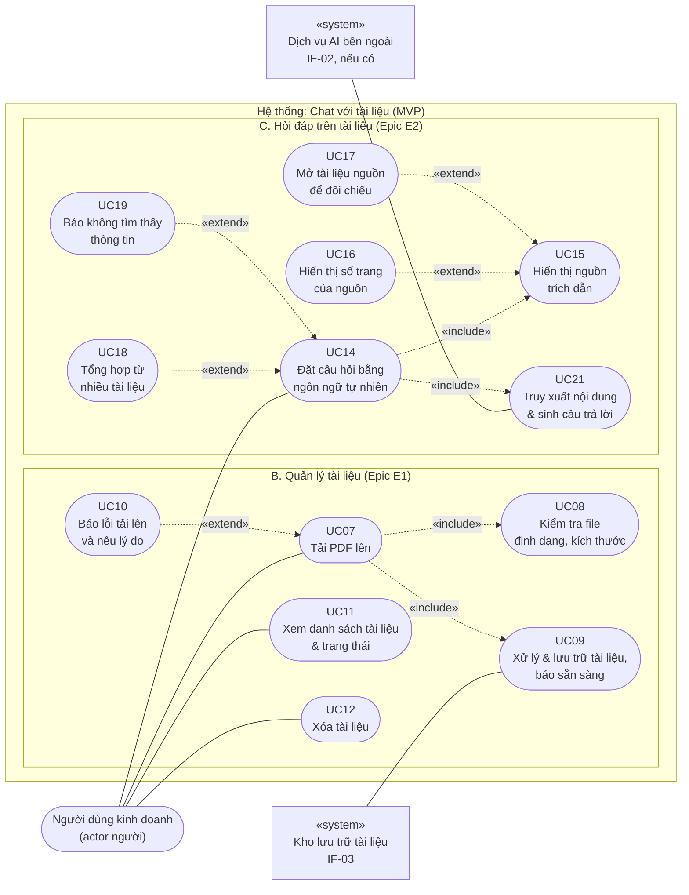

# Sơ đồ use case — "Chat với tài liệu" (MVP)

> **Nguồn chuẩn:** `use-case-diagram.drawio` (cùng thư mục). Tệp này là bản Mermaid dựng lại **đúng** nội dung sơ đồ đó để xem trực tiếp trong Markdown; không thêm hay bớt use case, actor hay quan hệ nào. Khi sơ đồ drawio đổi, phải cập nhật tệp này.
> **Phạm vi:** 13 use case (UC07–UC12, UC14–UC19, UC21), 1 actor người, 2 actor hệ thống. Số hiệu UC không đánh lại sau khi loại use case; khoảng trống là có chủ ý.
> **Không có trong MVP:** đăng nhập, phân quyền, quản trị, chia sẻ tài liệu, nhật ký truy cập, số liệu sử dụng, hỏi tiếp nối.

## 1. Sơ đồ

Mermaid không có kiểu sơ đồ use case riêng nên dùng sơ đồ lưu đồ: bầu dục = use case, hình tròn dài = actor, hộp = hệ thống ngoài («system»). Đường liền = liên kết (association); đường đứt = quan hệ giữa use case, mũi tên theo quy ước UML (`include`: use case gốc → use case được include; `extend`: use case mở rộng → use case gốc).

## 2. Quan hệ

| Loại | Từ | Đến | Ý nghĩa |
|---|---|---|---|
| Liên kết | Người dùng kinh doanh | UC07, UC11, UC12, UC14 | Bốn điểm vào của người dùng; các use case còn lại được kích hoạt gián tiếp |
| Liên kết | IF-03 Kho lưu trữ | UC09 | Hệ thống ngoài tham gia khi lưu và xử lý tài liệu |
| Liên kết | IF-02 Dịch vụ AI | UC21 | Hệ thống ngoài tham gia khi truy xuất và sinh câu trả lời |
| `«include»` | UC07 | UC08, UC09 | Tải lên luôn kiểm tra file, rồi xử lý và lưu |
| `«include»` | UC14 | UC15, UC21 | Mỗi câu hỏi luôn truy xuất và sinh câu trả lời, rồi hiển thị nguồn |
| `«extend»` | UC10 → UC07 | | Khi file không hợp lệ, hỏng, có mật khẩu, là ảnh quét, hoặc mất kết nối |
| `«extend»` | UC16 → UC15 | | Khi xác định được vị trí (trang) trong tài liệu |
| `«extend»` | UC17 → UC15 | | Khi người dùng muốn kiểm chứng nguồn |
| `«extend»` | UC18 → UC14 | | Khi câu hỏi cần thông tin từ ≥ 2 tài liệu |
| `«extend»` | UC19 → UC14 | | Khi tập tài liệu không có căn cứ để trả lời |

Tổng: 6 liên kết, 4 `include`, 5 `extend`.

## 3. Danh mục use case

| ID | Use case | Actor liên quan | Quan hệ | User story | Yêu cầu (BRD) |
|---|---|---|---|---|---|
| UC07 | Tải PDF lên | Người dùng kinh doanh | include UC08, UC09; extend bởi UC10 | US-001 | BR-001, BR-005 |
| UC08 | Kiểm tra file (định dạng, kích thước) | (hệ thống) | được include bởi UC07 | US-001 (AC2, AC3) | BR-005, BRU-003 |
| UC09 | Xử lý & lưu trữ tài liệu, báo sẵn sàng | IF-03 Kho lưu trữ | được include bởi UC07 | US-002 | BR-002, BR-016 |
| UC10 | Báo lỗi tải lên và nêu lý do | (hệ thống) | extend UC07 | US-003 | BR-018 |
| UC11 | Xem danh sách tài liệu & trạng thái | Người dùng kinh doanh | — | US-004 | BR-003 |
| UC12 | Xóa tài liệu | Người dùng kinh doanh | — | US-005 | BR-004 |
| UC14 | Đặt câu hỏi bằng ngôn ngữ tự nhiên | Người dùng kinh doanh | include UC15, UC21; extend bởi UC18, UC19 | US-006 | BR-006 |
| UC15 | Hiển thị nguồn trích dẫn | (hệ thống) | được include bởi UC14; extend bởi UC16, UC17 | US-007 | BR-007 |
| UC16 | Hiển thị số trang của nguồn | (hệ thống) | extend UC15 | US-008 | BR-008 |
| UC17 | Mở tài liệu nguồn để đối chiếu | Người dùng kinh doanh (xem ghi chú) | extend UC15 | US-008 | BR-008 |
| UC18 | Tổng hợp từ nhiều tài liệu | (hệ thống) | extend UC14 | US-009 | BR-009 |
| UC19 | Báo không tìm thấy thông tin | (hệ thống) | extend UC14 | US-010 | BR-010 |
| UC21 | Truy xuất nội dung & sinh câu trả lời | IF-02 Dịch vụ AI | được include bởi UC14 | US-006 | BR-006 |

Không có use case riêng: BR-011 (độ chính xác, là cổng phát hành G3) và US-015 / BR-016 (vị trí lưu trữ, thể hiện qua UC09 và IF-03).

## 4. Ghi chú và điểm lệch cần biết

- **UC17 và actor.** Danh mục trong `use-case-diagram.drawio` ghi UC17 có actor *Người dùng kinh doanh*, nhưng sơ đồ **không** vẽ đường liên kết từ actor tới UC17; người dùng chạm tới UC17 gián tiếp qua UC14 → UC15. Tệp này vẽ theo sơ đồ (không có đường liên kết) và chỉ nêu lệch ở đây.
- **Ghi chú cũ trong drawio.** Trang "Danh mục Use Case" của tệp drawio còn vài câu đã lỗi thời: *"Mọi use case của người dùng yêu cầu đã đăng nhập; luồng đăng nhập không được vẽ"* và các đoạn nhắc UC01…UC06, UC13, UC20, UC22–UC24, BRD v0.3, OQ-006. MVP hiện **không có đăng nhập**. Tệp Markdown này không chép các câu đó. Nên sửa trong drawio khi có dịp.
- **IF-02, IF-03.** Có dùng hay không còn chờ quyết định về chính sách dữ liệu (OQ-005); sơ đồ vẽ theo giả định có.
- **Mermaid chưa được dựng thử** trong trình hiển thị; cấu trúc đã được đối chiếu tự động với tệp drawio.
