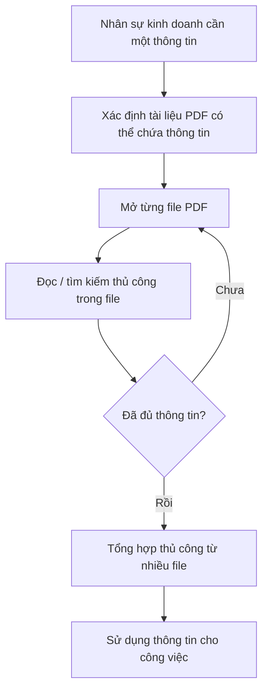
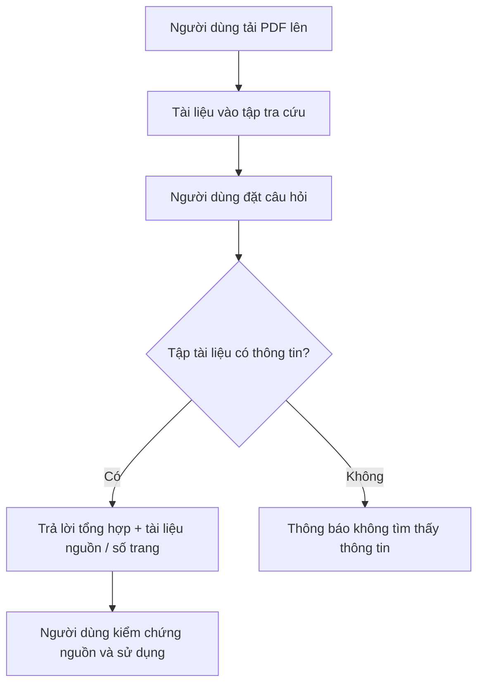

# Tài liệu Yêu cầu Nghiệp vụ (BRD) — Công cụ "Chat với tài liệu" (MVP)

> **Chuẩn áp dụng:** IEEE 29148-2018
> **Giai đoạn SDLC:** 5.2 Requirements and discovery
> **Ngôn ngữ:** Tiếng Việt

---

## 0. Tóm tắt kiểm định đầu vào (Validation Summary)

**Đầu vào đã nhận:**
- Bối cảnh giả định: đội phát triển kinh doanh khó nắm bắt nội dung nhiều file PDF; mỗi lần tra cứu phải tổng hợp thủ công từ nhiều file (SRC-001).
- Yêu cầu từ quản lý: phát triển MVP "Chat với tài liệu" — ứng dụng web cho phép upload PDF và chat với AI để truy vấn nội dung các tài liệu đã upload (SRC-001).

**Còn thiếu (chưa có trong đầu vào):**
- Tên tổ chức, sponsor, business owner, problem owner, ngân sách, mốc thời gian.
- Số liệu nền (baseline): thời gian tra cứu hiện tại, số lượng/kích thước/loại PDF, số người dùng, tần suất tra cứu.
- Yêu cầu bảo mật, tuân thủ, phân quyền, lưu trữ dữ liệu; ngôn ngữ của tài liệu.
- Định nghĩa "thành công" theo lời sponsor.

**Top 3 rủi ro đối với chất lượng yêu cầu:**
1. Không có baseline và target đo lường được → các mục tiêu chưa thể xác nhận là hợp lệ (OQ-001, OQ-002).
2. Chưa rõ mức độ nhạy cảm của tài liệu và yêu cầu bảo mật/quyền riêng tư (OQ-005, OQ-006).
3. Chưa xác định ngưỡng chấp nhận về độ chính xác câu trả lời của AI, rủi ro "trả lời sai nhưng tự tin" (OQ-004, RSK-001).

> Mọi giá trị chưa có nguồn được ghi `[TBD: OQ-xxx]` hoặc `[Unverified]`. Tài liệu không tự suy diễn số liệu.

---

## 1. Kiểm soát tài liệu (4.1)

| Trường | Giá trị |
|---|---|
| Tên tài liệu | BRD — Công cụ "Chat với tài liệu" (MVP) |
| Số tài liệu | BRD-CWD-001 |
| Phiên bản | 0.2 |
| Trạng thái | Draft |
| Tác giả | Business Analyst (do Claude soạn thảo) |
| Cộng tác viên | [TBD: OQ-007] |
| Người review | [TBD: OQ-007] |
| Người phê duyệt | [TBD: OQ-007] |
| Phân loại bảo mật | Nội bộ — [Unverified], xác nhận tại OQ-005 |
| Danh sách phân phối | [TBD: OQ-007] |

**Lịch sử phiên bản**

| Phiên bản | Ngày | Tác giả | Tóm tắt thay đổi |
|---|---|---|---|
| 0.1 | 2026-10-19 | Business Analyst | Bản nháp đầu tiên từ bối cảnh và yêu cầu của quản lý |
| 0.2 | 2026-10-21 | Business Analyst | Sửa theo kết quả review checklist IEEE 29148: thêm tầm nhìn, hồ sơ người dùng, kịch bản nghiệp vụ; tách BR-002/BR-016 (thêm BR-018, BR-019); thêm BR-020, BR-021; bổ sung phương án dự phòng rủi ro, RSK-005, DEP-003, OQ-013, OQ-014 |

---

## 2. Tóm tắt điều hành (4.2)

**Tầm nhìn (Vision).** Mọi nhân sự kinh doanh có thể lấy được thông tin cần thiết từ kho tài liệu PDF của tổ chức trong vài phút thay vì phải mở và tổng hợp thủ công nhiều file, và luôn biết thông tin đó đến từ đâu. MVP này kiểm chứng giá trị của tầm nhìn đó trước khi đầu tư mở rộng. Mức độ gắn với chiến lược của tổ chức: `[TBD: OQ-007]`.

**Vấn đề.** Đội phát triển kinh doanh làm việc với nhiều tài liệu PDF nhưng khó nắm bắt đầy đủ nội dung. Mỗi lần cần một thông tin, nhân sự phải mở và tổng hợp từ nhiều file, tốn thời gian (SRC-001). Mức độ thiệt hại định lượng (giờ công/tuần, chi phí) **chưa có số liệu** `[TBD: OQ-001]`.

**Thay đổi nghiệp vụ đề xuất.** Cung cấp một công cụ web cho phép người dùng tải lên tài liệu PDF và đặt câu hỏi bằng ngôn ngữ tự nhiên; công cụ trả lời dựa trên nội dung các tài liệu đã tải lên, kèm chỉ dẫn nguồn để người dùng kiểm chứng. Phạm vi là MVP nhằm kiểm chứng giá trị trước khi đầu tư mở rộng.

**Lợi ích kỳ vọng và thước đo.** Giảm thời gian tìm một thông tin từ nhiều PDF (MET-001); tăng độ tin cậy của câu trả lời nhờ trích dẫn nguồn (MET-002); mức độ chấp nhận sử dụng của đội kinh doanh (MET-003). Baseline và target: `[TBD: OQ-001, OQ-002]`.

**Đầu tư, tiến độ, rủi ro chính.** Ngân sách và mốc thời gian: `[TBD: OQ-003]`. Rủi ro chính: câu trả lời sai (RSK-001), rò rỉ dữ liệu tài liệu nội bộ (RSK-002), mức sử dụng thấp (RSK-003).

**Quyết định cần từ người phê duyệt.** Phê duyệt phạm vi MVP và trả lời các câu hỏi mở chặn (OQ-001 → OQ-006) để chuyển BRD sang trạng thái *In review*.

---

## 3. Bối cảnh nghiệp vụ và phát biểu vấn đề (4.3)

### 3.1 Quy trình hiện tại (current-state)

Nguồn: SRC-001 (mô tả bối cảnh). Chi tiết quy trình thực tế `[Unverified]`, cần xác nhận qua phỏng vấn (OQ-008).

### 3.2 Ai bị ảnh hưởng

- Đội phát triển kinh doanh: mất thời gian tra cứu, khó có cái nhìn đầy đủ (SRC-001).
- Quản lý: cần thông tin kịp thời để ra quyết định `[Unverified]`.

### 3.3 Chi phí của việc không hành động

Chưa có số liệu. Các chiều cần định lượng: giờ công tra cứu, chậm trễ phản hồi khách hàng/đối tác, rủi ro bỏ sót thông tin trong tài liệu `[TBD: OQ-001]`.

### 3.4 Nguyên nhân gốc và triệu chứng

| Loại | Nội dung | Nguồn |
|---|---|---|
| Triệu chứng | Tra cứu mất thời gian; phải tổng hợp từ nhiều file | SRC-001 |
| Nguyên nhân gốc (giả thuyết) | Tri thức nằm rải rác trong nhiều PDF, không có cách truy vấn thống nhất theo nội dung | `[Unverified]` — cần xác nhận (OQ-008) |

### 3.5 Vì sao bây giờ

Quản lý yêu cầu phát triển MVP (SRC-001). Tác nhân kích hoạt cụ thể (doanh thu, áp lực chi phí, cạnh tranh) `[TBD: OQ-003]`.

---

## 4. Động lực, mục tiêu và thước đo (4.4)

| ID | Động lực | Mục tiêu (kết quả) | Metric | Baseline | Target | Thời hạn | Nguồn |
|---|---|---|---|---|---|---|---|
| BO-001 | Tra cứu từ nhiều PDF tốn thời gian | Rút ngắn thời gian tìm một thông tin cần thiết từ tập tài liệu | MET-001 | [TBD: OQ-001] | [TBD: OQ-002] | [TBD: OQ-003] | SRC-001 |
| BO-002 | Thông tin rải rác, khó nắm đủ | Người dùng nhận được câu trả lời tổng hợp từ nhiều tài liệu, kiểm chứng được về nguồn | MET-002 | [TBD: OQ-001] | [TBD: OQ-004] | [TBD: OQ-003] | SRC-001 |
| BO-003 | Cần chứng minh giá trị trước khi đầu tư lớn | Xác nhận đội kinh doanh chấp nhận và dùng công cụ trong giai đoạn MVP | MET-003 | 0 (chưa có công cụ) `[Unverified]` | [TBD: OQ-002] | [TBD: OQ-003] | SRC-001 |

**Định nghĩa thước đo**

| Metric | Định nghĩa | Công thức | Nguồn dữ liệu | Chủ sở hữu | Tần suất | Ngày baseline |
|---|---|---|---|---|---|---|
| MET-001 | Thời gian trung bình để người dùng tìm được một thông tin đúng | Tổng thời gian hoàn thành các tác vụ tra cứu ÷ số tác vụ | Khảo sát/đo thử trên bộ tác vụ chuẩn | [TBD: OQ-007] | [TBD: OQ-002] | [TBD: OQ-001] |
| MET-002 | Tỷ lệ câu trả lời đúng và có trích dẫn nguồn hợp lệ | Số câu trả lời được đánh giá đúng ÷ tổng số câu hỏi trong bộ kiểm thử | Bộ câu hỏi kiểm thử do business owner xác nhận | [TBD: OQ-007] | [TBD: OQ-002] | [TBD: OQ-001] |
| MET-003 | Mức độ chấp nhận sử dụng | Số người dùng hoạt động hằng tuần ÷ số người dùng mục tiêu | Số liệu sử dụng và khảo sát | [TBD: OQ-007] | Hằng tuần | [TBD: OQ-001] |

> Các mục tiêu trên chưa hợp lệ hoàn toàn cho tới khi có baseline và phương pháp đo (xem 4.4, IEEE 29148).

---

## 5. Phạm vi (4.5)

**Trong phạm vi (MVP):**
- Tải lên tài liệu PDF bởi người dùng.
- Hỏi đáp bằng ngôn ngữ tự nhiên về nội dung các tài liệu đã tải lên.
- Câu trả lời có thể truy ngược đến tài liệu nguồn.
- Quản lý danh sách tài liệu đã tải lên ở mức cơ bản.
- Kênh: ứng dụng web.

**Ngoài phạm vi:**
- Định dạng khác PDF (Word, Excel, hình ảnh, web) — lý do: MVP tập trung vào bài toán đã nêu `[Unverified]`.
- Ứng dụng di động gốc.
- Tích hợp với hệ thống CRM/ERP/kho tài liệu doanh nghiệp.
- Chỉnh sửa nội dung tài liệu gốc.

**Hoãn lại (Deferred):** Phân quyền chi tiết theo tài liệu/nhóm, báo cáo phân tích sử dụng, hỗ trợ nhiều định dạng — xem xét sau MVP `[TBD: OQ-006]`.

**Ranh giới:** Khởi đầu khi người dùng tải tài liệu lên; kết thúc khi người dùng nhận câu trả lời kèm nguồn. Việc ra quyết định kinh doanh dựa trên câu trả lời thuộc về người dùng.

---

## 6. Bên liên quan và nhu cầu (4.6)

| ID | Bên liên quan | Vai trò | Mối quan tâm | Ảnh hưởng | Nhu cầu | Nguồn |
|---|---|---|---|---|---|---|
| STK-001 | Đội phát triển kinh doanh | Người dùng chính | Tìm thông tin nhanh, đáng tin cậy | Cao | SN-001, SN-002, SN-003, SN-004 | SRC-001 |
| STK-002 | Quản lý (người yêu cầu MVP) | Sponsor/người ra yêu cầu `[Unverified]` | Chứng minh giá trị MVP | Cao | SN-005 | SRC-001 |
| STK-003 | Bộ phận CNTT / bảo mật | Vận hành, bảo vệ dữ liệu `[Unverified]` | An toàn dữ liệu tài liệu | Trung bình | SN-006 | `[Unverified]` — OQ-005 |
| STK-004 | Chủ sở hữu/người phát hành tài liệu | Sở hữu nội dung PDF `[Unverified]` | Tài liệu không bị lộ hoặc dùng sai | Trung bình | SN-006 | `[Unverified]` — OQ-005 |
| STK-005 | Người dùng hoài nghi / nhóm có thể cản trở áp dụng | Bên liên quan tiêu cực `[Unverified]` | Lo ngại AI trả lời sai, thay đổi thói quen làm việc | Trung bình | SN-003 | `[Unverified]` — OQ-008 |
| STK-006 | Nhà cung cấp dịch vụ AI/hạ tầng bên ngoài (nếu có) | Bên ngoài, cung cấp dịch vụ `[Unverified]` | Điều khoản sử dụng, bảo mật dữ liệu | Thấp | SN-006 | `[Unverified]` — OQ-005 |

**Nhu cầu của bên liên quan**

| ID | Bên liên quan | Phát biểu nhu cầu | Nỗi đau hiện tại | Bằng chứng | Ưu tiên |
|---|---|---|---|---|---|
| SN-001 | STK-001 | Đưa tài liệu PDF của mình vào một nơi thống nhất để tra cứu | Thông tin nằm rải rác trong nhiều file | SRC-001 | Must |
| SN-002 | STK-001 | Hỏi bằng ngôn ngữ tự nhiên và nhận câu trả lời trực tiếp | Phải mở và đọc nhiều file | SRC-001 | Must |
| SN-003 | STK-001, STK-005 | Biết câu trả lời lấy từ đâu để kiểm chứng | Khó tin vào thông tin tổng hợp nếu không rõ nguồn | `[Unverified]` | Must |
| SN-004 | STK-001 | Nhận câu trả lời tổng hợp xuyên nhiều tài liệu | Phải tổng hợp thủ công từ nhiều file | SRC-001 | Must |
| SN-005 | STK-002 | Có số liệu sử dụng và hiệu quả để quyết định mở rộng | Chưa có căn cứ đầu tư | `[Unverified]` | Should |
| SN-006 | STK-003, STK-004, STK-006 | Tài liệu tải lên được bảo vệ khỏi truy cập trái phép | Chưa có thông tin về yêu cầu | `[Unverified]` — OQ-005 | Must |

**Phân loại:** nội bộ — STK-001 → STK-005; bên ngoài — STK-006 (chưa xác định có hay không, OQ-005). Chưa có khách hàng/đối tác bên ngoài là người dùng trực tiếp trong MVP `[Unverified]`.

### 6.1 Hồ sơ người dùng (User classes)

| ID | Nhóm người dùng | Vai trò nghiệp vụ | Ngữ cảnh sử dụng | Quy mô / tần suất | Mức quen thuộc công nghệ/AI | Nguồn |
|---|---|---|---|---|---|---|
| UC-P1 | Nhân viên phát triển kinh doanh | Chuẩn bị đề xuất, trả lời khách hàng/đối tác, theo dõi cơ hội | Cần một thông tin cụ thể nhanh, thường nằm trong nhiều PDF | [TBD: OQ-001] | [TBD: OQ-008] | SRC-001 |
| UC-P2 | Trưởng nhóm / quản lý kinh doanh | Rà soát, ra quyết định, cần cái nhìn tổng hợp | Cần tổng hợp xuyên nhiều tài liệu và kiểm chứng nguồn | [TBD: OQ-001] | [TBD: OQ-008] | `[Unverified]` |
| UC-P3 | Quản trị viên công cụ (nếu có) | Cấp/thu hồi quyền, giám sát sử dụng | Vận hành MVP, bảo vệ dữ liệu | [TBD: OQ-007] | [TBD: OQ-007] | `[Unverified]` — OQ-005 |

> Hồ sơ trên chỉ dựa vào bối cảnh `SRC-001`; phải xác nhận qua phỏng vấn (OQ-008). Ngôn ngữ làm việc của người dùng: `[TBD: OQ-011]`.

### 6.2 Kịch bản nghiệp vụ (Business scenarios)

| ID | Kịch bản | Tác nhân | Tiền điều kiện | Diễn biến chính | Kết quả mong muốn | Yêu cầu liên quan |
|---|---|---|---|---|---|---|
| SC-001 | Tra cứu một thông tin trong một tài liệu | UC-P1 | Người dùng được cấp quyền; tài liệu đã tải lên | Người dùng nhập câu hỏi → nhận câu trả lời → xem tài liệu nguồn | Có câu trả lời đúng, kèm nguồn | BR-006, BR-007, BR-008 |
| SC-002 | Tổng hợp thông tin từ nhiều tài liệu | UC-P1, UC-P2 | Có ít nhất 2 tài liệu liên quan đã tải lên | Người dùng nhập câu hỏi cần nhiều nguồn → nhận câu trả lời tổng hợp | Một câu trả lời tổng hợp kèm các nguồn | BR-009, BR-007 |
| SC-003 | Câu hỏi ngoài nội dung tài liệu | UC-P1 | Tập tài liệu không chứa thông tin | Người dùng nhập câu hỏi → nhận thông báo không tìm thấy | Không có câu trả lời không căn cứ | BR-010 |
| SC-004 | Tải tài liệu mới và hỏi ngay | UC-P1 | Người dùng có file PDF hợp lệ | Tải file → nhận thông báo kết quả → đặt câu hỏi | Tài liệu mới được dùng trong câu trả lời | BR-001, BR-002, BR-018, BR-006 |
| SC-005 | Hỏi tiếp nối trong cùng một phiên | UC-P1 | Đã có ít nhất một câu hỏi trước | Người dùng hỏi câu tiếp tham chiếu câu trước | Câu trả lời đúng ngữ cảnh | BR-013 |
| SC-006 | Xóa tài liệu không còn dùng | UC-P1 | Tài liệu do người dùng tải lên | Người dùng yêu cầu xóa | Tài liệu không còn trong phạm vi tra cứu | BR-004 |

Các kịch bản này là cơ sở để xây dựng bộ câu hỏi kiểm thử cho BR-011 (OQ-004).

---

## 7. Yêu cầu nghiệp vụ (4.7)

Thang ưu tiên: **Must / Should / Could / Won't**. Phương pháp xác minh: Review / Test / Inspection / Demonstration / Analysis.

### 7.1 Quản lý tài liệu

| ID | Yêu cầu | Lý do | Nguồn | Ưu tiên | Tiêu chí chấp nhận | Xác minh | Trạng thái |
|---|---|---|---|---|---|---|---|
| BR-001 | Khi người dùng được cấp quyền chọn một file PDF hợp lệ, tổ chức **shall** cho phép người dùng tải file đó lên để đưa vào tập tài liệu tra cứu. | Điều kiện đầu vào của mọi truy vấn | BO-001 / SN-001 | Must | AC-001 | Demonstration | Draft |
| BR-002 | Khi tài liệu được tải lên thành công, tổ chức **shall** thông báo cho người dùng rằng tài liệu đã sẵn sàng để tra cứu. | Người dùng cần biết khi nào có thể hỏi về tài liệu | SN-001 | Must | AC-002 | Test | Draft |
| BR-003 | Tổ chức **shall** cho phép người dùng xem danh sách các tài liệu đã tải lên. | Người dùng cần biết phạm vi tra cứu | SN-001 | Should | AC-003 | Demonstration | Draft |
| BR-004 | Khi người dùng yêu cầu xóa một tài liệu mà họ đã tải lên, tổ chức **shall** loại tài liệu đó khỏi phạm vi tra cứu. | Kiểm soát dữ liệu, giảm rủi ro nội dung sai/lỗi thời | SN-001, SN-006 | Should | AC-004 | Test | Draft |
| BR-018 | Khi việc tải một file lên không thành công, tổ chức **shall** thông báo cho người dùng lý do thất bại. | Người dùng cần biết cách xử lý để không mất thời gian | SN-001 | Must | AC-018 | Test | Draft |
| BR-005 | Tổ chức **shall** hỗ trợ tải lên file PDF có kích thước tối đa [TBD: OQ-009] MB mỗi file. | Xác định giới hạn vận hành có thể kiểm thử | BO-001 | Must | AC-005 | Test | Draft |

### 7.2 Hỏi đáp trên tài liệu

| ID | Yêu cầu | Lý do | Nguồn | Ưu tiên | Tiêu chí chấp nhận | Xác minh | Trạng thái |
|---|---|---|---|---|---|---|---|
| BR-006 | Khi người dùng nhập một câu hỏi bằng ngôn ngữ tự nhiên, tổ chức **shall** cung cấp câu trả lời dựa trên nội dung các tài liệu đã tải lên. | Mục tiêu cốt lõi của MVP | BO-001 / SN-002 | Must | AC-006 | Test | Draft |
| BR-007 | Khi câu trả lời được tạo từ nội dung tài liệu, tổ chức **shall** cho người dùng biết tài liệu nguồn mà câu trả lời dựa vào. | Người dùng cần kiểm chứng thông tin trước khi dùng cho công việc kinh doanh, giảm rủi ro RSK-001 | BO-002 / SN-003 | Must | AC-007 | Test | Draft |
| BR-008 | Khi câu trả lời dựa trên một vị trí xác định trong tài liệu, tổ chức **shall** cho người dùng biết vị trí đó trong tài liệu ở mức trang. | Rút ngắn thời gian kiểm chứng so với đọc lại toàn bộ tài liệu (hỗ trợ MET-001) | BO-002 / SN-003 | Should | AC-008 | Test | Draft |
| BR-009 | Khi câu hỏi cần thông tin từ nhiều hơn một tài liệu, tổ chức **shall** tổng hợp thông tin từ các tài liệu liên quan vào một câu trả lời. | Giải quyết nỗi đau tổng hợp thủ công | BO-002 / SN-004 | Must | AC-009 | Test | Draft |
| BR-010 | Khi tập tài liệu đã tải lên không chứa thông tin để trả lời, tổ chức **shall** thông báo rõ cho người dùng rằng không tìm thấy thông tin, thay vì đưa ra câu trả lời không có căn cứ. | Giảm rủi ro thông tin sai | BO-002 / SN-003 | Must | AC-010 | Test | Draft |
| BR-011 | Tổ chức **shall** đạt tỷ lệ câu trả lời đúng tối thiểu [TBD: OQ-004] % trên bộ câu hỏi kiểm thử đã được business owner xác nhận. | Ngưỡng chất lượng chấp nhận được | BO-002 | Must | AC-011 | Analysis | Draft |
| BR-012 | Khi người dùng gửi câu hỏi, tổ chức **shall** trả về câu trả lời trong tối đa [TBD: OQ-010] giây đối với [TBD: OQ-010] % số truy vấn. | Hỗ trợ mục tiêu rút ngắn thời gian tra cứu | BO-001 | Should | AC-012 | Test | Draft |
| BR-013 | Khi người dùng đặt câu hỏi tiếp nối câu hỏi trước, tổ chức **shall** hiểu câu hỏi theo ngữ cảnh các câu hỏi trước đó trong cùng một cuộc trao đổi. | Người dùng không phải nhắc lại bối cảnh, rút ngắn thời gian tra cứu (hỗ trợ MET-001) | SN-002 | Should | AC-013 | Demonstration | Draft |

### 7.3 Bảo mật và dữ liệu

| ID | Yêu cầu | Lý do | Nguồn | Ưu tiên | Tiêu chí chấp nhận | Xác minh | Trạng thái |
|---|---|---|---|---|---|---|---|
| BR-014 | Tổ chức **shall** giới hạn quyền truy cập công cụ cho người dùng được cấp quyền. | Bảo vệ tài liệu nội bộ | SN-006 | Must | AC-014 | Test | Draft |
| BR-015 | Tổ chức **shall** đảm bảo tài liệu của một người dùng không xuất hiện trong câu trả lời cho người dùng khác trừ khi chính sách chia sẻ cho phép [TBD: OQ-006]. | Tránh lộ dữ liệu giữa người dùng | SN-006 | Must | AC-015 | Test | Draft |
| BR-016 | Tổ chức **shall** lưu trữ tài liệu tải lên tại nơi lưu trữ đáp ứng yêu cầu về vị trí dữ liệu [TBD: OQ-005]. | Tuân thủ | SN-006 | Must | AC-016 | Inspection | Draft |
| BR-019 | Tổ chức **shall** xóa tài liệu tải lên sau thời hạn lưu giữ [TBD: OQ-005] kể từ ngày tải lên. | Tuân thủ, giảm rủi ro RSK-002 | SN-006 | Must | AC-019 | Test | Draft |
| BR-021 | Tổ chức **shall** ghi nhận lại ai đã truy cập tài liệu và vào thời điểm nào, để phục vụ kiểm tra khi cần [TBD: OQ-005]. | Khả năng truy vết (auditability) khi có sự cố dữ liệu `[Unverified]` | SN-006 | Should | AC-021 | Inspection | Draft |

### 7.4 Đo lường hiệu quả MVP và tính sẵn sàng

| ID | Yêu cầu | Lý do | Nguồn | Ưu tiên | Tiêu chí chấp nhận | Xác minh | Trạng thái |
|---|---|---|---|---|---|---|---|
| BR-017 | Tổ chức **shall** ghi nhận số liệu sử dụng đủ để tính MET-001, MET-002 và MET-003 trong thời gian chạy MVP. | Phục vụ quyết định mở rộng | BO-003 / SN-005 | Should | AC-017 | Inspection | Draft |
| BR-020 | Tổ chức **shall** làm cho công cụ sẵn sàng sử dụng tối thiểu [TBD: OQ-013] % thời gian trong giờ làm việc [TBD: OQ-013]. | Người dùng cần công cụ sẵn sàng khi tra cứu để không quay lại cách thủ công | BO-001 / SN-002 | Could | AC-020 | Analysis | Draft |

---

## 8. Quy tắc nghiệp vụ (4.8)

| ID | Quy tắc | Loại | Phạm vi | Chủ sở hữu thực thi | Nguồn |
|---|---|---|---|---|---|
| BRU-001 | Câu trả lời chỉ được dựa trên nội dung các tài liệu đã tải lên; không được trình bày thông tin ngoài tập tài liệu như thể là nội dung tài liệu. | Chính sách | Hỏi đáp | Business owner [TBD: OQ-007] | `[Unverified]` — OQ-004 |
| BRU-002 | Mọi câu trả lời phải kèm tài liệu nguồn để người dùng tự kiểm chứng. | Chính sách | Hỏi đáp | Business owner [TBD: OQ-007] | SN-003 |
| BRU-003 | Chỉ file định dạng PDF được chấp nhận trong MVP. | Chính sách | Tải lên | Product owner [TBD: OQ-007] | SRC-001 |
| BRU-004 | Quy tắc chia sẻ tài liệu giữa người dùng: [TBD: OQ-006]. | Chính sách | Truy cập | [TBD: OQ-006] | — |

---

## 9. Ràng buộc (4.9)

| ID | Ràng buộc | Loại | Áp đặt bởi | Tác động | Nguồn |
|---|---|---|---|---|---|
| CON-001 | Sản phẩm là ứng dụng web | Kỹ thuật/Tổ chức | Quản lý | Giới hạn kênh phân phối | SRC-001 |
| CON-002 | Đầu vào tài liệu là file PDF | Kỹ thuật | Quản lý | Loại trừ định dạng khác | SRC-001 |
| CON-003 | Phạm vi MVP, ngân sách và thời hạn | Ngân sách/Thời gian | [TBD: OQ-003] | Giới hạn khối lượng chức năng | [TBD: OQ-003] |
| CON-004 | Yêu cầu pháp lý/tuân thủ về dữ liệu | Pháp lý | [TBD: OQ-005] | Có thể hạn chế nơi xử lý/lưu trữ dữ liệu | [TBD: OQ-005] |

---

## 10. Giả định, phụ thuộc và rủi ro (4.10)

| ID | Mục | Loại | Mô tả | Tác động nếu sai | Chủ sở hữu | Xác thực / giảm thiểu | Hạn |
|---|---|---|---|---|---|---|---|
| ASM-001 | Tài liệu PDF chứa văn bản có thể trích xuất (không chỉ là ảnh quét) | Assumption | Phần lớn PDF là dạng văn bản | Tính năng không đọc được tài liệu quét | [TBD: OQ-007] | Lấy mẫu tài liệu thực tế | [TBD: OQ-003] |
| ASM-002 | Tài liệu được viết chủ yếu bằng ngôn ngữ [TBD: OQ-011] | Assumption | Ngôn ngữ ảnh hưởng chất lượng truy vấn | Chất lượng trả lời thấp | [TBD: OQ-007] | Xác nhận với đội kinh doanh | [TBD: OQ-003] |
| ASM-003 | Người dùng sẵn sàng tải tài liệu lên công cụ | Assumption | Tài liệu được phép đưa vào công cụ | MVP không có dữ liệu để dùng | [TBD: OQ-007] | Xác nhận với CNTT/bảo mật | [TBD: OQ-003] |
| DEP-001 | Quyết định về chính sách dữ liệu và bảo mật | Dependency | Phê duyệt từ CNTT/bảo mật/pháp lý | Chặn việc triển khai | [TBD: OQ-007] | Theo dõi OQ-005 | [TBD: OQ-003] |
| DEP-002 | Cung cấp bộ tài liệu mẫu và bộ câu hỏi kiểm thử | Dependency | Cần để đo MET-002 | Không đo được chất lượng | [TBD: OQ-007] | Theo dõi OQ-004 | [TBD: OQ-003] |
| DEP-003 | Dịch vụ xử lý AI / hạ tầng của bên thứ ba (nếu có) `[Unverified]` | Dependency | Việc có dùng bên thứ ba hay không do chính sách tại OQ-005 quyết định | Ảnh hưởng chi phí, bảo mật, tính sẵn sàng | [TBD: OQ-007] | Theo dõi OQ-005 | [TBD: OQ-003] |
| DEP-004 | Chương trình/hệ thống khác của tổ chức liên quan đến kho tài liệu PDF hiện có | Dependency | Chưa biết có hay không `[Unverified]` | Có thể trùng lặp hoặc xung đột nguồn tài liệu | [TBD: OQ-007] | Xác nhận với quản lý và CNTT (OQ-014) | [TBD: OQ-003] |
| RSK-001 | Câu trả lời sai | Risk | AI tạo câu trả lời không đúng nhưng nghe có vẻ tin cậy → người dùng ra quyết định sai | Cao (xác suất [TBD: OQ-007]) | [TBD: OQ-007] | Giảm thiểu: trích dẫn nguồn (BR-007), từ chối khi thiếu căn cứ (BR-010), ngưỡng chính xác (BR-011). Dự phòng: tạm dừng triển khai rộng nếu tỷ lệ đúng dưới ngưỡng OQ-004; hướng dẫn người dùng luôn kiểm chứng nguồn trước khi dùng | [TBD: OQ-003] |
| RSK-002 | Rò rỉ dữ liệu | Risk | Tài liệu nhạy cảm bị truy cập trái phép hoặc gửi ra ngoài tổ chức | Cao (xác suất [TBD: OQ-007]) | [TBD: OQ-007] | Giảm thiểu: BR-014 → BR-016, BR-019, BR-021; xác nhận chính sách (OQ-005). Dự phòng: có quy trình thu hồi quyền và xóa tài liệu khi phát hiện sự cố | [TBD: OQ-003] |
| RSK-003 | Mức sử dụng thấp | Risk | Người dùng không tin hoặc không đổi thói quen → MVP không chứng minh được giá trị | Trung bình (xác suất [TBD: OQ-007]) | [TBD: OQ-007] | Giảm thiểu: hướng dẫn ngắn, thu thập phản hồi, đo MET-003. Dự phòng: nếu MET-003 dưới target, điều chỉnh phạm vi hoặc dừng MVP | [TBD: OQ-003] |
| RSK-004 | Chi phí vận hành phát sinh theo mức dùng | Risk | Chi phí biến đổi vượt ngân sách `[Unverified]` | Trung bình (xác suất [TBD: OQ-007]) | [TBD: OQ-007] | Giảm thiểu: chốt ngân sách tại OQ-003, theo dõi chi phí theo mức sử dụng (BR-017). Dự phòng: giới hạn số người dùng/số truy vấn khi chạm ngưỡng chi phí | [TBD: OQ-003] |
| RSK-005 | Tài liệu đầu vào không đọc được | Risk | PDF dạng ảnh quét hoặc lỗi định dạng → không trích xuất được nội dung → câu trả lời thiếu hoặc không có | Trung bình (xác suất [TBD: OQ-014]) | [TBD: OQ-007] | Giảm thiểu: lấy mẫu tài liệu thực tế (DEP-002, ASM-001); thông báo lý do (BR-018). Dự phòng: loại trừ nhóm tài liệu đó khỏi MVP | [TBD: OQ-003] |

---

## 11. Truy vết (4.11)

| Mục tiêu | Nhu cầu | Yêu cầu | Tiêu chí chấp nhận | PRD/SRS ID hạ nguồn |
|---|---|---|---|---|
| BO-001 | SN-001 | BR-001, BR-002, BR-003, BR-004, BR-005, BR-018 | AC-001 → AC-005, AC-018 | [TBD] |
| BO-001 | SN-002 | BR-006, BR-012, BR-013, BR-020 | AC-006, AC-012, AC-013, AC-020 | [TBD] |
| BO-002 | SN-003 | BR-007, BR-008, BR-010, BR-011 | AC-007, AC-008, AC-010, AC-011 | [TBD] |
| BO-002 | SN-004 | BR-009 | AC-009 | [TBD] |
| — | SN-006 | BR-014, BR-015, BR-016, BR-019, BR-021 | AC-014 → AC-016, AC-019, AC-021 | [TBD] |
| BO-003 | SN-005 | BR-017 | AC-017 | [TBD] |

**Báo cáo độ phủ**
- Mục tiêu chưa có yêu cầu: không.
- Yêu cầu mồ côi (không có mục tiêu hoặc nhu cầu): không. (BR-014 → BR-016 truy vết tới SN-006, không có BO tương ứng — đề xuất bổ sung một mục tiêu về bảo vệ dữ liệu: OQ-012.)
- Nhu cầu chưa có yêu cầu: không.
- Yêu cầu chưa có tiêu chí chấp nhận/phương pháp xác minh: không (nội dung AC-xxx ở bên dưới).

**Kịch bản → yêu cầu:** xem mục 6.2 (SC-001 → SC-006).

**Tiêu chí chấp nhận**

| ID | Tiêu chí | BR |
|---|---|---|
| AC-001 | Người dùng được cấp quyền tải được ít nhất một file PDF hợp lệ và file xuất hiện trong phạm vi tra cứu | BR-001 |
| AC-002 | Sau khi tải thành công, người dùng thấy thông báo tài liệu sẵn sàng và có thể hỏi về tài liệu đó | BR-002 |
| AC-003 | Danh sách hiển thị đúng và đầy đủ các tài liệu đã tải lên của người dùng | BR-003 |
| AC-004 | Sau khi xóa, các câu hỏi tiếp theo không còn trả về nội dung từ tài liệu đã xóa | BR-004 |
| AC-005 | File có kích thước bằng giới hạn được chấp nhận; file vượt giới hạn bị từ chối kèm thông báo | BR-005 |
| AC-006 | Với bộ câu hỏi kiểm thử, mỗi câu hỏi nhận được câu trả lời liên quan đến nội dung tài liệu | BR-006 |
| AC-007 | 100% câu trả lời có nội dung từ tài liệu kèm tên tài liệu nguồn đúng | BR-007 |
| AC-008 | Số trang được chỉ ra khớp với vị trí nội dung trong tài liệu ở mẫu kiểm tra | BR-008 |
| AC-009 | Với câu hỏi kiểm thử cần ≥ 2 tài liệu, câu trả lời chứa thông tin từ cả các tài liệu đó | BR-009 |
| AC-010 | Với câu hỏi nằm ngoài nội dung tài liệu, hệ thống thông báo không tìm thấy thông tin trong 100% trường hợp thử | BR-010 |
| AC-011 | Tỷ lệ đúng đạt ngưỡng đã thống nhất tại OQ-004 trên bộ kiểm thử | BR-011 |
| AC-012 | Thời gian phản hồi đạt ngưỡng đã thống nhất tại OQ-010 trong thử nghiệm | BR-012 |
| AC-013 | Câu hỏi tiếp nối tham chiếu ngữ cảnh trước (ví dụ "còn điều khoản thứ hai?") được hiểu đúng ở mẫu kiểm tra | BR-013 |
| AC-014 | Người dùng không được cấp quyền không truy cập được công cụ | BR-014 |
| AC-015 | Trong kiểm thử với hai tài khoản, câu trả lời của tài khoản A không chứa nội dung tài liệu của tài khoản B (khi chưa chia sẻ) | BR-015 |
| AC-016 | Vị trí lưu trữ dữ liệu khớp với chính sách đã được phê duyệt tại OQ-005 | BR-016 |
| AC-017 | Số liệu thu thập đủ để tính ba metric trong báo cáo MVP | BR-017 |
| AC-018 | Với file lỗi hoặc không hợp lệ, người dùng thấy thông báo có nêu lý do trong 100% trường hợp thử | BR-018 |
| AC-019 | Tài liệu quá thời hạn lưu giữ không còn tồn tại và không xuất hiện trong câu trả lời | BR-019 |
| AC-020 | Tỷ lệ sẵn sàng đo được trong thời gian chạy MVP đạt ngưỡng đã thống nhất tại OQ-013 | BR-020 |
| AC-021 | Với mẫu truy cập thử, nhật ký cho biết đúng người dùng, tài liệu và thời điểm | BR-021 |

---

## 12. Câu hỏi mở và quyết định (4.12)

| ID | Câu hỏi / quyết định cần | Vì sao quan trọng | Chủ sở hữu | Cần trước | Trạng thái | Kết quả |
|---|---|---|---|---|---|---|
| OQ-001 | Baseline hiện tại: thời gian tra cứu, số tài liệu, số người dùng, tần suất tra cứu là bao nhiêu? | Không có baseline thì BO/MET không hợp lệ | [TBD] | [TBD] | Open | — |
| OQ-002 | Giá trị mục tiêu (target) cho MET-001 và MET-003 là gì? | Xác định thành công của MVP | Sponsor | [TBD] | Open | — |
| OQ-003 | Ngân sách, mốc thời gian MVP và tác nhân kích hoạt (vì sao bây giờ)? | Ràng buộc phạm vi và tính khả thi | Sponsor | [TBD] | Open | — |
| OQ-004 | Ngưỡng độ chính xác chấp nhận được của câu trả lời; ai xác nhận bộ câu hỏi kiểm thử? | Chặn BR-011, MET-002, BRU-001 | Business owner | [TBD] | Open | — |
| OQ-005 | Mức độ nhạy cảm của tài liệu, yêu cầu về nơi lưu trữ dữ liệu, thời hạn lưu giữ, có được gửi nội dung tới dịch vụ AI bên ngoài không? | Chặn BR-016, RSK-002, CON-004 | CNTT/Bảo mật/Pháp lý | [TBD] | Open | — |
| OQ-006 | Mô hình chia sẻ tài liệu: riêng tư theo người dùng hay dùng chung cả đội? | Chặn BR-015, BRU-004 | Business owner | [TBD] | Open | — |
| OQ-007 | Ai là sponsor, business owner, product owner, reviewer, approver và chủ sở hữu từng metric/rủi ro? | Cần cho phê duyệt và trách nhiệm | Quản lý | [TBD] | Open | — |
| OQ-008 | Quy trình tra cứu thực tế hiện tại là gì (phỏng vấn người dùng) và có nhóm phản đối áp dụng không? | Xác nhận nguyên nhân gốc, STK-005 | BA | [TBD] | Open | — |
| OQ-009 | Giới hạn kích thước/số trang/số file mỗi người dùng? | Chặn BR-005 | Product owner | [TBD] | Open | — |
| OQ-010 | Ngưỡng thời gian phản hồi mong muốn? | Chặn BR-012 | Business owner | [TBD] | Open | — |
| OQ-011 | Ngôn ngữ của tài liệu và của câu hỏi (Việt, Anh, cả hai)? | Ảnh hưởng chất lượng và ASM-002 | Business owner | [TBD] | Open | — |
| OQ-012 | Có cần thêm mục tiêu nghiệp vụ về bảo vệ dữ liệu (BO) để BR-014 → BR-016, BR-019, BR-021 truy vết được? | Hoàn thiện truy vết | BA/Sponsor | [TBD] | Open | — |
| OQ-013 | MVP có cần cam kết sẵn sàng/thời gian ngừng chấp nhận được/khôi phục sau sự cố không? Nếu không, ghi nhận thành giả định | Chặn BR-020 | Business owner | [TBD] | Open | — |
| OQ-014 | Có nhiều phiên bản của cùng một tài liệu không và dùng phiên bản nào? Tỷ lệ PDF dạng ảnh quét là bao nhiêu? Có hệ thống/kho tài liệu hiện có liên quan không (DEP-004)? | Ảnh hưởng phạm vi, RSK-005, ASM-001 | Business owner / CNTT | [TBD] | Open | — |

---

## 13. Bảng thuật ngữ và tài liệu tham chiếu (4.13)

**Thuật ngữ**

| Thuật ngữ | Định nghĩa |
|---|---|
| BRD | Business Requirements Document — tài liệu yêu cầu nghiệp vụ |
| MVP | Minimum Viable Product — sản phẩm khả thi tối thiểu để kiểm chứng giá trị |
| PDF | Định dạng tài liệu di động (Portable Document Format) |
| Chat với tài liệu | Hình thức người dùng đặt câu hỏi bằng ngôn ngữ tự nhiên và nhận câu trả lời dựa trên nội dung tài liệu đã tải lên |
| Tài liệu nguồn | Tài liệu (và trang) mà câu trả lời dựa vào |
| Tập tài liệu | Toàn bộ các PDF mà người dùng đã tải lên và có quyền truy vấn |
| Câu trả lời đúng | Câu trả lời khớp với nội dung tài liệu theo đánh giá của người xác nhận bộ kiểm thử (định nghĩa chính thức tại OQ-004) |
| Business owner | Người chịu trách nhiệm về kết quả nghiệp vụ của sáng kiến |

**Tài liệu tham chiếu**

| ID | Tên | Phiên bản | Vị trí | Ngày truy cập |
|---|---|---|---|---|
| SRC-001 | Bối cảnh và yêu cầu từ quản lý trong BRD_Prompt_IEEE_standard.md | 1.0 | chat_with_document/BRD_Prompt_IEEE_standard.md | 2026-10-19 |
| REF-001 | IEEE 29148-2018 | 2018 | IEEE | — |

---

## 14. Phê duyệt (4.14)

| Vai trò | Tên | Quyết định | Chữ ký / ngày |
|---|---|---|---|
| Sponsor điều hành | [TBD: OQ-007] | [Phê duyệt / Phê duyệt có điều kiện / Từ chối] | — |
| Business owner | [TBD: OQ-007] | [Phê duyệt / Từ chối] | — |
| Product manager / owner | [TBD: OQ-007] | [Phê duyệt / Từ chối] | — |
| Tuân thủ / pháp lý | [TBD: OQ-007] | [Phê duyệt / Từ chối] | — |

Điều kiện phê duyệt: giải quyết các OQ chặn (OQ-001 → OQ-006). Phiên bản đề nghị baseline: sau khi các OQ này đóng và nâng lên v1.0.

---

## 15. Phụ lục (4.15)

- **Phụ lục 0 — Tiền tố ID bổ sung trong tài liệu này:** `UC-Px` = nhóm người dùng, `SC-xxx` = kịch bản nghiệp vụ (ngoài bảng tiền tố IEEE trong prompt).
- **Phụ lục A — Quy trình đề xuất (to-be) ở mức nghiệp vụ**

- **Phụ lục B — Ghi chú chuyển giao cho PRD/SAD (không phải yêu cầu nghiệp vụ):** lựa chọn mô hình AI, cách lập chỉ mục tài liệu, kiến trúc lưu trữ và xác thực là quyết định thiết kế cho giai đoạn sau; các ràng buộc về dữ liệu ở OQ-005 sẽ quyết định phạm vi lựa chọn.

---

## 16. Kết quả rà soát theo checklist (Mục 5 của prompt)

| Hạng mục | Kết quả |
|---|---|
| Cú pháp `shall`, một nghĩa vụ mỗi yêu cầu | Đạt (đã tách BR-002/BR-018 và BR-016/BR-019) |
| Không có ngôn ngữ giải pháp/thiết kế | Đạt (đã bỏ "tên file", "số trang", "phiên trò chuyện" khỏi câu yêu cầu) |
| Định lượng khi ảnh hưởng chấp nhận | Chưa đạt — BR-005, BR-011, BR-012, BR-019, BR-020 chờ OQ-009, OQ-004, OQ-010, OQ-005, OQ-013 |
| Không còn từ định tính mơ hồ | Đạt |
| Mỗi mục tiêu có yêu cầu; mỗi yêu cầu có nguồn, AC, xác minh | Đạt |
| Baseline và target có nguồn, đo lường được | Chưa đạt — OQ-001, OQ-002 |
| Mỗi câu hỏi mở có chủ sở hữu và hạn | Chưa đạt — chủ sở hữu/hạn còn [TBD] (OQ-007, OQ-003) |
| Phát biểu vấn đề có bằng chứng | Chưa đạt — chỉ có mô tả bối cảnh (OQ-001, OQ-008) |
| Sponsor xác nhận vấn đề và kết quả mong muốn | Chưa thực hiện |

---

## 17. Tuyên bố mức sẵn sàng

**Not ready** (Chưa sẵn sàng phê duyệt).

Mục chặn (cập nhật v0.2; OQ-013 và OQ-014 không chặn vì BR-020 là Could): **OQ-001, OQ-002** (baseline/target), **OQ-003** (ngân sách, thời gian), **OQ-004** (ngưỡng chính xác — BR-011, một yêu cầu Must), **OQ-005** (bảo mật/tuân thủ — BR-016, một yêu cầu Must), **OQ-006** (mô hình chia sẻ — BR-015, một yêu cầu Must), **OQ-007** (người chịu trách nhiệm).
Khi các mục trên được trả lời, tài liệu có thể chuyển lên *Ready with conditions* và sang trạng thái *In review*.
