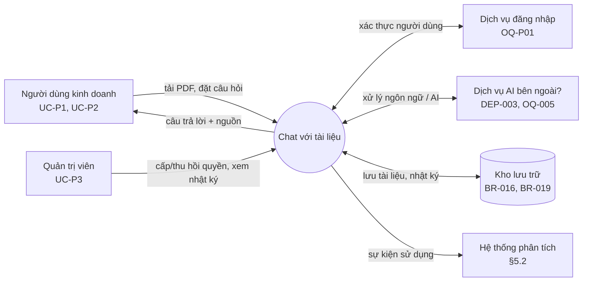
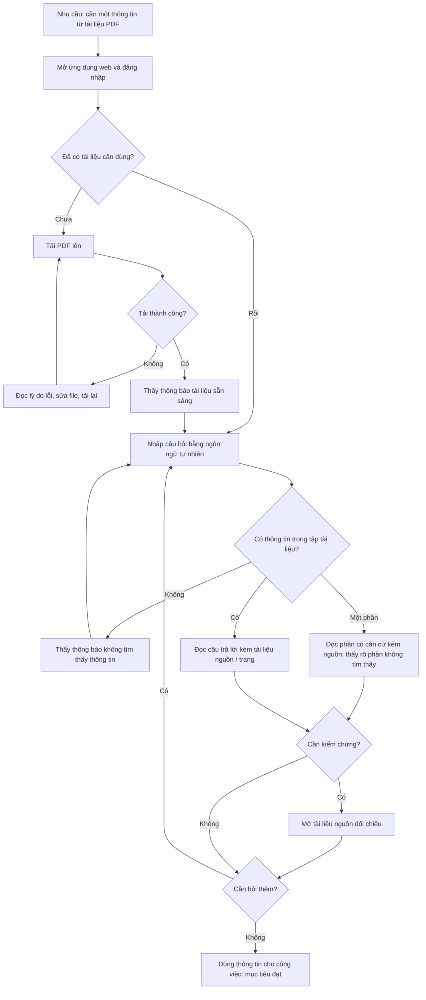

# Tài liệu Yêu cầu Sản phẩm (PRD) — "Chat với tài liệu" (MVP)

> **Chuẩn áp dụng:** IEEE 29148-2018
> **Phiên bản:** 0.2 (Draft) — 2026-10-21. Thay đổi so với 0.1: thêm ngữ cảnh hệ thống (§1.4), persona UC-P4/P5, AC cho story P1/P2, yêu cầu phi chức năng (§3.7), giao diện hệ thống và môi trường (§4.3), phụ thuộc/ràng buộc đầy đủ (§8), phân loại mức Must/Should cho cổng phát hành, đồng bộ danh sách câu hỏi chặn; đổi tên AC theo dạng `US-xxx-ACn`.
> **Đầu vào:** `docs/requirements/BRD.md` (v0.2, trạng thái Draft)
> **Ngôn ngữ:** Tiếng Việt
> **Quy ước:** `[TBD: OQ-xxx]` = chưa có thông tin, đã ghi thành câu hỏi mở. `[Đề xuất]` = giá trị do PM đề xuất làm điểm xuất phát, **chưa được business owner xác nhận**. `[Unverified]` = chưa có nguồn.

---

## 0. Kiểm định nền tảng sản phẩm (Product Foundation Validation)

Prompt gốc có phần "Product Foundation" chưa điền. Tôi suy ra từ BRD như sau:

| Trường | Giá trị suy ra từ BRD | Nguồn | Trạng thái |
|---|---|---|---|
| Tên sản phẩm | "Chat với tài liệu" (MVP) | BRD §0 | Đã xác nhận trong BRD |
| Người dùng mục tiêu | Đội phát triển kinh doanh (UC-P1), trưởng nhóm/quản lý (UC-P2), quản trị viên (UC-P3) | BRD §6.1 | UC-P2, UC-P3 là `[Unverified]` |
| Vấn đề | Thông tin nằm rải rác trong nhiều PDF; mỗi lần tra cứu phải mở và tổng hợp thủ công | BRD §3 (SRC-001) | Chưa định lượng (OQ-001) |
| Giải pháp cốt lõi | Ứng dụng web: tải PDF lên, hỏi AI bằng ngôn ngữ tự nhiên, nhận câu trả lời dựa trên các tài liệu đã tải và kèm nguồn | BRD §5, BR-001…BR-009 | Đã xác nhận ở mức phạm vi |

**Kiểm định các trụ cột UX (UX Pillars).** BRD không nêu trụ cột UX; tôi đề xuất 5 trụ cột rút ra từ nhu cầu và rủi ro trong BRD:

| # | Trụ cột đề xuất | Căn cứ trong BRD | Đánh giá | Vấn đề cần xử lý |
|---|---|---|---|---|
| P1 | **Luôn kèm nguồn để kiểm chứng:** mọi câu trả lời có nội dung tài liệu đều kèm tài liệu nguồn (và trang nếu xác định được) | SN-003, BR-007, BR-008, RSK-001 | Hợp lệ | Mức chi tiết nguồn (tên + trang hay kèm trích đoạn) → OQ-P05 |
| P2 | **Trung thực khi không biết:** thà nói "không tìm thấy" còn hơn trả lời không căn cứ | BR-010, BRU-001 | Hợp lệ | Ngưỡng chính xác chưa có → OQ-004 |
| P3 | **Ít thao tác:** từ lúc mở ứng dụng đến lúc có câu trả lời đầu tiên cho một tài liệu đã có tối đa 3 thao tác (mở khung hỏi, nhập, gửi); đến lúc có câu trả lời đầu tiên cho tài liệu mới tối đa 5 thao tác `[Đề xuất]` | BO-001, MET-001 | Hợp lệ; con số là đề xuất | Cần business owner xác nhận; kiểm bằng thử nghiệm sử dụng (G12) |
| P4 | **Riêng tư theo mặc định:** tài liệu của ai thì người đó thấy, trừ khi chính sách cho phép chia sẻ | BR-015, SN-006 | Hợp lệ, phụ thuộc quyết định | Mô hình chia sẻ → OQ-006 |
| P5 | **Web, ưu tiên máy tính:** dùng trình duyệt trên máy tính; mobile không cam kết trong MVP | CON-001 (web) | `[Đề xuất]` — BRD chỉ nêu "web" | Cần xác nhận → OQ-P02 |

**Top 3 rủi ro đối với PRD:**
1. Các mục tiêu đo lường chưa có baseline/target (OQ-001, OQ-002) nên OKR dưới đây chỉ là đề xuất.
2. Chính sách dữ liệu/bảo mật chưa chốt (OQ-005, OQ-006) có thể làm đổi cả luồng tải lên và chia sẻ.
3. Chưa có bộ câu hỏi kiểm thử và ngưỡng chính xác (OQ-004) nên cổng phát hành về chất lượng AI chưa đo được.

---

## 1. Tóm tắt điều hành và chiến lược

### 1.1 Tầm nhìn sản phẩm

Mọi nhân sự kinh doanh lấy được thông tin họ cần từ kho tài liệu PDF của tổ chức trong vài phút, thay vì mở và tổng hợp thủ công nhiều file, và luôn biết thông tin đó đến từ tài liệu nào. MVP kiểm chứng giả thuyết này trên một nhóm người dùng giới hạn trước khi đầu tư mở rộng. (Căn cứ: BRD §2 Tầm nhìn; mức gắn với chiến lược tổ chức `[TBD: OQ-007]`.)

**Giả thuyết cần kiểm chứng của MVP:** *Nếu người dùng có thể hỏi bằng ngôn ngữ tự nhiên trên các PDF của mình và nhận câu trả lời kèm nguồn, thì thời gian tìm thông tin giảm đạt mức mục tiêu KR1.1 so với cách làm thủ công, và người dùng quay lại dùng hằng tuần đạt mức mục tiêu KR3.1.*

### 1.2 Mục tiêu và kết quả then chốt (OKR)

Giá trị baseline/target chính thức do business owner chốt (OQ-001, OQ-002). Cột "Đề xuất" chỉ là điểm xuất phát để thảo luận.

| Objective | Key Result | Metric (BRD) | Baseline | Target chính thức | Đề xuất khởi điểm `[Đề xuất]` | Cách đo |
|---|---|---|---|---|---|---|
| **O1.** Rút ngắn thời gian tìm một thông tin từ nhiều PDF (BO-001) | KR1.1 Thời gian trung bình hoàn thành một tác vụ tra cứu chuẩn | MET-001 | [TBD: OQ-001] | [TBD: OQ-002] | Giảm ≥ 50% so với baseline | Đo thử trên bộ tác vụ chuẩn, so sánh cách làm thủ công với công cụ |
| | KR1.2 Thời gian từ khi gửi câu hỏi đến khi có câu trả lời | — (BR-012) | n/a | [TBD: OQ-010] | p95 ≤ 15 giây | Telemetry `answer_returned.latency_ms` |
| **O2.** Câu trả lời đáng tin và kiểm chứng được (BO-002) | KR2.1 Tỷ lệ câu trả lời đúng trên bộ câu hỏi kiểm thử | MET-002 | [TBD: OQ-001] | [TBD: OQ-004] | ≥ 85% | Chấm điểm bộ kiểm thử do business owner xác nhận |
| | KR2.2 Tỷ lệ câu trả lời có nội dung tài liệu mà kèm nguồn đúng | — (AC-007) | n/a | 100% (theo AC-007) | 100% | Kiểm thử + lấy mẫu |
| | KR2.3 Tỷ lệ câu hỏi ngoài tài liệu được từ chối đúng | — (AC-010) | n/a | 100% trong bộ thử (theo AC-010) | 100% | Bộ câu hỏi ngoài phạm vi |
| **O3.** Chứng minh mức chấp nhận của đội kinh doanh (BO-003) | KR3.1 Người dùng hoạt động hằng tuần ÷ người dùng mục tiêu | MET-003 | 0 (chưa có công cụ) `[Unverified]` | [TBD: OQ-002] | ≥ 60% sau [TBD: OQ-003] tuần chạy | Telemetry `session_started` |

> Các đề xuất 50%, 15 giây, 85%, 60% **không có nguồn** trong BRD. Chúng chỉ được dùng nếu business owner chấp nhận hoặc điều chỉnh.

### 1.3 Phạm vi sản phẩm (tóm tắt từ BRD §5)

- **MVP gồm:** tải PDF, xem/xóa tài liệu, hỏi đáp có trích nguồn trên toàn bộ tập tài liệu của người dùng, hỏi tiếp nối trong cùng cuộc trao đổi, kiểm soát truy cập, ghi nhận số liệu sử dụng.
- **Ngoài phạm vi:** định dạng khác PDF; ứng dụng di động gốc; tích hợp CRM/ERP/kho tài liệu; chỉnh sửa tài liệu gốc.
- **Hoãn lại:** phân quyền chi tiết theo tài liệu/nhóm, báo cáo phân tích sử dụng, nhiều định dạng (OQ-006).

### 1.4 Mục đích tài liệu và ngữ cảnh hệ thống

**Mục đích.** PRD này chuyển các yêu cầu nghiệp vụ trong BRD (BR-xxx) thành yêu cầu sản phẩm mà Engineering, Design và QA cùng dùng: user story, tiêu chí chấp nhận, yêu cầu phi chức năng, cổng phát hành. PRD mô tả **sản phẩm làm gì**, không quy định cách xây dựng (thuộc SRS/SAD).

**Ngữ cảnh hệ thống.** Sản phẩm tương tác với người dùng và với một số hệ thống bên ngoài. Việc có hay không và loại hệ thống nào do các câu hỏi mở quyết định (xem §4.3).



Ranh giới: sản phẩm **không** thay đổi tài liệu gốc, không tích hợp CRM/ERP/kho tài liệu doanh nghiệp (ngoài phạm vi, §1.3).

---

## 2. Persona và hành trình người dùng

### 2.1 Persona mục tiêu

Các persona dưới đây rút ra từ BRD §6.1 và chưa qua phỏng vấn (OQ-008). Tôi không đặt tên giả để tránh tạo cảm giác có dữ liệu thật.

| | **Persona chính — Nhân viên phát triển kinh doanh (UC-P1)** | **Persona phụ — Trưởng nhóm / quản lý kinh doanh (UC-P2)** | **Persona vận hành — Quản trị viên (UC-P3)** |
|---|---|---|---|
| Mục tiêu | Tìm nhanh một thông tin cụ thể để chuẩn bị đề xuất/trả lời đối tác | Có cái nhìn tổng hợp xuyên nhiều tài liệu để ra quyết định | Cấp/thu hồi quyền, bảo vệ dữ liệu, theo dõi sử dụng |
| Nỗi đau | Phải mở nhiều PDF và tự tổng hợp | Không tin thông tin tổng hợp nếu không rõ nguồn | Lo tài liệu nội bộ bị lộ |
| Hành vi chính | Tải tài liệu, đặt nhiều câu hỏi ngắn | Đặt câu hỏi tổng hợp, kiểm tra nguồn | Quản lý người dùng, xem nhật ký |
| Mức quen thuộc AI | [TBD: OQ-008] | [TBD: OQ-008] | [TBD: OQ-007] |
| Quy mô / tần suất | [TBD: OQ-001] | [TBD: OQ-001] | [TBD: OQ-007] |
| Nguồn | SRC-001 | `[Unverified]` | `[Unverified]` |

**Vai bổ sung xuất hiện trong user story (để mọi vai trong §3 đều có định nghĩa):**

| ID | Vai | Mô tả | Quan tâm chính | Nguồn |
|---|---|---|---|---|
| UC-P4 | Đại diện CNTT / bảo mật / pháp lý | Người phê duyệt chính sách dữ liệu (STK-003, STK-004) | Vị trí lưu trữ, thời hạn lưu giữ, rò rỉ dữ liệu | `[Unverified]` — OQ-005 |
| UC-P5 | Quản lý / sponsor | Người quyết định mở rộng MVP (STK-002) | Số liệu sử dụng và hiệu quả | SRC-001, `[Unverified]` |

**Persona tiêu cực (nhóm có thể cản trở áp dụng, STK-005):** người lo ngại AI trả lời sai, thích tự đọc tài liệu. Họ chỉ chấp nhận công cụ nếu kiểm chứng nguồn dễ dàng (trụ cột P1).

### 2.2 Hành trình người dùng cấp cao



| Giai đoạn | Hành động người dùng | Cảm xúc/rủi ro | Cơ hội sản phẩm | Yêu cầu BRD |
|---|---|---|---|---|
| Khám phá | Nghe giới thiệu từ quản lý, mở ứng dụng | Hoài nghi | Màn hình đầu tiên nêu rõ công cụ làm gì và dữ liệu được bảo vệ ra sao | BR-014 |
| Chuẩn bị | Tải PDF | Lo tài liệu bị lộ; lo upload thất bại | Thông báo kết quả rõ ràng, nêu lý do lỗi | BR-001, BR-002, BR-018 |
| Hỏi đáp | Đặt câu hỏi, hỏi tiếp | Lo câu trả lời sai | Nguồn hiển thị ngay bên câu trả lời; từ chối khi thiếu căn cứ | BR-006, BR-007, BR-009, BR-010, BR-013 |
| Kiểm chứng | Đối chiếu nguồn | Mất công nếu phải tìm lại | Chỉ ra trang để mở nhanh | BR-008 |
| Hoàn tất | Dùng thông tin, xóa tài liệu không cần | Muốn kiểm soát dữ liệu | Xóa được tài liệu ngay từ danh sách tài liệu (không cần vào màn hình khác) | BR-004, BR-019 |

---

## 3. Yêu cầu chức năng và User Story

**Quy ước:** P0 = bắt buộc để phát hành (tương ứng *Must* trong BRD); P1 = nên có (*Should*); P2 = có thì tốt (*Could*). Mọi story đều truy vết về một `BR-xxx`. Story P0 có tiêu chí chấp nhận dạng Given-When-Then; story P1/P2 có AC rút gọn. Tiêu chí chấp nhận được đặt ID dạng `US-xxx-ACn` để không nhầm với `AC-xxx` của BRD. Giá trị `[TBD]` được giữ nguyên, không bịa.

### 3.1 Ma trận Epic / Feature

| Epic | Feature | User story | Ưu tiên | BRD |
|---|---|---|---|---|
| **E1. Quản lý tài liệu** | F1.1 Tải PDF | US-001 | P0 | BR-001, BR-005 |
| | F1.2 Thông báo kết quả tải | US-002, US-003 | P0 | BR-002, BR-018 |
| | F1.3 Danh sách tài liệu | US-004 | P1 | BR-003 |
| | F1.4 Xóa tài liệu | US-005 | P1 | BR-004 |
| **E2. Hỏi đáp trên tài liệu** | F2.1 Hỏi và nhận trả lời | US-006 | P0 | BR-006 |
| | F2.2 Trích dẫn nguồn | US-007, US-008 | P0 / P1 | BR-007, BR-008 |
| | F2.3 Tổng hợp nhiều tài liệu | US-009 | P0 | BR-009 |
| | F2.4 Từ chối khi thiếu căn cứ | US-010 | P0 | BR-010 |
| | F2.5 Hỏi tiếp nối | US-011 | P1 | BR-013 |
| | F2.6 Thời gian phản hồi | US-012 | P1 | BR-012 |
| **E3. Truy cập, bảo mật, dữ liệu** | F3.1 Kiểm soát truy cập | US-013 | P0 | BR-014 |
| | F3.2 Cô lập dữ liệu giữa người dùng | US-014 | P0 | BR-015 |
| | F3.3 Vị trí lưu trữ | US-015 | P0 | BR-016 |
| | F3.4 Thời hạn lưu giữ | US-016 | P0 | BR-019 |
| | F3.5 Nhật ký truy cập | US-017 | P1 | BR-021 |
| **E4. Đo lường và vận hành** | F4.1 Ghi nhận số liệu sử dụng | US-018 | P1 | BR-017 |
| | F4.2 Sẵn sàng sử dụng | US-019 | P2 | BR-020 |
| **Chất lượng (cổng phát hành)** | Ngưỡng chính xác câu trả lời | — (xem §5.1) | P0 | BR-011 |

### 3.2 E1 — Quản lý tài liệu

**US-001 (P0)** — Là *nhân viên phát triển kinh doanh*, tôi muốn *tải một file PDF lên*, để *đưa tài liệu vào tập tra cứu của tôi*. *(BR-001, BR-005)*
- **US-001-AC1.** Given tôi đã đăng nhập và có một file PDF hợp lệ kích thước ≤ [TBD: OQ-009] MB, When tôi chọn file để tải lên, Then file được nhận và đưa vào tập tài liệu của tôi.
- **US-001-AC2.** Given file lớn hơn [TBD: OQ-009] MB, When tôi tải lên, Then file bị từ chối và tôi thấy giới hạn kích thước tối đa.
- **US-001-AC3.** Given file không phải PDF (BRU-003), When tôi tải lên, Then file bị từ chối và tôi được báo chỉ hỗ trợ PDF.

**US-002 (P0)** — Là *nhân viên phát triển kinh doanh*, tôi muốn *biết khi nào tài liệu đã sẵn sàng để hỏi*, để *không đặt câu hỏi khi tài liệu chưa được xử lý xong*. *(BR-002)*
- **US-002-AC1.** Given tôi vừa tải thành công một PDF, When tài liệu sẵn sàng tra cứu, Then tôi thấy thông báo "đã sẵn sàng" gắn với tên tài liệu đó.
- **US-002-AC2.** Given tài liệu chưa sẵn sàng, When tôi đặt câu hỏi, Then tôi thấy trạng thái "đang xử lý" và câu trả lời không dùng nội dung tài liệu đó.

**US-003 (P0)** — Là *nhân viên phát triển kinh doanh*, tôi muốn *biết lý do khi tải file thất bại*, để *tự xử lý được mà không mất thời gian*. *(BR-018)*
- **US-003-AC1.** Given file PDF bị hỏng, When tôi tải lên, Then tải thất bại và tôi thấy thông báo nêu lý do "file bị hỏng" cùng hướng xử lý (tải lại file khác).
- **US-003-AC2.** Given file PDF có mật khẩu, When tôi tải lên, Then tải thất bại và tôi thấy thông báo nêu lý do "file có mật khẩu" cùng hướng xử lý (bỏ mật khẩu rồi tải lại).
- **US-003-AC3.** Given file PDF không có văn bản trích xuất được (dạng ảnh quét), When tôi tải lên, Then tài liệu không được đánh dấu "sẵn sàng" và tôi thấy thông báo nêu lý do này (ASM-001, RSK-005).
- **US-003-AC4.** Given mất kết nối trong lúc tải, When kết nối được khôi phục, Then tôi thấy trạng thái thất bại và có thể thử lại, không có tài liệu "nửa vời" trong danh sách.

**US-004 (P1)** — Là *nhân viên phát triển kinh doanh*, tôi muốn *xem danh sách tài liệu đã tải*, để *biết phạm vi tra cứu hiện tại*. *(BR-003)*
- **US-004-AC1.** Given tôi đã tải ít nhất một tài liệu, When tôi mở danh sách tài liệu, Then tôi thấy đầy đủ các tài liệu của tôi kèm tên và trạng thái (sẵn sàng / đang xử lý / lỗi).
- **US-004-AC2.** Given tài liệu của người dùng khác chưa được chia sẻ, When tôi mở danh sách, Then tôi không thấy tài liệu đó.

**US-005 (P1)** — Là *nhân viên phát triển kinh doanh*, tôi muốn *xóa tài liệu đã tải*, để *loại nội dung lỗi thời hoặc không cần khỏi kết quả tra cứu*. *(BR-004)*
- **US-005-AC1.** Given một tài liệu do tôi tải lên, When tôi yêu cầu xóa và xác nhận, Then tài liệu biến mất khỏi danh sách của tôi.
- **US-005-AC2.** Given tài liệu đã bị xóa, When tôi đặt câu hỏi liên quan nội dung tài liệu đó, Then câu trả lời không chứa nội dung hay tên của tài liệu đó.

### 3.3 E2 — Hỏi đáp trên tài liệu

**US-006 (P0)** — Là *nhân viên phát triển kinh doanh*, tôi muốn *đặt câu hỏi bằng ngôn ngữ tự nhiên*, để *nhận câu trả lời dựa trên nội dung tài liệu của tôi mà không phải đọc từng file*. *(BR-006)*
- **US-006-AC1.** Given tôi có ít nhất một tài liệu ở trạng thái sẵn sàng, When tôi gửi một câu hỏi thuộc bộ câu hỏi kiểm thử, Then tôi nhận được câu trả lời mà nội dung khớp với tài liệu theo đánh giá của người chấm (ngưỡng tổng thể tại G3).
- **US-006-AC2.** Given tôi chưa có tài liệu nào, When tôi mở khung hỏi đáp, Then tôi thấy hướng dẫn tải tài liệu trước (trạng thái trống) và không thể gửi câu hỏi.
- **US-006-AC3.** Given câu hỏi nằm trong ngôn ngữ [TBD: OQ-011], When tôi gửi, Then câu trả lời bằng cùng ngôn ngữ với câu hỏi.

**US-007 (P0)** — Là *trưởng nhóm kinh doanh*, tôi muốn *thấy câu trả lời dựa vào tài liệu nào*, để *kiểm chứng trước khi dùng cho quyết định*. *(BR-007)*
- **US-007-AC1.** Given một câu trả lời có nội dung lấy từ tài liệu, When câu trả lời hiển thị, Then ngay bên dưới có danh sách tài liệu nguồn đúng với tài liệu mà thông tin được lấy.
- **US-007-AC2.** Given câu trả lời lấy từ N tài liệu, When hiển thị, Then liệt kê đủ N tài liệu đó, không thừa tài liệu không liên quan.

**US-008 (P1)** — Là *trưởng nhóm kinh doanh*, tôi muốn *biết trang chứa thông tin*, để *đối chiếu nhanh mà không đọc lại cả tài liệu*. *(BR-008)*
- **US-008-AC1.** Given câu trả lời dựa trên một vị trí xác định trong tài liệu, When câu trả lời hiển thị, Then số trang hiển thị khớp trang chứa nội dung đó trong mẫu kiểm tra.

**US-009 (P0)** — Là *nhân viên phát triển kinh doanh*, tôi muốn *một câu trả lời tổng hợp từ nhiều tài liệu*, để *không phải tự ghép thông tin từ nhiều file*. *(BR-009)*
- **US-009-AC1.** Given tôi có ≥ 2 tài liệu cùng chứa thông tin liên quan đến câu hỏi, When tôi gửi câu hỏi, Then câu trả lời có thông tin từ cả các tài liệu đó và liệt kê từng nguồn.
- **US-009-AC2.** Given hai tài liệu có thông tin mâu thuẫn nhau, When tôi hỏi, Then câu trả lời nêu rõ có khác biệt và chỉ ra từng nguồn, không tự chọn một bên.

**US-010 (P0)** — Là *nhân viên phát triển kinh doanh*, tôi muốn *được báo rõ khi tài liệu không có thông tin*, để *không bị dẫn dắt bởi câu trả lời không có căn cứ*. *(BR-010, BRU-001)*
- **US-010-AC1.** Given tập tài liệu của tôi không chứa thông tin cho câu hỏi, When tôi gửi câu hỏi, Then tôi nhận thông báo "không tìm thấy thông tin trong các tài liệu đã tải" và không nhận nội dung bịa.
- **US-010-AC2.** Given câu hỏi chỉ trả lời được một phần, When tôi gửi, Then câu trả lời nêu phần có căn cứ và nói rõ phần nào không tìm thấy.

**US-011 (P1)** — Là *nhân viên phát triển kinh doanh*, tôi muốn *hỏi tiếp mà không nhắc lại bối cảnh*, để *tra cứu tự nhiên và nhanh hơn*. *(BR-013)*
- **US-011-AC1.** Given tôi vừa hỏi về một chủ đề, When tôi hỏi tiếp bằng câu tham chiếu câu trước (ví dụ "còn điều khoản thứ hai?"), Then câu trả lời hiểu đúng đối tượng được nhắc tới theo mẫu kiểm tra.

**US-012 (P1)** — Là *nhân viên phát triển kinh doanh*, tôi muốn *nhận câu trả lời trong ngưỡng thời gian đã thống nhất*, để *không quay lại tìm thủ công*. *(BR-012, NFR-PRF-001; ngưỡng [TBD: OQ-010])*
- **US-012-AC1.** Given bộ tài liệu mẫu và bộ câu hỏi kiểm thử, When tôi gửi các câu hỏi, Then tối thiểu [TBD: OQ-010]% câu hỏi nhận câu trả lời trong tối đa [TBD: OQ-010] giây.

### 3.4 E3 — Truy cập, bảo mật, dữ liệu

**US-013 (P0)** — Là *quản trị viên (UC-P3)*, tôi muốn *chỉ người được cấp quyền mới vào được công cụ*, để *bảo vệ tài liệu nội bộ*. *(BR-014)*
- **US-013-AC1.** Given một người chưa được cấp quyền, When họ mở địa chỉ ứng dụng, Then họ không xem được tài liệu hay hỏi đáp, và chỉ thấy yêu cầu đăng nhập hoặc thông báo không có quyền.
- **US-013-AC2.** Given tôi thu hồi quyền của một người dùng, When họ truy cập lại, Then họ bị chặn.

**US-014 (P0)** — Là *nhân viên kinh doanh*, tôi muốn *tài liệu của tôi không xuất hiện trong câu trả lời cho người khác (nếu chưa chia sẻ)*, để *tránh lộ thông tin*. *(BR-015, BRU-004, [TBD: OQ-006])*
- **US-014-AC1.** Given hai tài khoản A và B, A đã tải tài liệu X và chưa chia sẻ, When B hỏi một câu liên quan nội dung X, Then câu trả lời của B không chứa nội dung hay tên của X.
- **US-014-AC2.** Given chính sách chia sẻ được chốt tại OQ-006 cho phép chia sẻ, When A chia sẻ X cho B, Then B nhận được câu trả lời dựa trên X kèm nguồn. (Điều kiện này chỉ áp dụng nếu OQ-006 chọn mô hình dùng chung.)

**US-015 (P0)** — Là *đại diện CNTT/bảo mật (UC-P4)*, tôi muốn *tài liệu được lưu tại nơi đáp ứng yêu cầu vị trí dữ liệu*, để *tuân thủ chính sách*. *(BR-016, [TBD: OQ-005])*
- **US-015-AC1.** Given chính sách vị trí dữ liệu đã được phê duyệt, When rà soát cấu hình lưu trữ, Then vị trí lưu trữ khớp chính sách.

**US-016 (P0)** — Là *đại diện CNTT/bảo mật (UC-P4)*, tôi muốn *tài liệu bị xóa sau thời hạn lưu giữ*, để *không giữ dữ liệu lâu hơn cần thiết*. *(BR-019, [TBD: OQ-005])*
- **US-016-AC1.** Given thời hạn lưu giữ là T [TBD: OQ-005], When một tài liệu quá T kể từ ngày tải lên, Then tài liệu bị xóa và không còn xuất hiện trong câu trả lời.

**US-017 (P1)** — Là *quản trị viên*, tôi muốn *có nhật ký ai truy cập tài liệu nào, lúc nào*, để *điều tra khi có sự cố*. *(BR-021)*
- **US-017-AC1.** Given quản trị viên và một chuỗi truy cập thử, When quản trị viên tra nhật ký, Then nhật ký cho biết đúng người dùng, tài liệu và thời điểm của từng truy cập.

### 3.5 E4 — Đo lường và vận hành

**US-018 (P1)** — Là *quản lý / sponsor (UC-P5)*, tôi muốn *có số liệu sử dụng của MVP*, để *quyết định có mở rộng hay không*. *(BR-017; chi tiết sự kiện ở §5.2)*
- **US-018-AC1.** Given MVP đã chạy [TBD: OQ-003] tuần, When sponsor xem số liệu, Then tính được MET-001, MET-002, MET-003 từ số liệu đã thu.

**US-019 (P2)** — Là *nhân viên kinh doanh*, tôi muốn *công cụ sẵn sàng khi cần*, để *không quay lại cách tra cứu thủ công*. *(BR-020; ngưỡng [TBD: OQ-013])*
- **US-019-AC1.** Given thời gian chạy MVP, When đo tính sẵn sàng, Then tỷ lệ sẵn sàng đạt tối thiểu [TBD: OQ-013]% trong giờ làm việc [TBD: OQ-013].

### 3.6 Ghi chú phạm vi

- **Tính chính xác câu trả lời (BR-011, Must)** không phải một story của người dùng mà là điều kiện phát hành (mục 5.1). Chưa có ngưỡng cho tới khi OQ-004 được trả lời.
- Một số story P0 phụ thuộc quyết định chưa có (US-001-AC2, US-014, US-015, US-016). Chúng vẫn là P0 vì BR tương ứng là *Must*, nhưng không thể kiểm thử cho tới khi OQ liên quan đóng.

### 3.7 Yêu cầu phi chức năng (NFR)

Cú pháp: *sản phẩm* **shall** … Ưu tiên theo thang Must / Should / Could (BRD). Giá trị `[Đề xuất]` là điểm khởi đầu do PM đưa ra, chưa được xác nhận; giá trị `[TBD]` chờ quyết định.

| ID | Yêu cầu | Nhóm | Ưu tiên | Nguồn | Xác minh |
|---|---|---|---|---|---|
| NFR-PRF-001 | Khi người dùng gửi câu hỏi, sản phẩm **shall** trả câu trả lời trong tối đa [TBD: OQ-010] giây đối với [TBD: OQ-010]% số truy vấn. | Hiệu năng | Should | BR-012 (cổng G6) | Test |
| NFR-PRF-002 | Khi một tài liệu được tải lên thành công, sản phẩm **shall** hoàn tất xử lý để tài liệu sẵn sàng tra cứu trong tối đa [TBD: OQ-P07] phút kể từ lúc tải xong. | Hiệu năng | Should | BR-002 | Test |
| NFR-CAP-001 | Sản phẩm **shall** chấp nhận file PDF kích thước tối đa [TBD: OQ-009] MB và tối đa [TBD: OQ-009] tài liệu cho mỗi người dùng. | Dung lượng | Must | BR-005 | Test |
| NFR-SCL-001 | Sản phẩm **shall** phục vụ đồng thời tối thiểu [TBD: OQ-001] người dùng mà vẫn đạt NFR-PRF-001. | Mở rộng | Should | BO-003, MET-003 | Test |
| NFR-SCL-002 | Khi tải vượt công suất, sản phẩm **shall** thông báo cho người dùng rằng hệ thống đang bận và giữ nguyên các tài liệu đã tải `[Đề xuất]`. | Mở rộng | Should | RSK-P02 | Test |
| NFR-SEC-001 | Sản phẩm **shall** chỉ truyền dữ liệu giữa người dùng và hệ thống qua kênh được mã hóa; chuẩn cụ thể [TBD: OQ-P08] `[Đề xuất]`. | Bảo mật | Must | SN-006, CON-004 | Inspection |
| NFR-SEC-002 | Sản phẩm **shall** bảo vệ tài liệu đang lưu trữ bằng mã hóa theo chuẩn [TBD: OQ-P08] `[Đề xuất]`. | Bảo mật | Must | SN-006, CON-004 | Inspection |
| NFR-SEC-003 | Sản phẩm **shall** phân biệt tối thiểu hai vai trò là người dùng và quản trị viên, với quyền hạn của quản trị viên gồm cấp/thu hồi quyền và xem nhật ký. | Bảo mật | Must | BR-014, BR-021, UC-P3 | Test |
| NFR-REL-001 | Sản phẩm **shall** sẵn sàng tối thiểu [TBD: OQ-013]% thời gian trong giờ làm việc [TBD: OQ-013]. | Độ tin cậy | Could | BR-020 | Analysis |
| NFR-REL-002 | Sau sự cố mất dữ liệu, sản phẩm **shall** khôi phục các tài liệu đã tải trong vòng [TBD: OQ-013] (RTO) và mất dữ liệu không quá [TBD: OQ-013] (RPO). | Độ tin cậy | Could | BR-020 | Test |

> Nếu business owner quyết định MVP **không** cam kết mức sẵn sàng, NFR-REL-001/002 chuyển thành giả định ASM-P01 ("MVP chạy theo nguyên tắc cố gắng tối đa, không có SLA") thay vì để trống.

---

## 4. Yêu cầu UX và UI

> BRD không quy định giao diện. Mô tả dưới đây là **đề xuất** của PM theo các trụ cột P1–P5; thiết kế chi tiết do Design thực hiện.

### 4.1 Luồng và bố cục cốt lõi

```text
┌───────────────────────────────────────────────────────────────┐
│  Chat với tài liệu                          [người dùng ▾]    │
├──────────────────────┬────────────────────────────────────────┤
│ TÀI LIỆU CỦA TÔI     │  Cuộc trao đổi                         │
│ [+ Tải PDF lên]      │                                        │
│                      │  Bạn:  Điều khoản thanh toán là gì?    │
│ ● hop-dong-A.pdf  ✓  │  AI:   Thanh toán trong 30 ngày ...    │
│ ● bao-gia-B.pdf   ⟳  │        Nguồn: hop-dong-A.pdf, tr. 4    │
│ ● quy-dinh-C.pdf  ✕  │               [Mở tài liệu]            │
│   (lỗi: file bị khóa)│                                        │
│                      │  ┌──────────────────────────────┐ [Gửi]│
│  (xóa 🗑 khi chọn)   │  │ Nhập câu hỏi...              │      │
│                      │  └──────────────────────────────┘      │
└──────────────────────┴────────────────────────────────────────┘
 ✓ sẵn sàng   ⟳ đang xử lý   ✕ lỗi
```
*(Ví dụ minh họa; nội dung "30 ngày" là giả định hiển thị, không phải dữ liệu thật.)*

**Nguyên tắc tương tác then chốt:**
1. **Hai vùng cố định:** danh sách tài liệu bên trái, khung trao đổi bên phải; tải PDF luôn nằm một thao tác từ màn hình chính (trụ cột P3).
2. **Nguồn gắn liền câu trả lời:** tài liệu nguồn (và trang nếu có) nằm ngay dưới mỗi câu trả lời, không ẩn trong menu (trụ cột P1).
3. **Trạng thái tài liệu luôn nhìn thấy:** sẵn sàng / đang xử lý / lỗi; chỉ tài liệu "sẵn sàng" mới được dùng để trả lời (US-002).
4. **Phân biệt rõ ba loại phản hồi:** có câu trả lời kèm nguồn; trả lời một phần; không tìm thấy thông tin (trụ cột P2). Hai loại sau phải có kiểu hiển thị khác để người dùng không nhầm.
5. **Đang xử lý câu hỏi:** hiển thị chỉ báo đang chờ; cho phép gửi lại hoặc hủy nếu quá thời gian.
6. **Thông tin nhạy cảm:** màn hình đầu và vùng tải lên có dòng nêu rõ dữ liệu được lưu bao lâu, ở đâu, ai xem được (khi OQ-005, OQ-006 đóng).
7. **Khả năng tiếp cận:** điều khiển dùng được bằng bàn phím; mức tuân thủ tiêu chuẩn truy cập cần xác nhận `[TBD: OQ-P02]`.

### 4.2 Trường hợp biên và trạng thái lỗi

| # | Tình huống | Hành vi yêu cầu | Liên quan |
|---|---|---|---|
| EC-01 | Chưa có tài liệu nào (trạng thái trống) | Hiển thị hướng dẫn tải PDF; vô hiệu khung hỏi | US-006-AC2 |
| EC-02 | File không phải PDF | Từ chối ngay, nêu chỉ hỗ trợ PDF | US-001-AC3, BRU-003 |
| EC-03 | File vượt giới hạn kích thước | Từ chối, nêu giới hạn [TBD: OQ-009] | US-001-AC2 |
| EC-04 | PDF hỏng hoặc có mật khẩu | Báo lỗi nêu lý do; không đưa vào danh sách "sẵn sàng" | US-003-AC1, US-003-AC2 |
| EC-05 | PDF dạng ảnh quét, không trích xuất được văn bản | Báo "không đọc được nội dung văn bản" và không coi là sẵn sàng | US-003-AC3, ASM-001, RSK-005, OQ-014 |
| EC-06 | Mất mạng khi đang tải lên | Báo thất bại, cho thử lại; không để lại tài liệu dở dang | US-003-AC4 |
| EC-07 | Mất mạng khi đang chờ câu trả lời | Giữ lại câu hỏi đã nhập; báo lỗi kết nối; cho gửi lại | BR-006 |
| EC-08 | Câu hỏi rỗng hoặc chỉ khoảng trắng | Không gửi; không tạo yêu cầu mới | BR-006 |
| EC-09 | Câu hỏi quá dài | Báo giới hạn độ dài [TBD: OQ-P06] | BR-006 |
| EC-10 | Không tìm thấy thông tin | Thông báo rõ, không bịa; có thể gợi ý đặt lại câu hỏi | US-010 |
| EC-11 | Thông tin mâu thuẫn giữa các tài liệu | Nêu có khác biệt và liệt kê từng nguồn | US-009-AC2 |
| EC-12 | Tải lên tài liệu trùng tên / trùng nội dung | Cách xử lý (ghi đè, giữ cả hai) chưa quyết định | OQ-014 |
| EC-13 | Phiên đăng nhập hết hạn | Yêu cầu đăng nhập lại; không mất câu hỏi đang nhập | US-013 |
| EC-14 | Người dùng bị thu hồi quyền khi đang dùng | Chặn thao tác kế tiếp và báo không còn quyền | US-013-AC2 |
| EC-15 | Hệ thống không phản hồi quá thời gian | Báo hết thời gian, cho thử lại; ghi nhận sự kiện lỗi | BR-012 |
| EC-16 | Tài liệu bị xóa khi đang có cuộc trao đổi dùng nó | Các câu hỏi sau không dùng tài liệu đó; câu trả lời cũ giữ nguyên nhưng nguồn đánh dấu "đã xóa" `[Đề xuất]` | US-005, OQ-P04 |

### 4.3 Giao diện hệ thống và môi trường vận hành

**Môi trường người dùng.** Ứng dụng web chạy trên trình duyệt máy tính. Danh sách trình duyệt và phiên bản được hỗ trợ: [TBD: OQ-P09]. Môi trường triển khai (nội bộ hay đám mây): [TBD: OQ-005] (phụ thuộc chính sách dữ liệu). Mobile: chưa cam kết (OQ-P02).

**Giao diện phần cứng.** Không áp dụng — sản phẩm là ứng dụng web, không có kết nối phần cứng chuyên dụng trong MVP.

**Giao diện phần mềm / hệ thống bên ngoài** (mức nghiệp vụ; chi tiết giao thức thuộc SRS/SAD):

| ID | Hệ thống | Mục đích | Dữ liệu trao đổi | Trạng thái | Nguồn |
|---|---|---|---|---|---|
| IF-01 | Dịch vụ xác thực / đăng nhập | Xác định người dùng và quyền (BR-014) | Định danh người dùng, vai trò | Chưa quyết định: dùng tài khoản nội bộ hay riêng (OQ-P01) | BR-014 |
| IF-02 | Dịch vụ xử lý AI / hạ tầng bên thứ ba (nếu có) | Hiểu câu hỏi và tạo câu trả lời từ nội dung tài liệu | Nội dung tài liệu / câu hỏi (mức nhạy cảm cần phê duyệt) | Chưa quyết định có dùng hay không (OQ-005, DEP-003) | DEP-003 `[Unverified]` |
| IF-03 | Kho lưu trữ tài liệu | Lưu tài liệu theo vị trí và thời hạn đã duyệt | Tệp PDF, siêu dữ liệu | Phụ thuộc OQ-005 | BR-016, BR-019 |
| IF-04 | Nhật ký truy cập | Ghi ai truy cập tài liệu nào, lúc nào | Người dùng, tài liệu, thời điểm | Chờ OQ-005 | BR-021 |
| IF-05 | Hệ thống phân tích sử dụng | Nhận sự kiện telemetry (§5.2) | Sự kiện không chứa nội dung | Chờ OQ-005 | BR-017 |

**Giao diện truyền thông.** Mọi trao đổi giữa trình duyệt và sản phẩm, và giữa sản phẩm với IF-01…IF-05, phải đi qua kênh được mã hóa (NFR-SEC-001). Giao thức và chuẩn cụ thể: [TBD: OQ-P08], để SRS/SAD quy định.

---

## 5. Tiêu chí phát hành và số liệu sau ra mắt

### 5.1 Cổng phát hành (Launch Gates)

Giá trị chính thức do business owner chốt. Cột "Đề xuất" chỉ để khởi động thảo luận.

| # | Cổng | Mức | Tiêu chí | Giá trị yêu cầu | Đề xuất `[Đề xuất]` | Nguồn / bằng chứng |
|---|---|---|---|---|---|---|
| G1 | Chức năng | Must | 100% story P0 đạt toàn bộ AC | 100% | 100% | Báo cáo kiểm thử |
| G2 | Chức năng | Must | Không còn lỗi mức nghiêm trọng/chặn mở đối với P0 | 0 | 0 | Hệ thống theo dõi lỗi |
| G3 | Chất lượng AI | Must | Tỷ lệ câu trả lời đúng trên bộ kiểm thử đã xác nhận (BR-011, MET-002) | [TBD: OQ-004] | ≥ 85% | Bộ kiểm thử do business owner xác nhận (DEP-002) |
| G4 | Chất lượng AI | Must | 100% câu trả lời có nội dung tài liệu đều có nguồn đúng (AC-007) | 100% | 100% | Kiểm thử + lấy mẫu |
| G5 | Chất lượng AI | Must | Câu hỏi ngoài tài liệu nhận thông báo "không tìm thấy" (AC-010) | 100% trong bộ thử | 100% | Bộ câu hỏi ngoài phạm vi |
| G6 | Hiệu năng | Should | NFR-PRF-001 đạt (BR-012) | [TBD: OQ-010] | p95 ≤ 15 giây | Kiểm thử tải nhẹ trên bộ tài liệu mẫu |
| G7 | Bảo mật | Must | Cô lập dữ liệu giữa người dùng (AC-015) và chặn người chưa cấp quyền (AC-014) | Đạt | Đạt | Kiểm thử hai tài khoản; rà soát bảo mật |
| G8 | Bảo mật / tuân thủ | Must | Chính sách vị trí lưu trữ và thời hạn lưu giữ được phê duyệt và đã cấu hình (AC-016, AC-019) | Đạt | Đạt | Chữ ký CNTT/Pháp lý (OQ-005) |
| G9 | Bảo mật | Must | Không có lỗ hổng mức cao/nghiêm trọng chưa xử lý; NFR-SEC-001…003 đạt | 0 | 0 | Kết quả quét/rà soát bảo mật |
| G10 | Dữ liệu | Should | Tính được MET-001, MET-002, MET-003 từ số liệu đã thu (AC-017) | Đạt | Đạt | Rà soát telemetry |
| G11 | Sẵn sàng vận hành | Should | Có quy trình thu hồi quyền và xóa tài liệu khi có sự cố (RSK-002) | Có | Có | Tài liệu quy trình |
| G12 | Chấp nhận nghiệp vụ | Must | Business owner xác nhận kết quả thử với người dùng thật, gồm thử nghiệm số thao tác (trụ cột P3) | Có | Có | Biên bản UAT |
| G13 | Phi chức năng | Must | Mọi NFR mức Must (NFR-CAP-001, NFR-SEC-001…003) đạt | Đạt | Đạt | Báo cáo kiểm thử NFR |

**Điều kiện chặn phát hành:** G3, G6, G8 chưa thể đánh giá cho tới khi OQ-004, OQ-010, OQ-005 được trả lời. Không phát hành khi bất kỳ cổng mức **Must** (G1–G5, G7–G9, G12, G13) chưa đạt. Cổng mức **Should** (G6, G10, G11) chưa đạt chỉ được phát hành kèm ngoại lệ bằng văn bản của business owner.

### 5.2 Phân tích và theo dõi (Analytics & Tracking)

**Nguyên tắc:** chỉ ghi metadata cần cho MET-001…003; **không ghi nội dung câu hỏi, nội dung câu trả lời hay nội dung tài liệu** trong telemetry cho tới khi chính sách dữ liệu được chốt (OQ-005). Mọi sự kiện gắn mã người dùng ẩn danh hoá `[TBD: OQ-005]`.

| Sự kiện | Kích hoạt khi | Thuộc tính | Phục vụ |
|---|---|---|---|
| `session_started` | Người dùng đăng nhập thành công | user_id, timestamp | MET-003 |
| `document_upload_started` | Bắt đầu tải file | doc_id, size_bytes | Phễu tải lên |
| `document_upload_succeeded` | Tài liệu sẵn sàng | doc_id, size_bytes, page_count, processing_ms | MET-001, BR-002 |
| `document_upload_failed` | Tải/xử lý thất bại | doc_id, error_code (file_type / size / corrupt / scanned / network / other) | US-003, RSK-005 |
| `document_deleted` | Xóa tài liệu | doc_id, trigger (user / retention) | BR-004, BR-019 |
| `question_submitted` | Gửi câu hỏi | conversation_id, question_index, doc_count | MET-003 |
| `answer_returned` | Trả câu trả lời | conversation_id, latency_ms, source_count, outcome (answered / partial / not_found / error) | MET-001, BR-010, BR-012 |
| `source_opened` | Người dùng mở tài liệu nguồn | doc_id, page | Mức kiểm chứng (trụ cột P1) |
| `followup_asked` | Hỏi tiếp trong cùng cuộc trao đổi | conversation_id, question_index | BR-013 |
| `error_shown` | Hiển thị lỗi cho người dùng | error_code, screen | EC-xx |
| `access_denied` | Truy cập bị chặn | reason | BR-014 |
| `answer_feedback` | Người dùng đánh giá đúng/sai `[Đề xuất, P2, cần OQ-P03]` | conversation_id, rating | MET-002 sau ra mắt |

**Phễu chính cần theo dõi:** `session_started` → `document_upload_started` → `document_upload_succeeded` → `question_submitted` → `answer_returned(outcome=answered)` → `source_opened`.

**Chỉ số dẫn xuất:**

| Chỉ số | Công thức | Mục tiêu theo dõi |
|---|---|---|
| Tỷ lệ tải thành công | `upload_succeeded` ÷ `upload_started` | Phát hiện vấn đề định dạng/kích thước |
| Tỷ lệ "không tìm thấy" | `answer_returned(not_found)` ÷ `answer_returned` | Phát hiện thiếu tài liệu hoặc câu hỏi ngoài phạm vi |
| Tỷ lệ kiểm chứng nguồn | `source_opened` ÷ `answer_returned(answered)` | Mức tin cậy/nghi ngờ của người dùng |
| Người dùng hoạt động hằng tuần | số `user_id` có `session_started` trong tuần ÷ người dùng mục tiêu | MET-003 |
| Phân phối thời gian phản hồi | p50, p95 của `latency_ms` | KR1.2, BR-012 |

> MET-001 (thời gian hoàn thành tác vụ tra cứu) **không thể** đo hoàn toàn bằng telemetry của công cụ vì cần so sánh với cách làm thủ công. Cần đo thử có kiểm soát (xem OKR 1.2).

---

## 6. Truy vết BRD ↔ PRD

| BRD | Ưu tiên BRD | User story | Ưu tiên PRD | Ghi chú |
|---|---|---|---|---|
| BR-001, BR-005 | Must | US-001 | P0 | |
| BR-002 | Must | US-002 | P0 | |
| BR-018 | Must | US-003 | P0 | |
| BR-003 | Should | US-004 | P1 | |
| BR-004 | Should | US-005 | P1 | |
| BR-006 | Must | US-006 | P0 | |
| BR-007 | Must | US-007 | P0 | |
| BR-008 | Should | US-008 | P1 | |
| BR-009 | Must | US-009 | P0 | |
| BR-010 | Must | US-010 | P0 | |
| BR-011 | Must | Cổng G3 | P0 | Không phải story |
| BR-012 | Should | US-012, Cổng G6 | P1 | |
| BR-013 | Should | US-011 | P1 | |
| BR-014 | Must | US-013 | P0 | |
| BR-015 | Must | US-014 | P0 | |
| BR-016 | Must | US-015 | P0 | |
| BR-019 | Must | US-016 | P0 | |
| BR-021 | Should | US-017 | P1 | |
| BR-017 | Should | US-018, §5.2 | P1 | |
| BR-020 | Could | US-019 | P2 | |

**Độ phủ:** 21/21 yêu cầu BR (BR-001 → BR-021) đã có story hoặc cổng phát hành tương ứng. Không có story mồ côi.

**Yêu cầu phi chức năng và giao diện (§3.7, §4.3) truy vết về BRD:**

| NFR / IF | Nguồn BRD |
|---|---|
| NFR-PRF-001 | BR-012 |
| NFR-PRF-002 | BR-002 |
| NFR-CAP-001 | BR-005 |
| NFR-SCL-001 | BO-003, MET-003 |
| NFR-SCL-002 | RSK-P02 (PRD) |
| NFR-SEC-001, NFR-SEC-002 | SN-006, CON-004 |
| NFR-SEC-003 | BR-014, BR-021 |
| NFR-REL-001, NFR-REL-002 | BR-020 |
| IF-01 … IF-05 | BR-014, DEP-003, BR-016, BR-019, BR-021, BR-017 |

**Phần PRD vượt ra ngoài BRD (cần xác nhận):** trụ cột UX (§0), OKR đề xuất (§1.2), persona UC-P4/UC-P5, sự kiện `answer_feedback` (§5.2), EC-16, các cổng G9, G11, G13, NFR-SCL-002, NFR-SEC-001, NFR-SEC-002 (mức Must do PM đề xuất, vì BRD chưa có yêu cầu mã hóa cụ thể).

---

## 7. Câu hỏi mở của PRD

Kế thừa từ BRD (nội dung xem `BRD.md` §12):

- **Chặn phát hành:** OQ-001, OQ-002, OQ-003, OQ-004, OQ-005, OQ-006, OQ-007, OQ-009, OQ-010, OQ-011 (US-006-AC3).
- **Không chặn, cần theo dõi:** OQ-013 (BR-020 mức Could; xem ghi chú ASM-P01 ở §3.7), OQ-014 (phạm vi vòng đời tài liệu, RSK-005), OQ-008, OQ-012.

Bổ sung câu hỏi riêng của PRD:

| ID | Câu hỏi | Ảnh hưởng | Chủ sở hữu | Cần trước | Trạng thái |
|---|---|---|---|---|---|
| OQ-P01 | Đăng nhập dùng tài khoản nội bộ có sẵn của tổ chức hay tài khoản riêng của công cụ? | US-013, EC-13 | CNTT / Product owner | [TBD] | Open |
| OQ-P02 | Có cần dùng được trên điện thoại/máy tính bảng và mức tuân thủ khả năng tiếp cận nào không? | Trụ cột P5, §4.1 | Business owner | [TBD] | Open |
| OQ-P03 | Có thêm nút đánh giá đúng/sai cho câu trả lời để đo chất lượng sau ra mắt không? | MET-002, §5.2 | Business owner | [TBD] | Open |
| OQ-P04 | Lịch sử trao đổi lưu bao lâu và người dùng có được xóa không? | Quyền riêng tư, EC-16 | CNTT / Pháp lý | [TBD] | Open |
| OQ-P05 | Nguồn chỉ cần tên tài liệu và trang, hay cần hiển thị cả đoạn trích? | US-007/008, trụ cột P1 | Business owner | [TBD] | Open |
| OQ-P06 | Giới hạn độ dài câu hỏi và số tài liệu tối đa mỗi người dùng? | EC-09, OQ-009 | Product owner | [TBD] | Open |
| OQ-P07 | Thời gian tối đa chấp nhận được để một tài liệu sẵn sàng sau khi tải? | NFR-PRF-002, US-002 | Business owner | [TBD] | Open |
| OQ-P08 | Yêu cầu chuẩn mã hóa và tiêu chuẩn bảo mật cụ thể của tổ chức? | NFR-SEC-001, NFR-SEC-002, G9 | CNTT / Bảo mật | [TBD] | Open |
| OQ-P09 | Danh sách trình duyệt và phiên bản cần hỗ trợ? | §4.3 | Product owner / CNTT | [TBD] | Open |

---

## 8. Giả định, ràng buộc và rủi ro sản phẩm (tóm tắt)

- **Giả định kế thừa:** ASM-001 (PDF có văn bản trích xuất được), ASM-002 (ngôn ngữ tài liệu, OQ-011), ASM-003 (người dùng được phép tải tài liệu lên công cụ). Giả định có điều kiện của PRD: ASM-P01 (MVP không có SLA, chỉ áp dụng nếu OQ-013 xác nhận).
- **Ràng buộc kế thừa (nội dung):**
  - CON-001: sản phẩm là ứng dụng web.
  - CON-002: đầu vào tài liệu là file PDF.
  - CON-003: ngân sách và thời hạn MVP [TBD: OQ-003].
  - CON-004: yêu cầu pháp lý/tuân thủ về dữ liệu [TBD: OQ-005]; chưa liệt kê quy định cụ thể.
  - Ràng buộc công nghệ: chưa có (nếu có sẽ ghi tại SRS/SAD).
- **Phụ thuộc kế thừa:**

| ID | Phụ thuộc | Ảnh hưởng tới PRD | Chủ sở hữu | Hạn |
|---|---|---|---|---|
| DEP-001 | Quyết định chính sách dữ liệu và bảo mật | US-014, US-015, US-016, NFR-SEC, G8 | [TBD: OQ-007] | [TBD: OQ-003] |
| DEP-002 | Bộ tài liệu mẫu và bộ câu hỏi kiểm thử | G3, G4, G5, NFR-PRF-001 | [TBD: OQ-007] | [TBD: OQ-003] |
| DEP-003 | Dịch vụ xử lý AI / hạ tầng bên thứ ba (nếu có) | IF-02, NFR-SEC, NFR-PRF | [TBD: OQ-007] | [TBD: OQ-003] |
| DEP-004 | Chương trình / hệ thống liên quan đến kho tài liệu PDF hiện có | EC-12, phạm vi vòng đời tài liệu | [TBD: OQ-007] | [TBD: OQ-003] |

- **Rủi ro kế thừa:** RSK-001 (trả lời sai), RSK-002 (rò rỉ dữ liệu), RSK-003 (mức sử dụng thấp), RSK-004 (chi phí biến đổi), RSK-005 (PDF không đọc được).
- **Rủi ro sản phẩm mới:**
  - *RSK-P01:* người dùng tin tưởng quá mức vào câu trả lời và bỏ qua việc kiểm chứng → giảm thiểu: nguồn luôn hiển thị (trụ cột P1), hướng dẫn ngắn lúc bắt đầu.
  - *RSK-P02:* trải nghiệm chậm khiến người dùng quay lại cách thủ công → giảm thiểu: chỉ báo chờ, ngưỡng G6.

---

## 9. Tuyên bố mức sẵn sàng

**Not ready** (Chưa sẵn sàng chuyển sang SRS/thiết kế chi tiết).

**Mục chặn:**
- **OQ-001, OQ-002:** thiếu baseline/target, nên OKR (§1.2) chưa xác nhận.
- **OQ-004:** thiếu ngưỡng chính xác, nên cổng G3 và BR-011 (Must) chưa đo được.
- **OQ-005, OQ-006:** thiếu chính sách dữ liệu và chia sẻ, nên US-014, US-015, US-016 (P0) chưa kiểm thử được.
- **OQ-009, OQ-010, OQ-011:** thiếu giới hạn kích thước, thời gian phản hồi và ngôn ngữ, nên US-001-AC2, US-006-AC3, NFR-CAP-001 và cổng G6 chưa có giá trị.
- **OQ-P08:** chưa có chuẩn mã hóa/bảo mật, nên NFR-SEC-001/002 và cổng G9 chưa đo được.
- **Không chặn:** OQ-013 và OQ-014 (BR-020 mức Could; theo dõi song song).
- **OQ-007:** chưa có sponsor, owner, approver.

**Có thể tiến hành song song:** thiết kế giao diện theo §4 (các trường hợp biên EC-01…EC-11 không phụ thuộc câu hỏi chặn), và chuẩn bị bộ tài liệu mẫu cùng bộ câu hỏi kiểm thử (DEP-002).
