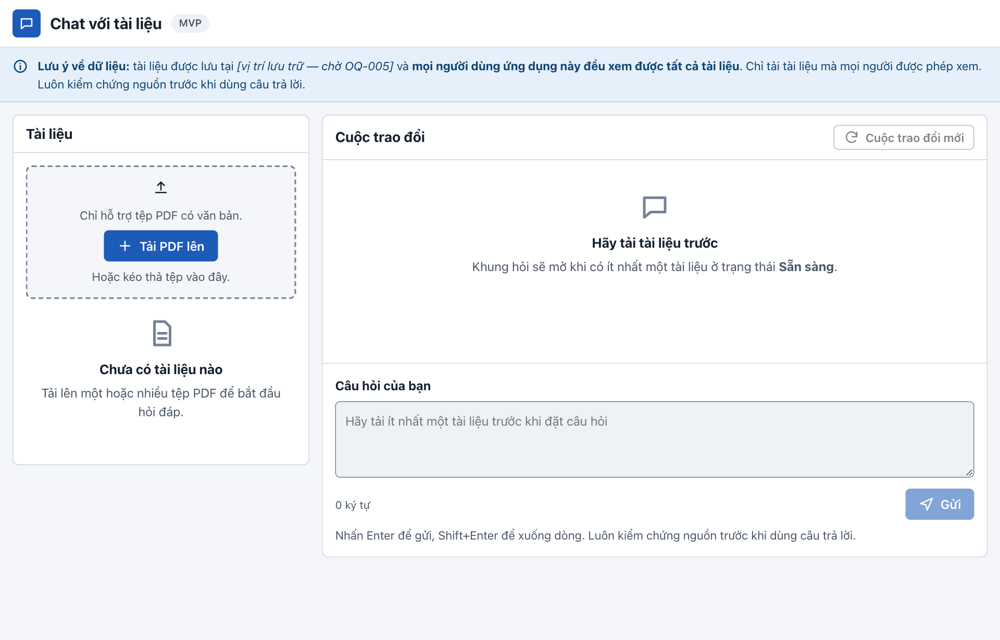

# Hướng dẫn cài đặt — Chat với tài liệu (bản MVP)

> Dành cho: người cài đặt và vận hành (IT, lập trình viên).
> Cập nhật: 27/10/2026. Đã kiểm chứng trên macOS (Apple Silicon) với Homebrew.

Tài liệu này hướng dẫn cài đặt ứng dụng theo một trong hai cách:

| Cách | Dùng khi | Địa chỉ sau khi chạy |
|---|---|---|
| **A. Bản demo cục bộ** (khuyên dùng để dùng thử) | Muốn chạy nhanh trên một máy Mac, không cần Docker | http://localhost:8000 |
| **B. Bản kiểu sản xuất bằng Docker** | Muốn thử cấu hình gần với triển khai thật: HTTPS, 2 bản API, phân quyền CSDL tối thiểu | https://localhost:8443 |

Hướng dẫn dùng ứng dụng sau khi cài xong: [HUONG_DAN_SU_DUNG.md](HUONG_DAN_SU_DUNG.md).

---

## 1. Lưu ý trước khi cài

- **AI trong bản demo là AI giả, chạy cục bộ.** Nó chỉ trích nguyên văn câu có sẵn trong tài liệu, không tự viết câu trả lời và không gửi dữ liệu ra ngoài. Muốn dùng dịch vụ AI thật, xem [mục 6](#6-bật-dịch-vụ-ai-thật). Việc này chỉ được làm khi chính sách dữ liệu (OQ-005) cho phép.
- **Không có đăng nhập.** Mọi người truy cập được ứng dụng đều xem được tất cả tài liệu. Chỉ cài trong mạng nội bộ.
- **Vị trí lưu trữ tài liệu chưa được phê duyệt** (OQ-005). Không tải tài liệu mật lên bản demo.

## 2. Yêu cầu hệ thống

| Hạng mục | Yêu cầu |
|---|---|
| Hệ điều hành | macOS 14 trở lên. Đã thử trên Apple Silicon; máy Intel cần sửa đường dẫn `/opt/homebrew` trong `app/Makefile` thành `/usr/local` |
| Trình quản lý gói | [Homebrew](https://brew.sh) |
| Bộ nhớ trống | Cách A: khoảng 1,5 GB (phụ thuộc Python và Node khoảng 530 MB). Cách B: thêm khoảng 5 GB cho máy ảo và các image Docker |
| RAM | Cách A: 4 GB. Cách B: 8 GB (máy ảo Colima dùng 3 GB) |
| Cổng mạng | 8000 (cách A); 8443, 5433, 9000 (cách B); 5432 (PostgreSQL) |
| Trình duyệt | Chrome, Edge, Safari hoặc Firefox bản mới |

Mã nguồn nằm trong thư mục `chat_with_document/app`. Mọi lệnh `make` bên dưới đều chạy **trong thư mục `app/`**.

---

## 3. Cách A — Bản demo cục bộ

### Bước 1. Cài phần mềm nền

```bash
brew install python@3.12 node postgresql@17 pgvector
```

Kiểm tra:

```bash
/opt/homebrew/bin/python3.12 --version     # Python 3.12.x
node --version                              # v22 trở lên
/opt/homebrew/opt/postgresql@17/bin/postgres --version   # postgres (PostgreSQL) 17.x
```

### Bước 2. Cài thư viện của ứng dụng

```bash
cd chat_with_document/app
make setup
```

Lệnh này tạo môi trường Python riêng (`server/.venv`) và cài thư viện giao diện (`web/node_modules`). Lần đầu mất khoảng 1–3 phút.

### Bước 3. Tạo tệp cấu hình

```bash
cp .env.example .env      # bỏ qua nếu đã có tệp .env
```

Giá trị mặc định đủ để chạy demo. Ý nghĩa từng biến xem ở [mục 5](#5-cấu-hình).

### Bước 4. Chạy

```bash
make demo
```

`make demo` làm lần lượt các việc sau:

1. Build giao diện web.
2. Sinh các PDF mẫu vào `app/samples/`.
3. Bật PostgreSQL và tạo CSDL `cwd`.
4. Chạy migration.
5. Chạy API và worker ở chế độ nền.
6. Chạy bài **kiểm tra khói** gồm 17 bước.

Kết quả mong đợi ở cuối màn hình:

```text
Đang chạy: http://localhost:8000
  ✓ readyz
  ✓ phục vụ giao diện web
  ...
Đạt 17 kiểm tra.
```

> Bài kiểm tra khói tải 3 PDF mẫu lên rồi xóa 1 tệp. Vì vậy, sau `make demo` danh sách tài liệu đã có sẵn vài tệp mẫu.

### Bước 5. Mở ứng dụng

Mở trình duyệt tới **http://localhost:8000**. Cài đặt thành công nếu thấy màn hình như dưới đây:



### Lệnh vận hành hằng ngày

| Việc | Lệnh (trong `app/`) |
|---|---|
| Chạy lại sau khi khởi động máy | `make run` (tự bật PostgreSQL nếu đang tắt) |
| Dừng API và worker (tắt êm) | `make stop` |
| Tắt PostgreSQL | `make db-down` |
| Xem log (dạng JSON, không chứa nội dung tài liệu hay câu hỏi) | `make logs` |
| Kiểm tra tình trạng | `curl localhost:8000/readyz` → `ok` |
| Đổi cổng | `PORT=8001 make run` |
| Sao lưu CSDL | `deploy/backup.sh` → `app/var/backups/` (giữ 7 bản) |
| Khôi phục CSDL (**xóa dữ liệu hiện có**) | `deploy/restore.sh <tệp .dump>` |

Tệp PDF gốc của bản demo nằm ở `app/var/storage/`. Muốn sao lưu đầy đủ, chép cả thư mục này cùng với bản dump CSDL.

---

## 4. Cách B — Bản kiểu sản xuất bằng Docker

Cách này chạy toàn bộ hệ thống trong container:

- nginx: HTTPS, giới hạn tốc độ, chỉ cho mạng nội bộ;
- 2 bản API;
- worker;
- PostgreSQL với vai trò quyền tối thiểu;
- kho S3 (SeaweedFS).

Mật khẩu được sinh ngẫu nhiên, chứng chỉ HTTPS là chứng chỉ **tự ký**.

### Bước 1. Cài Docker (qua Colima)

```bash
brew install colima docker docker-compose
colima start --cpu 2 --memory 3 --disk 20
docker version          # có dòng "Server: ..." là được
```

### Bước 2. Build và chạy

```bash
cd chat_with_document/app
make prod-up
```

Lần đầu mất khoảng 3–5 phút để tải image và build. Kết quả mong đợi:

```text
 Container cwd-prod-api-1 Healthy
 Container cwd-prod-api-2 Healthy
 Container cwd-prod-proxy-1 Healthy
ok — https://localhost:8443
```

### Bước 3. Mở ứng dụng

Mở **https://localhost:8443**. Vì chứng chỉ là tự ký, trình duyệt sẽ cảnh báo. Với bản thử cục bộ, chọn *Nâng cao → Tiếp tục truy cập localhost*. Bản triển khai thật phải dùng chứng chỉ do tổ chức cấp.

### Bước 4. Kiểm tra

```bash
make prod-ps       # mọi dịch vụ ở trạng thái healthy / running
make proxy-test    # kiểm biên mạng, mong đợi: "Đạt 13, lỗi 0."
SMOKE_CA=var/prod-local/certs/tls.crt server/.venv/bin/python server/scripts/smoke.py https://localhost:8443 samples
```

Lệnh cuối cần chạy `make setup` (cách A, bước 2) trước để có Python. Nếu chưa có PDF mẫu trong `samples/`, chạy `make samples` để sinh.

### Dừng và dọn dẹp

| Việc | Lệnh |
|---|---|
| Dừng và **xóa toàn bộ dữ liệu thử** | `make prod-down` |
| Tắt máy ảo Docker (giải phóng 3 GB RAM) | `colima stop` |

### Môi trường dev bằng Docker (tùy chọn, cho lập trình viên)

`make up` bật PostgreSQL ở cổng **5433** và kho S3 ở cổng **9000**, chạy song song với PostgreSQL Homebrew (cổng 5432). Để ứng dụng dùng hai dịch vụ này, bỏ dấu `#` ở khối “stack Docker” trong `.env`. Tắt bằng `make down`.

---

## 5. Cấu hình

Tệp `app/.env` (cách A) hoặc `app/deploy/env.prod` (triển khai thật — mẫu ở `deploy/env.prod.example`).

| Biến | Mặc định | Ý nghĩa |
|---|---|---|
| `DATABASE_URL` | `postgresql+psycopg:///cwd` | Kết nối PostgreSQL (cần tiện ích `vector`) |
| `OBJECT_STORE` | `local` | Nơi lưu PDF gốc: `local` (thư mục `var/storage`) hoặc `s3` |
| `S3_ENDPOINT`, `S3_BUCKET`, `S3_ACCESS_KEY`, `S3_SECRET_KEY`, `S3_REGION` | — | Khi `OBJECT_STORE=s3` |
| `LLM_PROVIDER` | `extractive` | `extractive` = AI giả cục bộ; `http` = dịch vụ AI tương thích OpenAI |
| `EMBEDDING_DIM` | `384` | Số chiều vector; phải khớp với mô hình embedding. Đổi giá trị này phải tạo lại CSDL |
| `MAX_FILE_SIZE_MB` | trống (chặn cứng ở 200 MB) | Giới hạn kích thước tệp tải lên — chờ quyết định OQ-009 |
| `MAX_QUESTION_LENGTH` | trống | Giới hạn độ dài câu hỏi — chờ OQ-P06 |

Sau khi sửa `.env`, chạy `make run` để áp dụng.

> **Lưu ý khi viết tệp env:** với cách B, Docker **không** bỏ chú thích ở cuối dòng. Hãy viết chú thích trên một dòng riêng.

## 6. Bật dịch vụ AI thật

Chỉ làm khi đã được phép gửi nội dung tài liệu tới dịch vụ AI bên ngoài (OQ-005).

1. Trong `.env`, đặt:
   ```text
   LLM_PROVIDER=http
   LLM_BASE_URL=https://<máy chủ AI>/v1
   LLM_API_KEY=<khóa — lấy từ bộ quản lý bí mật, không commit>
   LLM_EMBED_MODEL=<tên mô hình embedding>
   LLM_CHAT_MODEL=<tên mô hình hội thoại>
   EMBEDDING_DIM=<số chiều của mô hình embedding>
   ```
2. Nếu `EMBEDDING_DIM` khác giá trị cũ, tạo lại CSDL bằng `dropdb cwd`, rồi chạy `make run` (lệnh này tự tạo CSDL và chạy migration). Sau đó tải lại tài liệu.
3. Chạy `make run`, sau đó `make eval` để đánh giá chất lượng câu trả lời.

## 7. Xử lý sự cố

| Hiện tượng | Nguyên nhân thường gặp | Cách xử lý |
|---|---|---|
| `make run` báo “API chưa sẵn sàng” | Cổng 8000 bị chiếm hoặc lỗi cấu hình | Xem `make logs`; đổi cổng bằng `PORT=8001 make run` |
| `readyz` trả `not ready` | PostgreSQL tắt hoặc kho lưu trữ không truy cập được | `make db-up`; với S3, kiểm tra `S3_*` và bucket đã tồn tại |
| Lỗi `extension "vector" is not available` | Thiếu pgvector | `brew install pgvector`, sau đó `make db-down && make db-up` |
| `make setup` không tìm thấy `python3.12` | Chưa cài Python qua Homebrew | `brew install python@3.12` |
| Tài liệu đứng mãi ở “Đang xử lý” | Worker không chạy | `make logs` để xem `worker.log`; chạy lại `make run` |
| `make prod-up` báo `unhealthy` | Dịch vụ phụ thuộc chưa sẵn sàng hoặc thiếu RAM | `make prod-ps`; `docker logs cwd-prod-api-1`; tăng RAM bằng `colima stop && colima start --memory 4` |
| Trình duyệt chặn https://localhost:8443 | Chứng chỉ tự ký | Bình thường với bản thử; chọn tiếp tục truy cập |
| Bị lỗi 429 “Bạn thao tác quá nhanh” | Vượt hạn mức: 30 câu hỏi/phút, 10 lần tải lên/phút cho mỗi địa chỉ | Chờ vài giây rồi thử lại |

Khi cần báo lỗi, gửi kèm **mã tham chiếu** hiển thị trên giao diện, hoặc header `X-Request-Id`. Mã này giúp tìm đúng dòng log.

## 8. Gỡ cài đặt

```bash
cd chat_with_document/app
make stop
/opt/homebrew/opt/postgresql@17/bin/dropdb cwd                          # xóa CSDL (PostgreSQL phải đang chạy)
make db-down
make prod-down; make down; colima delete                                # chỉ khi đã dùng cách B
rm -rf server/.venv web/node_modules web/dist var                       # xóa phụ thuộc và dữ liệu cục bộ
brew uninstall colima docker docker-compose docker-buildx               # tùy chọn
```

## 9. Tài liệu liên quan

- Vận hành chi tiết: [docs/05-implement/runbook.md](../docs/05-implement/runbook.md)
- Trạng thái triển khai và giới hạn đã biết: [docs/05-implement/IMPLEMENTATION_STATUS.md](../docs/05-implement/IMPLEMENTATION_STATUS.md)
- Kiến trúc: [docs/04-design/SAD.md](../docs/04-design/SAD.md)
