# Hướng dẫn sử dụng — Chat với tài liệu

> Dành cho: người dùng ứng dụng (nhân viên văn phòng). Không cần kiến thức kỹ thuật.
> Cập nhật: 27/10/2026.

**Chat với tài liệu** giúp bạn tìm câu trả lời trong các tệp PDF bằng cách đặt câu hỏi như khi trò chuyện. Mỗi câu trả lời đều ghi rõ **lấy từ tài liệu nào, trang nào**, để bạn mở ra kiểm tra lại. Khi tài liệu không có thông tin, ứng dụng sẽ nói rõ là **không tìm thấy** chứ không tự bịa câu trả lời.

## Nội dung

1. [Trước khi bắt đầu](#1-trước-khi-bắt-đầu)
2. [Làm quen với màn hình](#2-làm-quen-với-màn-hình)
3. [Tải tài liệu lên](#3-tải-tài-liệu-lên)
4. [Đặt câu hỏi](#4-đặt-câu-hỏi)
5. [Kiểm tra nguồn của câu trả lời](#5-kiểm-tra-nguồn-của-câu-trả-lời)
6. [Hỏi trên nhiều tài liệu cùng lúc](#6-hỏi-trên-nhiều-tài-liệu-cùng-lúc)
7. [Khi không tìm thấy thông tin](#7-khi-không-tìm-thấy-thông-tin)
8. [Xóa tài liệu](#8-xóa-tài-liệu)
9. [Dùng trên điện thoại](#9-dùng-trên-điện-thoại)
10. [Thông báo lỗi và cách xử lý](#10-thông-báo-lỗi-và-cách-xử-lý)
11. [Mẹo đặt câu hỏi hiệu quả](#11-mẹo-đặt-câu-hỏi-hiệu-quả)

---

## 1. Trước khi bắt đầu

- **Địa chỉ truy cập:** do bộ phận IT cung cấp. Bản demo dùng `http://localhost:8000`.
- **Không cần đăng nhập.**

> ⚠️ **Quan trọng — mọi người đều xem được tài liệu của nhau.** Tài liệu bạn tải lên nằm trong một kho dùng chung. Bất kỳ ai dùng ứng dụng đều hỏi được trên tài liệu đó và mở được tài liệu đó. **Chỉ tải những tài liệu mà mọi người được phép xem.** Không tải tài liệu mật hoặc có dữ liệu cá nhân.

> ⚠️ **Luôn kiểm chứng trước khi dùng.** Câu trả lời có thể chưa đầy đủ. Trước khi dùng câu trả lời cho công việc quan trọng như hợp đồng hay thanh toán, hãy bấm vào nguồn để đọc lại đoạn gốc.

## 2. Làm quen với màn hình

Màn hình có ba vùng:

| Vùng | Vị trí | Chức năng |
|---|---|---|
| **Lưu ý về dữ liệu** | Dải màu xanh trên cùng | Nhắc rằng tài liệu dùng chung cho mọi người |
| **Tài liệu** | Cột bên trái | Tải PDF lên, xem trạng thái từng tệp, xóa tệp |
| **Cuộc trao đổi** | Cột bên phải | Đặt câu hỏi và đọc câu trả lời |

Khi chưa có tài liệu nào sẵn sàng, ô **Câu hỏi của bạn** bị khóa (màu xám) và nút **Gửi** chưa bấm được.

## 3. Tải tài liệu lên

### Cách tải

1. Bấm nút **Tải PDF lên**, chọn một hoặc nhiều tệp PDF. Bạn cũng có thể **kéo thả tệp** vào khung viền nét đứt.
2. Tệp xuất hiện trong danh sách với trạng thái **Đang xử lý**. Ứng dụng đang đọc nội dung tài liệu.

   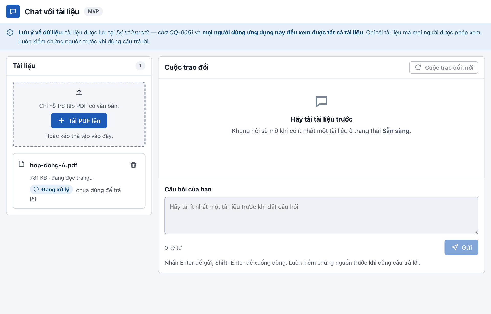

3. Sau vài giây (tài liệu dài có thể mất vài phút), trạng thái chuyển sang **Sẵn sàng** và có thông báo *“Tài liệu đã sẵn sàng để hỏi.”* Ô câu hỏi được mở khóa.

   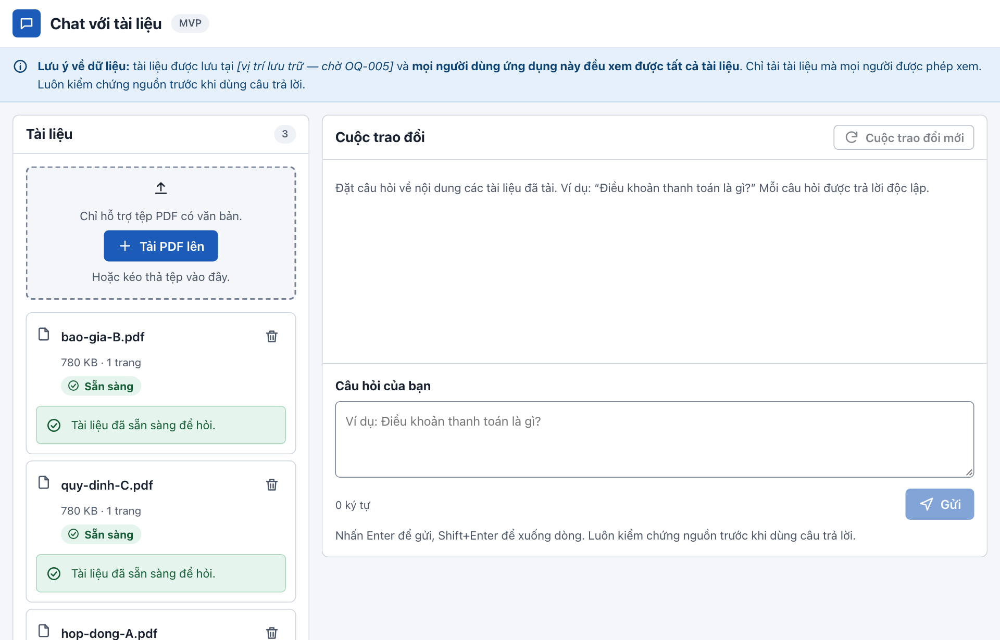

Bạn không cần ở lại trang trong lúc chờ. Trạng thái tự cập nhật, không cần tải lại trang.

### Ý nghĩa các trạng thái

| Trạng thái | Ý nghĩa | Hỏi được chưa? |
|---|---|---|
| 🔵 **Đang xử lý** | Ứng dụng đang đọc tài liệu | Chưa |
| 🟢 **Sẵn sàng** | Đã đọc xong | Được |
| 🔴 **Lỗi** | Không đọc được tài liệu; lý do ghi ngay bên dưới | Không |

### Tệp nào dùng được?

- ✅ Tệp **PDF có chữ**, tức là chọn và sao chép được chữ trong tệp. Ví dụ: tệp xuất từ Word.
- ❌ Tệp không phải PDF (Word, Excel, ảnh…). Hãy lưu sang PDF trước.
- ❌ PDF có mật khẩu. Hãy bỏ mật khẩu trước.
- ❌ PDF là ảnh chụp hoặc bản scan. Ứng dụng chưa đọc được chữ trong ảnh.

Khi chọn nhầm tệp không phải PDF, ứng dụng từ chối ngay:

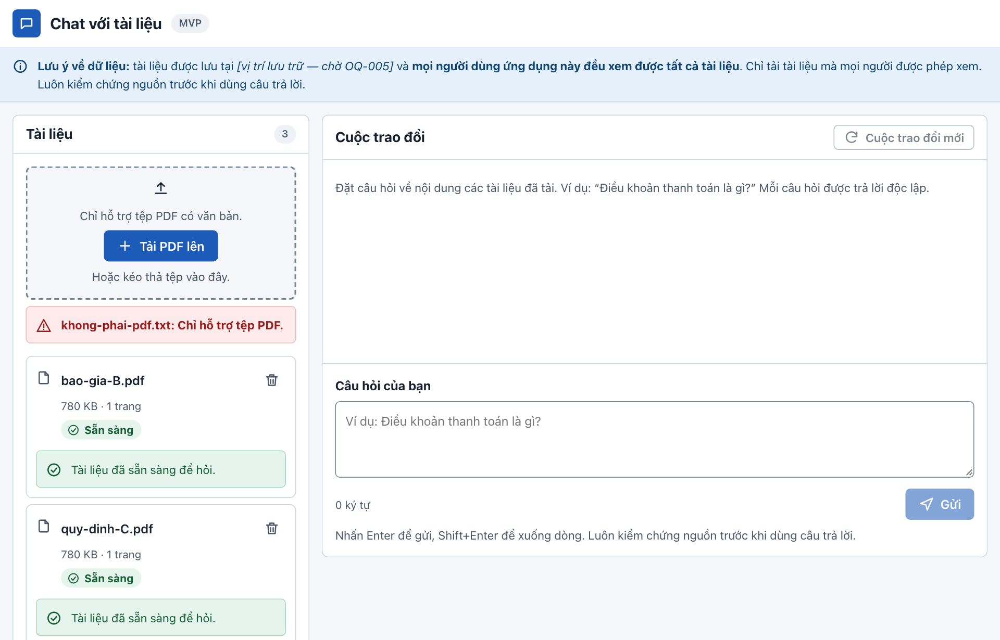

Khi tệp có mật khẩu, tệp vẫn hiện trong danh sách với trạng thái **Lỗi** và hướng dẫn cách khắc phục. Bạn có thể xóa tệp lỗi này bằng nút thùng rác.

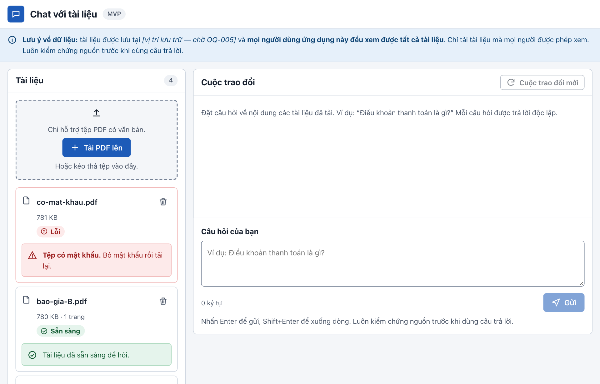

## 4. Đặt câu hỏi

1. Gõ câu hỏi vào ô **Câu hỏi của bạn**.

   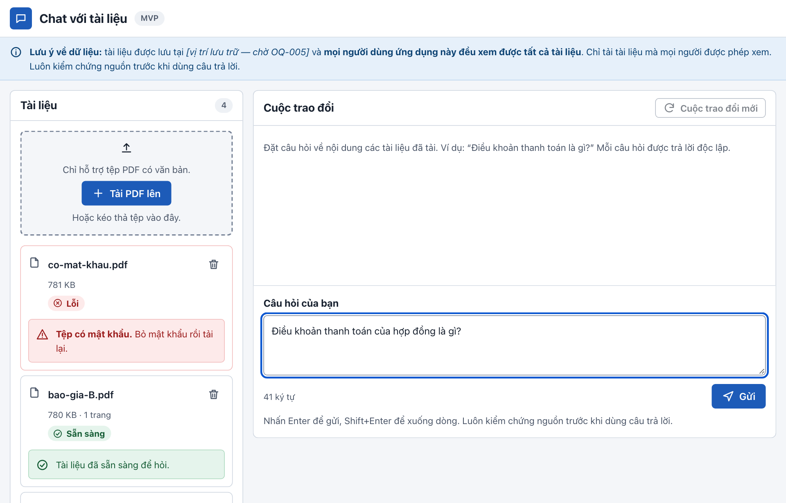

2. Nhấn **Enter** hoặc bấm **Gửi**. Muốn xuống dòng trong câu hỏi, nhấn **Shift + Enter**.
3. Trong lúc chờ, màn hình hiện *“Đang tìm trong các tài liệu…”*. Bấm **Hủy** nếu muốn dừng.
4. Câu trả lời hiện ngay dưới câu hỏi:

   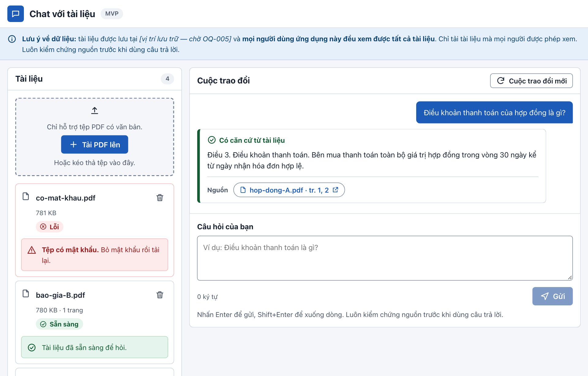

### Ba loại câu trả lời

| Nhãn | Màu viền | Ý nghĩa |
|---|---|---|
| ✅ **Có căn cứ từ tài liệu** | Xanh lá | Đã tìm thấy thông tin, kèm nguồn |
| ◐ **Câu trả lời một phần** | Vàng | Chỉ tìm thấy một phần thông tin. Đọc kỹ phần còn thiếu |
| 🔍 **Không tìm thấy thông tin** | Xám | Tài liệu đã tải không có thông tin này |

**Mỗi câu hỏi được trả lời độc lập.** Ứng dụng không nhớ câu hỏi trước. Vì vậy hãy hỏi đầy đủ ý: viết *“Thời hạn giao hàng trong hợp đồng A là bao lâu?”* thay vì *“Còn giao hàng thì sao?”*.

Muốn bắt đầu lại từ đầu, bấm **Cuộc trao đổi mới** ở góc trên bên phải. Lịch sử trao đổi trên màn hình sẽ được xóa; tài liệu vẫn được giữ nguyên.

## 5. Kiểm tra nguồn của câu trả lời

Dưới mỗi câu trả lời có dòng **Nguồn**, gồm tên tài liệu và số trang:

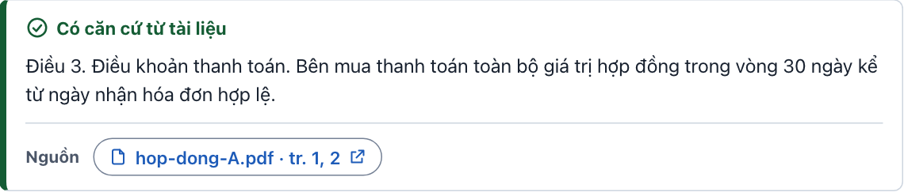

- Bấm vào nguồn (ví dụ `hop-dong-A.pdf · tr. 1, 2`) để **mở tài liệu gốc trong thẻ mới**, tại trang được trích.
- Số trang là **khoảng trang** chứa đoạn văn được dùng, ví dụ “tr. 1, 2”. Thông tin có thể nằm ở bất kỳ trang nào trong khoảng đó.
- Nếu tài liệu nguồn đã bị xóa, nguồn được đánh dấu **(đã xóa)** và không mở được nữa.

## 6. Hỏi trên nhiều tài liệu cùng lúc

Ứng dụng tìm trên **tất cả** tài liệu ở trạng thái Sẵn sàng. Khi câu trả lời dùng thông tin từ nhiều tài liệu, phần **Nguồn** liệt kê đủ từng tài liệu:

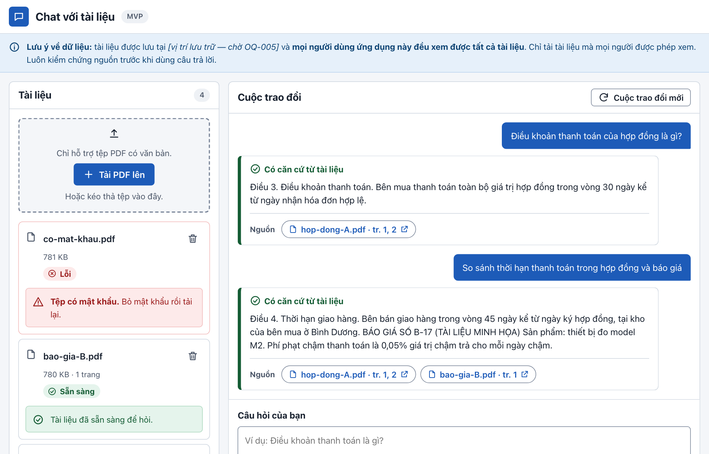

Với câu hỏi so sánh, hãy mở từng nguồn để đối chiếu, vì câu trả lời có thể chỉ trích một phần của mỗi tài liệu.

## 7. Khi không tìm thấy thông tin

Nếu các tài liệu không chứa thông tin bạn hỏi, ứng dụng trả lời **“Không tìm thấy thông tin”**. Đây là kết quả bình thường, không phải lỗi: ứng dụng được thiết kế để không đoán.

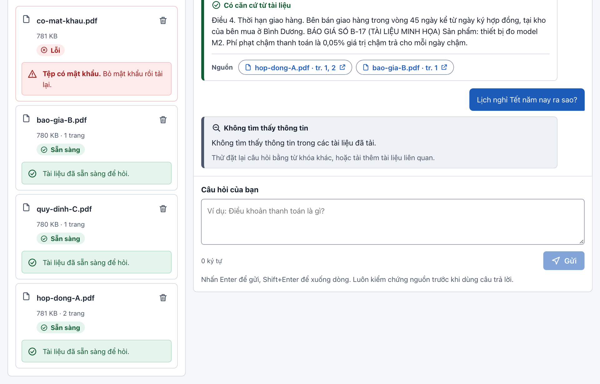

Bạn có thể:

- đặt lại câu hỏi bằng từ ngữ khác, gần với từ dùng trong tài liệu;
- kiểm tra tài liệu liên quan đã ở trạng thái **Sẵn sàng** chưa;
- tải thêm tài liệu có thông tin cần tìm.

## 8. Xóa tài liệu

1. Bấm biểu tượng **thùng rác** cạnh tên tài liệu.
2. Đọc hộp thoại xác nhận, rồi bấm **Xóa tài liệu**. Bấm **Hủy** hoặc nhấn **Esc** nếu đổi ý.

   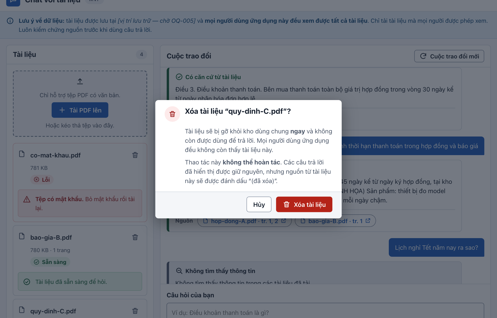

3. Tài liệu biến mất khỏi danh sách và **không còn được dùng để trả lời** cho bất kỳ ai.

   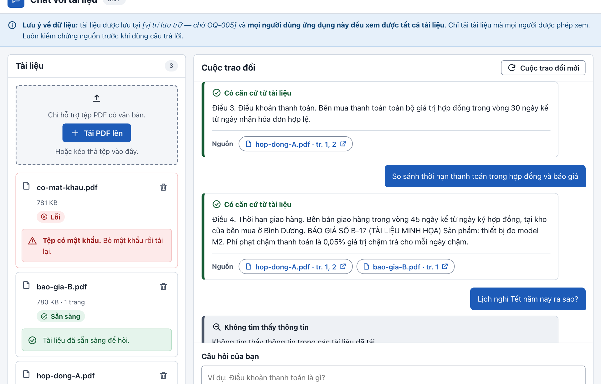

> ⚠️ **Xóa là xóa cho tất cả mọi người** và **không hoàn tác được**. Các câu trả lời đã hiện trên màn hình vẫn được giữ, nhưng nguồn từ tài liệu đã xóa sẽ không mở được nữa.

## 9. Dùng trên điện thoại

Ứng dụng tự sắp xếp lại cho màn hình nhỏ. Danh sách tài liệu nằm ở trên, cuộc trao đổi nằm ở dưới. Mọi chức năng đều giống trên máy tính.

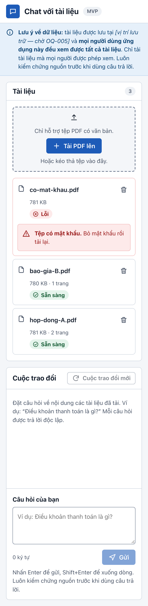

## 10. Thông báo lỗi và cách xử lý

| Thông báo | Ý nghĩa | Bạn nên làm gì |
|---|---|---|
| *Chỉ hỗ trợ tệp PDF.* | Tệp không phải PDF | Lưu tài liệu sang PDF rồi tải lại |
| *Tệp lớn hơn giới hạn cho phép.* | Tệp quá lớn | Tách tài liệu thành nhiều tệp nhỏ hơn |
| *Tệp có mật khẩu.* | PDF được khóa | Bỏ mật khẩu rồi tải lại |
| *Tệp không có văn bản đọc được (có thể là ảnh quét).* | PDF là ảnh scan | Dùng bản PDF có chữ |
| *Tệp bị hỏng, không đọc được.* | Tệp lỗi | Xuất lại PDF từ tệp gốc |
| *Bạn thao tác quá nhanh.* | Gửi quá nhiều câu hỏi hoặc tệp trong thời gian ngắn | Chờ hết đếm ngược trên nút **Thử lại**, rồi bấm |
| *Hệ thống đang bận.* | Có nhiều người dùng cùng lúc | Bấm **Thử lại** sau ít giây; tài liệu không bị mất |
| *Dịch vụ AI tạm thời không dùng được.* / *Hết thời gian chờ.* | Dịch vụ trả lời đang gặp sự cố | Bấm **Thử lại**; câu hỏi của bạn vẫn được giữ |
| *Mất kết nối* | Mạng có vấn đề | Kiểm tra mạng, rồi gửi lại |
| *Đã xảy ra lỗi… Mã tham chiếu: …* | Lỗi không xác định | Thử lại; nếu còn lặp lại, gửi **mã tham chiếu** cho bộ phận IT |

Khi có lỗi lúc đặt câu hỏi, bạn có thể bấm **Sửa câu hỏi** để đưa câu hỏi về lại ô nhập.

## 11. Mẹo đặt câu hỏi hiệu quả

- **Hỏi cụ thể, dùng từ có trong tài liệu.** Ví dụ: *“Điều khoản thanh toán của hợp đồng là gì?”* sẽ cho kết quả tốt hơn *“Trả tiền thế nào?”*.
- **Mỗi câu hỏi một ý.** Tách câu hỏi dài nhiều ý thành nhiều câu ngắn.
- **Nêu tên tài liệu khi cần,** ví dụ *“…trong báo giá B”*, để câu trả lời tập trung đúng tài liệu.
- **Luôn mở nguồn** để kiểm chứng trước khi dùng thông tin.

---

> ℹ️ **Về bản demo hiện tại:** phần trả lời đang dùng một bộ máy đơn giản. Nó **trích nguyên văn** những câu trong tài liệu khớp nhiều nhất với từ khóa trong câu hỏi, chứ chưa diễn đạt lại. Vì vậy câu trả lời có thể dài, có thể kèm câu không liên quan, và đôi khi trích nhầm đoạn chỉ trùng từ khóa. Hãy luôn kiểm tra nguồn. Chất lượng sẽ khác khi chuyển sang dịch vụ AI chính thức.
